# Geppetto Professional Asset-Maker Master Roadmap & 16-Lane Plan

**Date:** 2026-10-24  
**Scope (Model, Kernel, Render, Linework, Rig, Anim & Project Asset Hygiene — Zero UI Fluff):**
- `~/games/projects/geppetto` (`Effigy/`, `Code/`, `Editor/Effigy/`, `Editor/EffigyEditor/`, `Editor/RigControlEditor/`, `Effigy.Tests/`, `docs/`, `tools/`)
- `~/Desktop/geppetto-desktop` (`Marionette.Desktop`, `kernel/Effigy/`, `tests/`)
- `~/games/projects/linework` (`src/main.cpp`, `src/model.h`, `src/canvas.cpp`, `src/shapes.cpp`, `src/render.cpp`, `src/store.cpp`)
- Game Project Asset Relocation Targets: `~/games/projects/vt-07`, `~/games/projects/cookin`, `~/games/projects/podracer`, `~/games/projects/arcade`, `~/games/projects/deep_sentance`
- `~/.claude/skills/geppetto` (`SKILL.md`, `references/effigy/EFFIGY-API.md`, `references/effigy/toolset.quick.md`)

> [!IMPORTANT]
> **Design Mandate — Model-Side Power Only (Skip UI Chrome):**
> Every upgrade in this plan targets **what models can build, wear, groom, shade, deform, animate, and export** via `.effigy` features, `.linework` drawings, `.riganim` clips, build scripts, and `.vmdl`/`.vmat`/`.cloth.json` outputs. No effort is wasted on QML panels or UI widgets.

---

## North-Star Capabilities Across All 6 Pillars

1. **Pillar I — Model Making, CSG, SDF/Gore, Geometry Nodes & Project Asset Relocation:**
   - Parametric organic cages (`Profile`, `Skin`/`SkeletonCage`, `Fin`), topological limb welding (`MeshBranch`), CAD solids (`Sketch`, `Extrude`, `Revolve`, `Sweep`, `Loft`, `Shell`, `Fillet`, `Chamfer`, `Hole`, `Draft`), ZModeler-style context-sensitive `EditOp`s (`QMesh`, `PolyLoop`, `BridgeHolesArc`) + Blender **Proportional Editing** falloffs, headless exact booleans with auto-bevel seams, 24-part kitbash `PartLibrary` + ZBrush **Curve-IMM (Insert Multi-Mesh)** welded tri-part brushes (`StartCap`/`Middle`/`EndCap`) + surface `Scatter`, Houdini-style SDF/Implicit `Blob` hybrids (`SdfMesh`, `SdfGyroid`, `SdfOnion`, `SdfDilateErode`, `SdfCellularGrowth` differential-growth folds, auto-weighted `SurfaceNets`), body-horror anatomical `Wound`s, Voronoi `Fracture` destruction, procedural `Foliage`/trees, and a full **Houdini/Blender Geometry Nodes (`GeoNodesFeature`)** engine (`ShortestEdgePath` geodesics, `DualMesh`, `SpaceColonization`, `AttributePromote`).
   - **Project Asset Relocation (Clean Generic Engine):** Evict hardcoded character/prop assemblies (`CamheadAssembly.cs`, `SurveyPlayerAssembly.cs`, `SurveyMaterialMap.cs`, `MaterialPalette` Camhead/Survey tables, `RendererShaders` PS1 Survey boot-dirt uniforms, `diner_tile_gen.py`, `tama_gen.py`) out of Geppetto and **bake/save them directly into their owning game projects** (`vt-07`, `cookin`, `podracer`, `arcade`, `deep_sentance`) using generic `ImportFeature` multi-FBX/bone-merge and `VmdlMaterialMap`. *(Note: [`Code/PixelArmsStyle.cs`](file:///home/poo/games/projects/geppetto/Code/PixelArmsStyle.cs) stays inside Geppetto/Marionette as the first-person viewmodel animation & preview rig system — see Pillar V / Lane L!)*
2. **Pillar II — Linework 2D Editor Upgrades & 2D-to-3D Modeling Pipeline:**
   - **Linework Engine Upgrades (`~/games/projects/linework`):** True editable Cubic Bezier / B-spline curves (`ctrlPts`), closed-path 2D booleans (`union`, `subtract`, `intersect`), multi-channel PBR layers (`color`, `height`, `roughness`, `metallic`, `alpha`, `cutout`, `stitch_seam`), tileable wrap-around canvas mode (`wrap=true`) for seamless trim sheets, headless CLI export (`--export-png`, `--export-svg`, `--export-contours`), and live file-save notifications.
   - **Native `.linework` Consumption in Effigy (`LineworkReader.cs` & `Inflate2DFeature`):** Models directly consume `.linework` files as:
     1. 2D `Sketch` / `Profile` / `Fin` contours (with holes) for `Extrude`, `Revolve`, `Sweep`, `Loft`, and boolean `Cut`.
     2. Pressure-modulated 3D `Spline` tubes (`radius(t) = width * pressure(t)`).
     3. **Monster-Mash / Teddy 2D-to-3D Inflation (`add Inflate2D`)** that inflates closed `.linework` contours into smooth 3D meshes with automatic UV texture projection of upper paint layers.
     4. **ZBrush ShadowBox / Snapshot3D Orthogonal Silhouette CSG** (`front=`, `side=`, `top=` `.linework` silhouettes intersected in 3D).
     5. **Marvelous Designer 2D Sewing Pattern Panels** stitched edge-to-edge and draped onto 3D wearers, plus vector/raster `PaintFeature` decals, garment graphic prints, embroidery patches, and `BrushAlpha` sculpt stamps.
3. **Pillar III — Sculpting, Retopology, UVs & Baking (ZBrush, RizomUV & Marmoset Parity):**
   - Unified non-destructive `MultiresSculpt` with **ZBrush Sculpt Layers** (per-layer opacity `-1..2`) and `Morph` brush, BVH dynamic topology (`DyntopoService` split + collapse + flood fill), simultaneous sculpt + `Polypaint`, **ZBrush VDM (Vector Displacement Mesh) 3D stamps** supporting undercuts and overhangs (`vdm:ear`, `vdm:nose`, `vdm:horn_hook`, `vdm:scale_overhang`, `vdm:wound_lip`), procedural & `.linework` `BrushAlpha` stamps, `Anchored`/`DragDot`/`Roll`/`Lazy` stroke modes, `FaceSets`, planar `MeshClip` trim, 1-command `SculptReprojection`, **ZRemesher 4-RoSy curvature + explicit Guide Curves + density paint** (`QuadRemesh`), seam-safe `RetopoService` LOD chains, barycentric `DataTransferService` + **Blender `SurfaceDeform` / `MeshDeform` cage binding**, **RizomUV** auto-seams + strip straightening (`RectifyStrip`) + symmetric island stacking + multi-body `UVPack.PackAtlas`, and **Marmoset Toolbag** per-group ray cages (no mesh exploding), anti-skew normal correction, 16-bit rounded-edge normals, **Thickness**, **Bent Normals**, Polypaint, and dynamic `WrinkleMaps` baking.
4. **Pillar IV — Serious Hair/Fur/Feathers, Tailored Clothing, Substance Smart Materials & Renderer Upgrades:**
   - **Deep Hair, Fur & Feathers (`HairGroom.cs`, `HairTextureBaker.cs`, `StrandFeature.cs`, `FurShells.cs`):** Full parametric groom system (`Scalp`, `Beard`, `Moustache`, `Brows`, `Eyelashes`, `Mane`, `Tail`, `Feathers`) with `parting` lines, `MeshBVH`-colliding surface `comb`, fixed root-preserving `clump`, `curl`/`wave`/`kink`, `frizz`/`flyaways`, 3-strand interwoven `braid`, `ponytail`/`bun` gather, oriented `Cards` with automatic **procedural Hair Texture Sheet Baker** (`alpha`, `root_to_tip_id`, `tangent_flow`, `normal`, `depth_ao`), tapered `Tubes`, tangent-combed `FurShells` with silhouette fins, imbricate `Feathers`, and auto-rigged `SoftBone` chains.
   - **Deep Clothing & Marvelous Designer Tailoring (`GarmentFit.cs`, `GarmentFront.cs`, `ClothingFeatures.cs`, `GarmentDetailFeatures.cs`, `GarmentPoses.cs`, `ClothSimService.cs`):** Expand `GarmentRecipe` from 13 to **26 garment types** (`Skirt` with bridged leg-spanning envelope, `Dress`/`Robe`, `Hoodie`, `Trenchcoat`/`Greatcoat`, `Cape`/`Cloak`, `Scarf`/`Cowl`, `CargoTrousers`, `Overalls`, `Balaclava`, `Bracers`/`Gauntlets`, `Pauldrons`, `Apron`, `Holster`/`Bandolier`), **Marvelous Designer 2D Pattern Panel Stitching**, **Houdini Vellum Co-Dimensional XPBD Simulation** (with internal `PressureBalloon` inflation for puffy jackets, cushions, and organic sacs), structural **Collars & Lapels** (`Crew`, `VNeck`, `PoloTurnDown`, `StandMandarin`, `Turtleneck`, `NotchedLapel`, `PeakLapel`, `ShawlCollar`, `HoodDown`, `HoodUp`), **Cuffs** (`RibbedKnit`, `RolledUp`, `FrenchTurnback`, `ShirtButtoned`), **Pleats & Gathers** (`Knife`, `Box`, `Inverted`, `Accordion`), anatomical **Seams, Welts, Twin-Needle Topstitching & Piping**, frayed tear threads (`WearFeature`), multi-layer `GarmentPoses.AutoFixClipping` across all 8 extreme poses, and headless `.cloth.json` export (`GarmentCloth`).
   - **Substance 3D Smart Paint & Renderer Upgrades (`PaintFeature.cs`, `ShadedRender.cs`, `SceneRenderer.cs`):** Seam-free **Tri-Planar 3D projection**, cross-layer **Anchor Points** (painted height details drive upper-layer curvature wear & cavity grime), dual-lobe **Marschner / Kajiya-Kay anisotropic hair & fur shading**, **Beer-Lambert depth-thickness subsurface scattering (SSSS)**, **Linework-style NPR ink outlines** + **Halftone / Crosshatch / Bayer Dither** passes, and **Alpha-to-Coverage / Multi-Layer A-Buffer OIT** for zero-pop hair/feather cards.
5. **Pillar V — Rigging, Blender B-Bones, Cascadeur Physics Animation, `PixelArmsStyle` First-Person Viewmodels & Engine Export:**
   - 10 `RigTemplates` (`human`, `citizen`, `biped`, `quadruped`, `piscine`/`fish`, `avian`/`winged`, `arachnid`, `serpentine`, `vehicle_wheeled`, `weapon_firearm`) with medial-axis mesh auto-fit (`fit=Body`), **Blender Bendy Bones (`B-Bones`)** spline-segmented bones for smooth arcs, **ZBrush Transpose Master** multi-body unrigged proxy posing, 1-command s&box `Playermodel` fitting & validation, `RigCables` creature rig builder, scriptable `WeightPaint`/`WeightRamp` gradients & bone locks, rigid island auto-binding, automatic volume-preserving joint correctives (`PoseSpaceCorrective.AutoBuild`), automated FACS/HL2 `FaceRig` & s&box lip-sync visemes, non-IK constraints (`CopyTransform`, `TrackTo`, `LimitRotation`, `StretchTo`), per-channel F-curves & modifiers (`Cycle`, `Noise`, `SpringOvershoot`, `SteppedOn2s`), **Blender NLA (Nonlinear Animation) Action Strips & Pose Library**, **Cascadeur Physics-Informed AutoPosing, Center-of-Mass Ballistic Trajectories & Angular Momentum Conservation**, declarative `BuildScriptAnim` DSL (`wave`, `thrash`, `gait`, `spring`, `breathe`, `look_at`, `ballistic_com`), **`PixelArmsStyle.cs` First-Person Viewmodel Animation & Camera Rig** (dual-arm viewmodel FOV preview, `VertexSnap`/`TexelGrid`, 2-handed weapon IK handoffs, procedural weapon sway/bob/ADS/recoil), `SkeletonRetarget.RetargetClip`, `MotionLint.AutoFix`, `TakeAudit` substep collision sign-off, `RigSoftChain`, `TimelineEventDispatcher`, and complete s&box `.vmdl` compilation.
6. **Pillar VI — Studio Atmosphere, 8-Way Sprite Baker, Objective `AiJudge` & 100% Unblocked Self-Documenting Toolbox:**
   - Volumetric fog/atmosphere (`VolumeGrid`) & studio `IblBaker` lighting presets, GPU particle VFX preview (`ParticleSystem`), 8-way sprite-sheet / normal-lit pixel-art & icon baker (`SpriteSheetBaker`), hybrid objective+vision `AiJudge` (`TopologyReport` + `ReferenceMatch` + `FlexReport` + `TakeAudit`), unblocked `AiSuiteTools` (all 60+ features & all rig/edit/anim/inspect/linework verbs), self-documenting `ApiCatalog`, and automated 3-way kernel sync.

---

## 1. Deep Codebase Audit: Uncovered Subsystems, Hardcoded Project Hacks & Capability Gaps

### 1.1 Hardcoded Game-Project Assets Inside Geppetto (`CamheadAssembly`, `SurveyPlayerAssembly`, `SurveyMaterialMap`, `diner_tile_gen`, `tama_gen`) vs First-Person `PixelArmsStyle`
Auditing `~/Desktop/geppetto-desktop` and `~/games/projects/geppetto` revealed project-specific character/prop code that belongs inside the actual game projects rather than inside Geppetto's engine, alongside `PixelArmsStyle.cs` which belongs to Marionette's first-person animation suite:
1. **[`CamheadAssembly.cs`](file:///home/poo/Desktop/geppetto-desktop/CamheadAssembly.cs) & [`ViewportMesh.cs`](file:///home/poo/Desktop/geppetto-desktop/ViewportMesh.cs#L231-L238):**
   - `CamheadAssembly.cs` hardcodes 6 external FBX filenames (`camhead_hands.fbx`, `camhead_pelvis.fbx`, `camhead_flanks.fbx`, `camhead_legs.fbx`, `camhead_chest.fbx`, `camhead_neck.fbx`) and 9 material name remaps (`M_CreamArmor -> materials/camhead/panel.vmat`, etc.), triggered whenever `Path.GetFileName(documentPath).Equals("camhead.effigy")` in `ViewportMesh.cs:231,235` and `Program.cs:524`.
   - **Actual Owning Projects:** `~/games/projects/vt-07/Assets/models/players/camhead*`, `~/games/projects/podracer/Assets/models/players/camhead*`, `~/games/projects/cookin/tools/players/*camhead*`, and `~/games/projects/arcade/Assets/models/arcade/arcade_pinball_camhead*`.
2. **[`SurveyPlayerAssembly.cs`](file:///home/poo/Desktop/geppetto-desktop/SurveyPlayerAssembly.cs), [`SurveyMaterialMap.cs`](file:///home/poo/Desktop/geppetto-desktop/SurveyMaterialMap.cs), [`DocumentLoader.cs`](file:///home/poo/Desktop/geppetto-desktop/DocumentLoader.cs#L95-L97) & [`DocumentSession.cs`](file:///home/poo/Desktop/geppetto-desktop/DocumentSession.cs#L144-L171):**
   - `SurveyPlayerAssembly.cs` hardcodes `player_suit.fbx` + `player_head.fbx` bone-merging and `suit_head` stripping (`face_head`, `face_eyes`, `face_beard`, `face_hair`, `neck_ring`, `neck_bellows`).
   - `SurveyMaterialMap.cs` hardcodes `models/player/player_suit.vmdl` and `models/player/player_head.vmdl` slot-to-`.vmat` bindings and `LobePresets`, while `RendererShaders.cs:83-92, 297-325` hardcodes Survey's `ps1_lit.shader` `uPs1BootDirt`/`uPs1Wear`/`uPs1Grime` uniforms and `DesktopOptions.cs:8` defaults `Model` to `/home/poo/games/projects/deep_sentance/Assets/models/player/player_suit.fbx`.
   - **Actual Owning Project:** `~/games/projects/deep_sentance/Assets/models/player/player_suit*` & `player_head*`.
3. **[`MaterialPalette.cs`](file:///home/poo/Desktop/geppetto-desktop/MaterialPalette.cs#L47-L93):**
   - Hardcodes 15 `materials/camhead/*` entries (`lines 47-69`) and 17 `Survey` entries (`face_hair`, `hab_leather`, `collar_trim`, etc., `lines 72-93`).
4. **[`diner_tile_gen.py`](file:///home/poo/games/projects/geppetto/tools/diner_tile_gen.py) & [`tama_gen.py`](file:///home/poo/games/projects/geppetto/tools/tama_gen.py):**
   - `diner_tile_gen.py` belongs to `~/games/projects/cookin/tools/interior/`, and `tama_gen.py` belongs to its owning project's `tools/` folder.
5. **[`PixelArmsStyle.cs`](file:///home/poo/games/projects/geppetto/Code/PixelArmsStyle.cs) — Keep & Expand Inside Marionette (First-Person Animation Rig):**
   - `Code/PixelArmsStyle.cs` is Marionette's first-person viewmodel look & animation companion (`v_first_person_arms_human_light.vmat`, `VertexSnap`, `TexelGrid`, `HideSide`, `ScreenSize`). Currently it only sets scene-object material attributes on `SkinnedModelRenderer` in s&box and lacks first-person camera FOV/near-plane preview, two-handed weapon/prop IK space-switching, and procedural viewmodel sway/bob/ADS/recoil animation layers (**fixed in Lane L**).

### 1.2 Linework (`~/games/projects/linework`) Isolation from 3D Modeling
- Linework (`~/games/projects/linework/src/model.h`) authors `.linework` JSON documents (`layers`, `strokes` with `pen`/`pencil`/`ink`/`marker`/`airbrush`/`fill`/`shape`/`text`/`image`, `pts` with `x, y, pressure`, `holes`, `symOn`/`symX`, `persp` vanishing points).
- Currently, `geppetto-desktop` only launches `linework` as an external process (`host.py:2698`) — **Effigy has zero `.linework` reader**, so 2D drawings in Linework cannot drive 3D `Sketch` profiles, `Spline` sweeps, 2D-to-3D curve inflation, ShadowBox 3-view orthogonal CSG, Marvelous-Designer 2D sewing patterns, `Garment` pattern cutouts, `Paint` decals/embroidery, or `BrushAlpha` stamps!

### 1.3 Hair & Clothing Model-Side Limitations
1. **Hair (`desktop:HairStrandService.cs` & `Effigy/FurShells.cs`):**
   - `HairStrandService.cs` (131 lines) only outputs `"LINE x,y,z..."` strings (`ExportCurves`), has a broken `Clump()` that teleports all strand roots to `_strands[0].Points[0]` (`lines 121-130`), only collides against a single sphere (`bodyCenter`/`bodyRadius`), and cannot generate actual `PolyMesh` hair cards, tubes, braids, curls, partings, or baked hair card texture sheets (`alpha`, `id`, `flow`, `normal`, `ao`).
   - `FurShells.cs` only extrudes uniform shells along vertex normals with `-z` gravity sag (`line 69`) and lacks tangent comb fields, regional length/baldness masks, and silhouette fur fins.
2. **Clothing (`Effigy/GarmentFit.cs`, `GarmentFront.cs`, `ClothingFeatures.cs`, `GarmentDetailFeatures.cs`):**
   - `GarmentRecipe.Names` (`GarmentFit.cs:60`) only has 13 basic recipes and lacks `Skirt` (which currently fails because slicing the wearer's topology wraps each leg separately like trousers instead of bridging a skirt cone across both legs!), `Dress`/`Robe`, `Hoodie`, `Trenchcoat`, `Cape`/`Cloak`, `Scarf`, `CargoTrousers`, `Overalls`, `Balaclava`, `Pauldrons`, and `Holster`/`Bandolier`.
   - Missing structural tailoring features: 2D pattern panel stitching (Marvelous Designer style), folded `Collar` & `Lapel` geometry (`Polo`, `Mandarin`, `Turtleneck`, `NotchedLapel`, `PeakLapel`, `HoodUp`/`HoodDown`), `Cuff` styles (`RibbedKnit`, `RolledUp`, `FrenchTurnback`), radial `Pleats` (`Knife`, `Box`, `Accordion`), anatomical raised/recessed `Seams` + twin-needle 3D/normal topstitching, frayed tear threads, Vellum-style co-dimensional XPBD pressure inflation, and automated multi-pose penetration repair (`GarmentPoses.AutoFixClipping`).

### 1.4 Cross-DCC Gaps vs ZBrush, Blender, Houdini, Substance, Cascadeur, Marmoset & RizomUV
- **Sculpting vs ZBrush:** No 3D Vector Displacement Mesh (`VDM`) brushes for undercuts/overhangs; no tri-part Curve-IMM welded insert brushes; no non-destructive `SculptLayer` stack; no explicit `QuadRemesh` guide curves.
- **Modeling/Deformation vs Blender & Houdini:** No Proportional Editing falloff on `EditOp`; no `SurfaceDeform`/`MeshDeform` cage binding for layered accessories; no Bendy Bones (`B-Bones`) for smooth spline-segmented arcs; no `ShortestEdgePath` geodesic curve growth or `DualMesh` cellular topology; no differential-growth / reaction-diffusion SDF operators.
- **Baking/UVs/Texturing vs Marmoset, RizomUV & Substance:** No per-group ray cages (causing cross-talk between fingers/thighs unless exploded); no `Thickness` or `BentNormal` map bakers; no UV strip straightening (`RectifyStrip`) or symmetric island stacking; no Tri-Planar projection or cross-layer `Anchor` references in `PaintFeature`.
- **Animation vs Cascadeur & Blender NLA:** No NLA clip layering/strip timeline; no Center-of-Mass (`CoM`) ballistic parabolic enforcement for jumps/flops or Zero-Moment-Point (`ZMP`) balance correction.

### 1.5 The Toolbox Blind Spot (`AiSuiteTools.cs`, `EffigyMcp.cs` & `EFFIGY-API.md` Drift)
- [`AiSuiteTools.cs`](file:///home/poo/Desktop/geppetto-desktop/AiSuiteTools.cs#L31-L35) blocks 23 existing features (`Sketch`, `Extrude`, `Revolve`, `Sweep`, `Loft`, `Part`, `EditOp`, `Skin`, `Shrinkwrap`, `Padding`, `Footprint`, `BodyFromBones`, `Bind`, `ShapeKey`, `CorrectiveShapeKey`, `ShapeKeySplit`, `Wearer`, `Garment`, `Trim`, `Fur`, `Fabric`, `Pocket`, `Hardware`, `Glow`, `Paint`, `FleshMaterial`, `Wear`, `Sculpt`) and provides zero tool calls for rigging, animation, inspection reports, or baking.

---

## 2. The 16-Lane Parallel Worktree Architecture

Every file across `~/games/projects/geppetto`, `~/Desktop/geppetto-desktop`, `~/games/projects/linework`, and `~/.claude/skills/geppetto` is partitioned into **16 strictly disjoint lanes (Lanes A–P)** with zero shared files.

```mermaid
flowchart TD
    subgraph Pillar1["Pillar I: Model Making, CSG, SDF/Gore, GeoNodes & Project Asset Relocation"]
        LA["Lane A: Organic Cages, Fin, MeshBranch, Sweep/Loft, ZModeler & Proportional EditOp, Foliage"]
        LB["Lane B: Exact Booleans, Auto-Bevel, 24-Part Kitbash, ZBrush Curve-IMM & Surface Scatter"]
        LC["Lane C: Project Relocation (Camhead/Survey/Cookin) + Houdini SDF/Growth, Wound & Fracture"]
        LD["Lane D: Houdini/Blender Geometry Nodes (GeoNodesFeature, ShortestPath, DualMesh, 24 Nodes)"]
    end
    subgraph Pillar2["Pillar II: Linework 2D Editor & 2D-to-3D Modeling Pipeline"]
        LO["Lane O: Linework Upgrades + Effigy LineworkReader, Inflate2D, ShadowBox 3-View & 2D Pattern Panels"]
    end
    subgraph Pillar3["Pillar III: Sculpting, Retopology, UVs & Baking (ZBrush / RizomUV / Marmoset)"]
        LE["Lane E: Multires Sculpt Layers, VDM 3D Stamps, BVH Dyntopo, Polypaint, Alphas & FaceSets"]
        LF["Lane F: Guided QuadRemesh, Retopo LODs, Surface/MeshDeform, RizomUV Rectify & Marmoset Bake"]
    end
    subgraph Pillar4["Pillar IV: Serious Hair, Tailored Clothing, Substance Smart Paint & Renderer Upgrades"]
        LG["Lane G: Live .effigy Viewport Textures, Substance Tri-Planar + Anchors & OpenGL SceneRenderer"]
        LH["Lane H: ShadedRender & SlotLook (Marschner Hair, Thickness SSSS, Linework NPR, Multi-Layer OIT)"]
        LI["Lane I: Full HairGroom + HairTextureBaker + 26 Garments + Marvelous 2D Stitching + Vellum XPBD"]
    end
    subgraph Pillar5["Pillar V: B-Bone Rigging, Cascadeur Physics Anim, PixelArmsStyle FP & Engine Export"]
        LJ["Lane J: 10 RigTemplates + Auto-Fit, Blender B-Bones, TransposeMaster, Weight DSL & Auto-Correctives"]
        LK["Lane K: F-Curves, Blender NLA Strips, Cascadeur CoM Ballistics/AutoPose, Anim DSL & MotionLint"]
        LL["Lane L: PixelArmsStyle First-Person Viewmodel Suite, Runtime Marionette, SoftChains & TakeAudit"]
        LM["Lane M: Complete s&box VMDL (Attachments, Hitboxes, Ragdolls, BreakPieces, Multi-Mesh FBX)"]
    end
    subgraph Pillar6["Pillar VI: Studio Atmosphere, 8-Way Sprite Baker, Objective AiJudge & Self-Documenting API"]
        LN["Lane N: Volumetric Fog, IBL Studio Rigs, GPU Particles, Turntable, 8-Way Sprite Baker & AiJudge"]
        LP["Lane P: AiSuiteTools Unblock, Self-Documenting ApiCatalog, MCP Parity, Remedies & 3-Way Sync"]
    end
    LA & LB & LC & LD & LE & LF & LG & LH & LI & LJ & LK & LL & LM & LN & LO --> LP
```

### Master File-Ownership Matrix (Zero Overlap Across All 16 Lanes)

| Lane | Branch | Repo(s) | Exclusive Owned Files | Size |
|---|---|---|---|---|
| **Lane A** | `lane/modeling-cages-sweeps` | `geppetto` | `Effigy/Features/ProfileFeature.cs` `Effigy/CatmullClark.cs` `Effigy/MeshBranch.cs` `Effigy/SkeletonCage.cs` `Effigy/Features/SkinFeature.cs` `Effigy/Features/SweepFeatures.cs` `Effigy/Sketch/Sketch.cs` `Effigy/Sketch/Profile.cs` `Effigy/Features/EditOpFeature.cs` `Effigy/Features/BasicFeatures.cs` `Effigy/Features/FinFeature.cs` *(new)* `Effigy/Features/FoliageFeature.cs` *(new)* `Effigy.Tests/ModelingPillarTests.cs` *(new)* | **L** |
| **Lane B** | `lane/hard-surface-scatter` | `geppetto` | `Effigy/MeshBoolean.cs` `Effigy/ExactMeshBoolean.cs` *(new)* `Effigy/Features/BooleanFeature.cs` `Effigy/EdgeBlend.cs` `Effigy/MeshNormals.cs` `Effigy/PartLibrary.cs` `Effigy/Features/ScatterFeature.cs` *(new)* `Effigy.Tests/HardSurfaceTests.cs` *(new)* | **L** |
| **Lane C** | `lane/project-relocation-sdf-gore` | `geppetto` `desktop` `vt-07` `cookin` `podracer` `deep_sentance` | `Effigy/Features/ImportFeature.cs` `Effigy/Implicit.cs` `Effigy/SculptBlob.cs` `Effigy/Features/OrganicFeatures.cs` `Effigy/FleshMaterial.cs` `Effigy/Features/FleshMaterialFeature.cs` `Effigy/Features/WoundFeature.cs` *(new)* `Effigy/Features/FractureFeature.cs` *(new)* `desktop:CamheadAssembly.cs` *(relocate & delete)* `desktop:SurveyPlayerAssembly.cs` *(relocate & delete)* `desktop:SurveyMaterialMap.cs` *(relocate & delete)* `desktop:ViewportMesh.cs` `desktop:DocumentLoader.cs` `desktop:MaterialPalette.cs` `desktop:DesktopOptions.cs` `tools/diner_tile_gen.py` *(move to `cookin`)* `tools/tama_gen.py` *(move to owning project)* `Effigy.Tests/SdfGoreFractureTests.cs` *(new)* | **L** |
| **Lane D** | `lane/geometry-nodes` | `geppetto` `desktop` | `desktop:GeometryNodes.Core.cs` `Effigy/GeoNodes/GeoNodesEngine.cs` *(new)* `Effigy/GeoNodes/GeoNodesOps.cs` *(new)* `Effigy/Features/GeoNodesFeature.cs` *(new)* `Effigy.Tests/GeoNodesTests.cs` *(new)* | **L** |
| **Lane E** | `lane/sculpt-multires-dyntopo` | `geppetto` `desktop` | `Effigy/Brush.cs` `Effigy/SculptSession.cs` `Effigy/Multires.cs` `Effigy/SculptMask.cs` `Effigy/SculptReprojection.cs` `Effigy/Features/SculptFeature.cs` `Effigy/MeshClip.cs` `desktop:DyntopoService.cs` `desktop:PolypaintService.cs` `Effigy.Tests/SculptPillarTests.cs` *(new)* | **L** |
| **Lane F** | `lane/retopo-uv-baking` | `geppetto` `desktop` | `Effigy/QuadRemesh.cs` `desktop:CrossFieldService.cs` `desktop:RetopoService.cs` `desktop:DataTransferService.cs` `desktop:ShrinkwrapService.cs` `Effigy/UVPack.cs` `Effigy/UVDensity.cs` `Effigy/UVProjection.cs` `Effigy/NormalBake.cs` `Effigy/WrinkleMaps.cs` `Effigy/PolyMesh.cs` `Effigy.Tests/UvAtlasBakeTests.cs` *(new)* | **XL** |
| **Lane G** | `lane/paint-and-gl-renderer` | `geppetto` `desktop` | `Effigy/Features/PaintFeature.cs` `Effigy/PaintLayers.cs` `Effigy/PaintMasks.cs` `desktop:TexturePaintService.cs` `desktop:DocumentSession.cs` `desktop:SceneRenderer.cs` `desktop:RendererShaders.cs` `desktop:PostChainShaders.cs` `desktop:KeyShadowMap.cs` `desktop:MaterialDescriptor.cs` `desktop:MaterialLobes.cs` `Effigy.Tests/PaintScriptTests.cs` *(new)* | **L** |
| **Lane H** | `lane/shadedrender-look-spectrum` | `geppetto` `desktop` | `Effigy/Features/SlotLook.cs` `Effigy/Render/ShadedRender.cs` `Effigy/Render/ModelRender.cs` `Effigy/Render/ShadeEnvironment.cs` `Effigy/VmdlMaterials.cs` `Effigy/VmatMorph.cs` `Effigy/SurfaceDetail.cs` `desktop:GlShader.cs` `Effigy.Tests/LookSpectrumTests.cs` *(new)* | **L** |
| **Lane I** | `lane/hair-groom-and-tailoring` | `geppetto` `desktop` | `Effigy/HairGroom.cs` *(new)* `Effigy/HairTextureBaker.cs` *(new)* `Effigy/Features/StrandFeature.cs` *(new)* `Effigy/FurShells.cs` `desktop:HairStrandService.cs` `Effigy/GarmentFit.cs` `Effigy/GarmentFront.cs` `Effigy/GarmentDetail.cs` `Effigy/GarmentPoses.cs` `Effigy/GarmentHang.cs` `Effigy/GarmentLayerCheck.cs` `Effigy/Features/ClothingFeatures.cs` `Effigy/Features/GarmentDetailFeatures.cs` `Effigy/Features/WearFeature.cs` `Effigy/ClothExport.cs` `Code/Cloth/GarmentCloth.cs` `desktop:ClothSimService.cs` `desktop:ClothSimGpuService.cs` `Effigy/Tendons.cs` `Effigy/Render/EyeRender.cs` `Effigy.Tests/HairAndTailoringTests.cs` *(new)* | **XL** |
| **Lane J** | `lane/rigging-weights-correctives` | `geppetto` `desktop` | `Effigy/Rig/Skeleton.cs` `Effigy/Rig/RigTemplates.cs` `Effigy/Rig/Playermodel.cs` `Effigy/Rig/RigCables.cs` `Effigy/Rig/AutoWeights.cs` `Effigy/Rig/SkinBinder.cs` `Effigy/Rig/WeightPaintSession.cs` `Effigy/WeightRamp.cs` `Effigy/Rig/PoseSpaceCorrective.cs` `Effigy/Features/CorrectiveShapeKeyFeature.cs` `Effigy/FaceRig.cs` `desktop:FacePoserService.cs` `desktop:MorphEditService.cs` `Effigy.Tests/RiggingPillarTests.cs` *(new)* | **XL** |
| **Lane K** | `lane/animation-fcurves-dsl` | `geppetto` `desktop` | `Effigy/Rig/RigAnimFile.cs` `Effigy/Rig/ClipKeys.cs` `Effigy/Rig/ChainWave.cs` `Effigy/Rig/ChainSpring.cs` `Effigy/Rig/MotionLint.cs` `Effigy/Rig/AnimClip.cs` `Effigy/Rig/SkeletonRetarget.cs` `desktop:ClipBlendService.cs` `desktop:ClipEditService.cs` `desktop:AdvancedIkService.cs` `desktop:EuphoriaService.cs` `Effigy/Script/BuildScriptAnim.cs` *(new)* `Effigy.Tests/AnimationPillarTests.cs` *(new)* | **XL** |
| **Lane L** | `lane/runtime-marionette-take` | `geppetto` `desktop` | `Code/PixelArmsStyle.cs` `Code/RigControl/RigAnimPlayerComponent.cs` `Code/RigControl/RigSoftChain.cs` `Code/RigControl/RigConstraintSolver.cs` `Code/RigControl/RigEventPlayerComponent.cs` `Effigy/Rig/SoftBone.cs` `Effigy/Rig/TakeAudit.cs` `Effigy/Rig/SimRig.cs` `desktop:TimelineEventDispatcher.cs` `desktop:PropScene.cs` `Editor/RigControlEditor/DmxCameraWriter.cs` `Effigy.Tests/TakeRuntimeTests.cs` *(new)* | **L** |
| **Lane M** | `lane/vmdl-physics-export` | `geppetto` | `Effigy/VmdlDocument.cs` `Effigy/VmdlPhysics.cs` `Effigy/VmdlAnimation.cs` `Effigy/CollisionBuilder.cs` `Effigy/LodExport.cs` `Effigy/FbxWriter.cs` `Effigy.Tests/VmdlExportTests.cs` *(new)* | **M–L** |
| **Lane N** | `lane/lighting-vfx-sprites-judge` | `geppetto` `desktop` | `desktop:VolumeGrid.cs` `desktop:VolumePass.cs` `desktop:IblBaker.cs` `desktop:WorldEnvironment.cs` `desktop:ParticleSystem.cs` `desktop:GpuParticleSystem.cs` `desktop:AiJudge.cs` `desktop:AiModelSheet.cs` `Effigy/Render/ReferenceMatch.cs` `Effigy/Render/Turnaround.cs` `Effigy/Render/SpriteSheetBaker.cs` *(new)* `Effigy.Tests/SpriteTurntableTests.cs` *(new)* | **L** |
| **Lane O** | `lane/linework-2d-to-3d` | `linework` `geppetto` `desktop` | `linework:src/main.cpp` `linework:src/model.h` `linework:src/canvas.h` `linework:src/canvas.cpp` `linework:src/shapes.h` `linework:src/shapes.cpp` `linework:src/render.h` `linework:src/render.cpp` `linework:src/store.h` `linework:src/store.cpp` `Effigy/LineworkReader.cs` *(new)* `Effigy/Features/Inflate2DFeature.cs` *(new)* `desktop:cabinet/drawing_tools.py` `Effigy.Tests/LineworkIntegrationTests.cs` *(new)* | **L** |
| **Lane P** | `lane/api-docs-dsl-sync` | `geppetto` `desktop` `skills` | `desktop:AiSuiteTools.cs` `Effigy/Script/BuildScript.cs` `Effigy/Script/BuildScriptRig.cs` `Effigy/Script/BuildScript.Bake.cs` `Effigy/Script/BuildScript.Reports.cs` `Effigy/FeatureRemedy.cs` `Effigy/ModelMeasure.cs` `Effigy/Variables.cs` `desktop:ServeMode.cs` `Editor/EffigyEditor/EffigyMcp.cs` `Editor/RigControlEditor/MarionetteMcp.cs` `Effigy.Tests/EffigyCli.cs` `Effigy.Tests/Program.cs` `Effigy/Script/ApiCatalog.cs` *(new)* `docs/EFFIGY-API.md` `~/.claude/skills/geppetto/references/effigy/EFFIGY-API.md` `~/.claude/skills/geppetto/references/effigy/toolset.quick.md` `tools/sync-kernels.sh` *(new)* `Effigy.Tests/KernelSyncTests.cs` | **L** |

---

## 3. Beyond-7 Execution Priority Order (Swarm Master Sequence)

> [!IMPORTANT]
> **Rule #1 (`beyond-7-brief.md`):** A feature only counts when it is **SEEN in Geppetto's live viewport / cabinet** and survives export into `sbox-dev`.  
> **Rule #2 (Builder-First 85/15 Mandate):** **Builder competence is 85% of the loop; judging is 15%.** A competent builder with compact stage schemas, pre-flight measured dimensions, syntax healing, and per-part rollback beats a weak builder with a heavy judge every single time—especially on an 8 GB RTX 5060 Ti.

1. **Wave 1 — Priority 1: Look Wiring, Next-Gen Materials & Emission (Fastest Visible 5 $\rightarrow$ 8 Jump):**
   - **Lanes G & H:** Wire all `SlotLook` fields (including new `ShadowTint`, `Iridescence`, `Anisotropy`, `HairMarschner`, `Sheen`, `Transmission`, `Clearcoat`, `Subsurface`, `Toon`, `Stylized`, `OutlineWidth`) into **both** headless `ShadedRender.cs` AND the live OpenGL `SceneRenderer.cs` / `DocumentSession.cs` / `RendererShaders.cs` pass; add real **Emission** (`SlotLook.Emit` + `PaintFeature` emission channel $\rightarrow$ `out_m.png` G channel in `SpriteSheetBaker`); add **Substance-style `HeightBlend`, Tri-Planar projection, cross-layer `Anchor` points, and 20 procedural weave/scale/metal/skin generators**.
2. **Wave 2 — Priority 2: Paint End-to-End, Viewport Particles/Presets & Live Cabinet Sculpt (Solid 8):**
   - **Lanes G, N & E:** Wire `TexturePaintService` caller in `ServeMode.cs` with dirty-revision snapshot push + stroke persistence + automatic sidecar PNG export on bare FBX export (`FbxWriter.cs`); wire `ParticleSystem` rendering + `WorldEnvironment` preset flag into `SceneRenderer.cs` and `PartTrackEvaluator` (`focal`/`aperture`) into `OrbitCamera`; wire `SculptSession.ApplyDab`, `DyntopoService`, `PolypaintService`, `StrokeFeature.Level`, **ZBrush VDM 3D stamps**, and **SculptLayers** into `ServeMode`.
3. **Wave 3 — Priority 3: Unlimited Multi-Hole/Branching Modeling, Hair/Clothing/Linework & The 4 Flagship Archetypes (8 $\rightarrow$ 9):**
   - **Lanes A, B, C, D, F, I, O:** Smash the 1-hole limit in `Sweep`/`Loft` (`Skinner.SkinWithHoles` for unlimited $N$ holes + topological branching lofts); fix `EditOp` `Spin` axis + add ZModeler `QMesh` + Blender Proportional Editing; add ZBrush Curve-IMM welded brushes, Houdini SDF growth & `ShortestEdgePath` GeoNodes, Guided `QuadRemesh`, `WrinkleMaps` 16-bit + `UV2` transfer, `HairGroom` + `HairTextureBaker`, 26 `GarmentRecipe`s + Marvelous 2D pattern stitching + Vellum pressure inflation, and `LineworkReader` + `Inflate2D` + ShadowBox 3-view CSG. Prove composition by building **Barracuda v2**, **Talon Plasma Pistol**, **Deep-Sea Diver**, and **Rusty Harbor Crane & Buoy** end-to-end!
4. **Wave 4 — Priority 4: Live Animation Callers, Blender B-Bones/NLA, Cascadeur Physics, `PixelArmsStyle` First-Person Viewmodels & Engine-Probed VMDL (Solid 9):**
   - **Lanes J, K, L, M:** Fix `MirrorFeature` `_L`/`_R` bone-flip; add Blender Bendy Bones (`B-Bones`), `PoseSpaceCorrective.AutoBuild`, `FaceRig` FACS flexes, `MorphEditService` `ServeMode` attachment, `VmatMorph` caller; wire `ServeMode`/cabinet playback for clips, `AdvancedIkService` gaits, Blender NLA strips, Cascadeur `CoM` ballistic parabolic arcs + `ZMP` balance, and **`PixelArmsStyle.cs` first-person viewmodel animation & camera rig**; verify compiled `.vmdl_c` nodes (attachments, hitboxes, ragdoll, breakpieces, live `GarmentCloth`) in `sbox-dev`.
5. **Wave 5 — Priority 5: Competent Local/Cloud Builders (85%) + Light Measured Judge Backstop (15%) (9 $\rightarrow$ 10):**
   - **Lanes P & N:** Unblock all 60+ features and verbs in `AiSuiteTools.cs`; build stage-scoped compact builder prompts, pre-flight `measure.py` / `ModelMeasure` dimension tables, per-part rollback (`BuildLocal` / `crew -> ScriptLive` streaming without `stopped.json` killing the whole run), and wire the light deterministic-first `AiJudge` backstop (separate geometry/size/symmetry/look scores, 0-VRAM measured gates always on, optional 1-view 512px vision pass only after unloading the builder on 8 GB VRAM, max 2 targeted fix loops).

---

## 4. Detailed Specifications & Implementation Instructions Per Lane

---

### Lane A: Model Making — Organic Cages, Unlimited Multi-Hole/Branching `Sweep`/`Loft`, `FinFeature`, `MeshBranch`, ZModeler/Proportional `EditOp` & `FoliageFeature` (`lane/modeling-cages-sweeps`)

#### A1. Asymmetric `ProfileFeature` Silhouette Curves & Semi-Sharp `CatmullClark` Creases
- **Files:** [`ProfileFeature.cs`](file:///home/poo/games/projects/geppetto/Effigy/Features/ProfileFeature.cs), [`CatmullClark.cs`](file:///home/poo/games/projects/geppetto/Effigy/CatmullClark.cs)
- **Instructions:**
  1. Add `StringParam` fields `Top` (`"Top (s,z+)"`), `Bottom` (`"Bottom (s,z-)"`), `Left` (`"Left (s,x-)"`), `Right` (`"Right (s,x+)"`), and `Creases` (`"Creases"`) to `ProfileFeature`.
  2. In `ProfileBody.Build` (`ProfileFeature.cs:96-145`), evaluate `top(s)` for upper cross-section angles (`sin >= 0`) and `bottom(s)` for lower angles (`sin < 0`) relative to the `Curve` spine, with C1 continuity across the lateral midline (`sin == 0`), and support asymmetric `left(s)` / `right(s)` widths (`cos < 0` vs `cos >= 0`).
  3. Parse `Creases` (`"dorsal:0.6;keel:0.7;lateral:0.5;ring@0.21:0.8"`) into an `IReadOnlyDictionary<EdgeKey, float>` on the coarse cage and pass to `CatmullClark.Subdivide(cage, subdiv, creases)` (`CatmullClark.cs:89`).
  4. In `CatmullClark.cs`, preserve `FaceMaterials`, UV seams, and `VertexColors` across subdivision (**Backlog BL1**), and fix **Backlog B13** (`sides=4 squareness=1` diamond rotation and silent curve parse drops).

#### A2. Smash the 1-Hole Limit: Unlimited Multi-Hole Tunnels, Multi-Island Profiles & Topological Branching in `SweepFeature` and `LoftFeature`
- **Files:** [`SweepFeatures.cs`](file:///home/poo/games/projects/geppetto/Effigy/Features/SweepFeatures.cs#L165-L252), [`Sketch.cs`](file:///home/poo/games/projects/geppetto/Effigy/Sketch/Sketch.cs), [`Profile.cs`](file:///home/poo/games/projects/geppetto/Effigy/Sketch/Profile.cs)
- **Why:** Currently `SweepFeatures.cs:464` and `960` drop all holes after `profile.Holes[0]` (`"Only the first of N holes was carried through..."`), `LoftFeature:948` only reads `found.Profiles[0]` (dropping multi-island sketches), and `LoftFeature:954` fails if one section has holes and another does not!
- **Instructions:**
  1. **Unlimited $N$-Hole Tunnels (`Skinner.SkinWithHoles` in `SweepFeatures.cs:165-252`):**
     - Replace `Skinner.SkinWithHole(outerRings, holeRings, ...)` with `Skinner.SkinWithHoles(IReadOnlyList<List<Vec3>> outerRings, IReadOnlyList<List<List<Vec3>>> holeTunnels, int material, bool wrap)`:
       - Skin the outer wall (`Tube(outerStarts, flip: false)`) and **every** hole tunnel $h \in [0, H-1]$ (`Tube(holeStarts[h], flip: true)`), where each hole $h$ can have its own independent vertex count $M_h$ (e.g. `Math.Max(8, count / 2)`).
       - When `!wrap`, cap the start (`r = 0`) and end (`r = last`) cross-sections using **multi-hole bridge-cut polygon triangulation + quad-pair conversion** (`CapWithHoles(outerRing2D, holeRings2D, outerVertIndices, holeVertIndices, flipNormal)`) so a profile with **2, 6, or 50 holes** (double-barrel shotgun, 6-chamber revolver cylinder, perforated muzzle brake, honeycomb heatsink, skull with eye+nasal cavities) sweeps and lofts with **every single hole tunnel and cap manifold**!
  2. **Topological Hole Transition & Multi-Island Branching Lofts (`Skinner.SkinBranchingLoft` in `SweepFeatures.cs:925-990`):**
     - **Holes Appearing/Terminating Mid-Loft:** Remove the `if (!profile.HasHoles) Fail("Every loft section needs the same hole")` restriction at `SweepFeatures.cs:954`! When hole $h$ exists in section $k$ but not in section $k+1$, either cap hole $h$ at station $k$ or pinch-close its ring to its projected centroid on station $k+1$'s interior cap (`HoleTransition = Pinch | Cap`).
     - **Multi-Island & Bifurcating Profiles (`1-to-N` Branching Loft):** When section $k$ has 1 outer profile (`Profiles.Count == 1`) and section $k+1$ has $P > 1$ outer profiles (e.g. a torso splitting into 2 trouser legs, a bronchial/vascular trunk splitting into 2 branches, or an exhaust header splitting into 4 pipes), partition section $k$'s outer ring into $P$ angular arcs facing the $P$ centroids of section $k+1$, insert a manifold **saddle-bridge quad strip** across the bifurcation chords, and skin each sub-loop to its corresponding branch profile in section $k+1$!
  3. **Fix Winding (`B3`), Closed-Loop Holonomy (`B16`), Taper & Bezier/Text `Sketch` (`G14`):**
     - Flip ring vertex order when `Vec3.Dot(frameNormal, sweepDirection) < 0` so `Sweep` and `Loft` never produce inside-out negative volumes.
     - Add `SketchBezier` (cubic Bezier segments) and `Sketch.AddText` (2D vector glyph outlines with inner holes for embossed/engraved 3D text) to `Sketch.cs`.

#### A3. Adaptive Quad-Patch Inset in `MeshBranch.Join` & Loop-Closing Bridges in `SkeletonCage`
- **Files:** [`MeshBranch.cs`](file:///home/poo/games/projects/geppetto/Effigy/MeshBranch.cs#L54-L260), [`SkeletonCage.cs`](file:///home/poo/games/projects/geppetto/Effigy/SkeletonCage.cs), [`SkinFeature.cs`](file:///home/poo/games/projects/geppetto/Effigy/Features/SkinFeature.cs)
- **Instructions:**
  1. In `MeshBranch.Join`, when `FootprintRatio > 1.75f`, perform an automatic 1-ring quad inset (`InsetPatch`) on the parent quad patch before opening the hole, followed by 2 rings of tangent Laplacian relaxation.
  2. Extend `SkeletonCage.Graph` nodes to `(RadiusX, RadiusZ, Squareness, UpHint)` and bridge cycle-closing limbs (pelvic loops, jaw arches, handles, ribcages) via `MeshBranch.Join`.

#### A4. Native `FinFeature` (`add Fin`) & `FoliageFeature` (`add Foliage` + Studio `SkinBinder` Wiring)
- **Files:** `Effigy/Features/FinFeature.cs` *(new)*, `Effigy/Features/FoliageFeature.cs` *(new, promoted from [`TreeGen.cs`](file:///home/poo/games/projects/geppetto/Effigy.Tests/TreeGen.cs))*
- **Instructions:**
  1. `FinFeature`: loft a closed, manifold all-quad mesh between a `Root` polyline and a `Tip` polyline with `Thickness = root,tip`, `Rays = N`, `Ridge = height`, `Web = 0..1` (scalloped trailing recess between rays), `Camber`, and automatic `0..1` UVs.
  2. `FoliageFeature`: promote `TreeGen.cs` into a parametric feature (`Preset = Tree | Pine | Palm | Shrub | Kelp | Coral | Vine`) AND **wire automatic `SkinBinder` hierarchical branch bone binding into `ctx.Studio.Rig`** when `BindRig = true` so generated trees/kelp/vines sway immediately in animation!

#### A5. Expand `EditOpFeature` (Fix `Spin` Axis + ZModeler `QMesh`/`PolyLoop`/`BridgeArc` + Blender Proportional Editing) & Fix `MirrorFeature`
- **Files:** [`EditOpFeature.cs`](file:///home/poo/games/projects/geppetto/Effigy/Features/EditOpFeature.cs), [`BasicFeatures.cs`](file:///home/poo/games/projects/geppetto/Effigy/Features/BasicFeatures.cs)
- **Instructions:**
  1. **Fix `Spin` Axis Param (`beyond-7-brief.md` §8):** Add explicit `Axis = X | Y | Z | x,y,z` and `Pivot = x,y,z` parameters to `EditOp` `Spin` so lathed/spun faces can revolve around any axis!
  2. **ZModeler Context-Sensitive Poly-Actions:** Add `QMesh` (extrudes selected faces and automatically snaps/welds side faces to adjacent coplanar neighbors so pushing a step in or pulling a tab out leaves zero internal faces!), `PolyLoop` (ring extrude with bevel), `BridgeArc` (curved spline bridge between two open face selections or boundary loops with `Segments`, `ArcHeight`, `Twist`), `Knife`, `Slide`, `Poke`, `TrisToQuads`, and `GridFill`.
  3. **Blender Proportional Editing Falloff:** Add `FalloffRadius` (`falloff=2.5`) and `FalloffCurve = Smooth | Sphere | Root | InverseSquare | Sharp | Linear` to `EditOp` `Move`, `Rotate`, and `Scale` so translating/rotating a single vertex or loop smoothly reshapes surrounding vertices within `FalloffRadius` along surface geodesic distance!
  4. **Fix `MirrorFeature` (`BasicFeatures.cs:327-336`):** Weld centerline vertices within `1e-3f`, drop interior mirror-plane faces, and carry `Morphs` and `SkinWeights` across `Mirror` (flipping `_L`/`_R` bone bindings).

---

### Lane B: Hard-Surface CSG, Auto-Bevel Seams, 24-Part Kitbash `PartLibrary`, ZBrush Curve-IMM & `ScatterFeature` (`lane/hard-surface-scatter`)

#### B1. Portable Headless Exact Mesh Boolean & Auto-Bevel Seams
- **Files:** `Effigy/ExactMeshBoolean.cs` *(new)*, [`MeshBoolean.cs`](file:///home/poo/games/projects/geppetto/Effigy/MeshBoolean.cs), [`BooleanFeature.cs`](file:///home/poo/games/projects/geppetto/Effigy/Features/BooleanFeature.cs), [`EdgeBlend.cs`](file:///home/poo/games/projects/geppetto/Effigy/EdgeBlend.cs)
- **Instructions:**
  1. Implement `ExactMeshBoolean : IMeshBoolean` using `MeshBVH` triangle-triangle intersection, constrained ear-clipped face splitting, 3-axis winding vote, and `CoplanarMerge.cs`, registered as `MeshBoolean.Provider`.
  2. Add `BevelWidth` (`bevel=0.05`) and `BevelSegments` (`segments=2`) to `BooleanFeature.cs`, passing new intersection edges to `EdgeBlend.FilletReport`.

#### B2. Face-Area-Weighted Normals (`MeshNormals.cs`)
- **File:** [`MeshNormals.cs`](file:///home/poo/games/projects/geppetto/Effigy/MeshNormals.cs)
- **Instructions:** Add `NormalWeightMode.FaceWeighted` (`faceArea^2 * cornerAngle`) and honor `PolyMesh.SharpEdges`.

#### B3. Expand `PartLibrary.cs` (24 Kitbash Parts), ZBrush Tri-Part `CurveIMM` Welded Brushes & `ScatterFeature`
- **Files:** [`PartLibrary.cs`](file:///home/poo/games/projects/geppetto/Effigy/PartLibrary.cs), `Effigy/Features/ScatterFeature.cs` *(new)*
- **Instructions:**
  1. Add 14 new parametric parts to `PartLibrary`:
     - *Hard-Surface:* `Louvre`, `Grille`, `Picatinny`, `SpringCoil`, `CableTie`, `Flange`, `ToggleSwitch`, `HandleBar`, `WeldBead`, `Piston`.
     - *Organic/Creature:* `EyeBall`, `ToothCone`, `Claw`, `ScalePlate`, `SuckerDisc`, `HornSpiral`.
  2. **ZBrush Curve-IMM (Insert Multi-Mesh) Tri-Part Welded Mode in `ScatterFeature` (`Mode = CurveIMM`):**
     - Support `StartCap` (`body` or `part`), repeating `MiddleSegment`, and `EndCap` deformed continuously along a 3D surface curve’s parallel-transport Bishop frame (`u = normal`, `v = binormal`, `w = tangent`) with **automatic boundary-ring vertex welding** between consecutive segments (`WeldEnds = true`)!
     - Include built-in Curve-IMM presets (`imm:zipper`, `imm:roller_chain`, `imm:ammo_belt`, `imm:vertebrae_spine`, `imm:corrugated_hose`, `imm:braided_trim`, `imm:stitch_welt`, `imm:teeth_arcade`).
  3. Support `Mode = Curve | Grid | Poisson | StationRing | CurveIMM` in `ScatterFeature`.

---

### Lane C: Project Asset Relocation (`Camhead`, `Survey`, `Cookin`) + Houdini SDF/Differential-Growth, Body-Horror `WoundFeature` & Voronoi `FractureFeature` (`lane/project-relocation-sdf-gore`)

#### C1. Relocate Project-Specific Assets (`CamheadAssembly`, `SurveyPlayerAssembly`, `SurveyMaterialMap`, `diner_tile_gen`, `tama_gen`) into Their Game Projects
- **Files in `geppetto-desktop` & `geppetto`:**
  - [`CamheadAssembly.cs`](file:///home/poo/Desktop/geppetto-desktop/CamheadAssembly.cs) *(relocate & delete)*
  - [`SurveyPlayerAssembly.cs`](file:///home/poo/Desktop/geppetto-desktop/SurveyPlayerAssembly.cs) *(relocate & delete)*
  - [`SurveyMaterialMap.cs`](file:///home/poo/Desktop/geppetto-desktop/SurveyMaterialMap.cs) *(relocate & delete)*
  - [`ViewportMesh.cs`](file:///home/poo/Desktop/geppetto-desktop/ViewportMesh.cs#L231-L238), [`DocumentLoader.cs`](file:///home/poo/Desktop/geppetto-desktop/DocumentLoader.cs#L95-L97), [`MaterialPalette.cs`](file:///home/poo/Desktop/geppetto-desktop/MaterialPalette.cs#L47-L93), [`DesktopOptions.cs`](file:///home/poo/Desktop/geppetto-desktop/DesktopOptions.cs#L8), [`ImportFeature.cs`](file:///home/poo/games/projects/geppetto/Effigy/Features/ImportFeature.cs)
  - [`diner_tile_gen.py`](file:///home/poo/games/projects/geppetto/tools/diner_tile_gen.py) *(move to `~/games/projects/cookin/tools/interior/`)*, [`tama_gen.py`](file:///home/poo/games/projects/geppetto/tools/tama_gen.py) *(move to owning project)*
  - *(Note: [`Code/PixelArmsStyle.cs`](file:///home/poo/games/projects/geppetto/Code/PixelArmsStyle.cs) stays in Geppetto/Marionette — see Lane L!)*
- **Instructions:**
  1. Extend `ImportFeature.cs` with `Files`, `IncludePieces` / `ExcludePieces`, `MaterialRemap`, `BoneMerge = true`, and `BindToNearestBone = true`.
  2. Bake/save `CamheadAssembly` into `camhead.effigy` / `camhead.vmdl` in `vt-07`, `podracer`, `cookin`, and `arcade`, and bake/save `SurveyPlayerAssembly` + `SurveyMaterialMap` into `deep_sentance/Assets/models/player/player_suit.vmdl`, `player_head.vmdl`, and `player_suit.effigy`.
  3. Delete `CamheadAssembly.cs`, `SurveyPlayerAssembly.cs`, and `SurveyMaterialMap.cs` from `geppetto-desktop` and remove their hardcoded filename hooks.

#### C2. Houdini VDB/SDF Level-Set Operators, Differential Growth (`SdfCellularGrowth`), `SdfMesh`, `SdfGyroid` & Auto-Weighted `SurfaceNets`
- **Files:** [`Implicit.cs`](file:///home/poo/games/projects/geppetto/Effigy/Implicit.cs), [`SculptBlob.cs`](file:///home/poo/games/projects/geppetto/Effigy/SculptBlob.cs), [`OrganicFeatures.cs`](file:///home/poo/games/projects/geppetto/Effigy/Features/OrganicFeatures.cs)
- **Instructions:**
  1. Add `SdfMesh : SdfLeaf` (`shape=body:Torso`), `SdfOnion(inner, thickness)`, `SdfGyroid(scale, thickness)`, and domain warps `SdfTwist`, `SdfBend`, `SdfMirror`.
  2. **Houdini VDB-Style SDF Level-Set Filtering & Differential Growth:** Add `SdfDilateErode(offset)`, `SdfMeanCurvatureSmooth(iterations)`, and `SdfCellularGrowth(freq, amplitude, gyrations)` (3D Gray-Scott reaction-diffusion / meandrine brain-coral & mutated-flesh convolution ridges evaluated in the narrow band around $d(p) \approx 0$!).
  3. In `SurfaceNets` (`Implicit.cs`), automatically compute smooth inverse-distance `SkinWeights` from `Sdf.Collect` when leaves carry `Bone >= 0`.

#### C3. Body-Horror Anatomical `WoundFeature` (`add Wound`) & Voronoi 3D `FractureFeature` (`add Fracture`)
- **Files:** `Effigy/Features/WoundFeature.cs` *(new)*, `Effigy/Features/FractureFeature.cs` *(new)*, [`FleshMaterial.cs`](file:///home/poo/games/projects/geppetto/Effigy/FleshMaterial.cs), [`FleshMaterialFeature.cs`](file:///home/poo/games/projects/geppetto/Effigy/Features/FleshMaterialFeature.cs)
- **Instructions:**
  1. `WoundFeature`: carves a multi-layer anatomical incision (`Epidermis` rolled lip $\rightarrow$ `SubcutaneousFat` lobules $\rightarrow$ striated `Muscle` $\rightarrow$ `Bone` floor) along a 3D surface path and spans `TendonCount` wet sinew strands (`Tendons.cs`) across the gash.
  2. `FractureFeature`: shatters a target `Body` against 3D Voronoi seed points (`Uniform | ImpactCluster | Radial | Splinter`) into watertight shards (`Body_shard_0 .. N-1`) with interior material slot assignment.

---

### Lane D: Houdini/Blender Geometry Nodes Engine (`GeoNodesFeature` + 24 Procedural Nodes) (`lane/geometry-nodes`)

#### D1. Promote `GeometryNodes.Core.cs` into `Effigy` & Implement 24 Procedural Nodes (Including Houdini `ShortestEdgePath`, `DualMesh` & `SpaceColonization`)
- **Files:** [`GeometryNodes.Core.cs`](file:///home/poo/Desktop/geppetto-desktop/GeometryNodes.Core.cs), `Effigy/GeoNodes/GeoNodesEngine.cs` *(new)*, `Effigy/GeoNodes/GeoNodesOps.cs` *(new)*, `Effigy/Features/GeoNodesFeature.cs` *(new)*
- **Instructions:**
  1. Promote `GeometrySet`, `GeoMesh`, `GeoCurves`, `GeoInstances`, `GeoArray`, `GeoField`, `GeoFieldContext`, `GeoHash` into `Effigy/GeoNodes/GeoNodesEngine.cs`.
  2. Implement 24 procedural nodes in `Effigy/GeoNodes/GeoNodesOps.cs`:
     - *Generators & Curves:* `Grid`, `UVSphere`, `IcoSphere`, `Cylinder`, `CurveLine`, `CurveCircle`, `CurveSpiral`, `CurveToMesh`, `ResampleCurve`, `TrimCurve`.
     - *Houdini/Blender Advanced Topology & Growth Nodes:*
       - **`ShortestEdgePath` (Houdini `findshortestpath`):** Dijkstra geodesic pathfinding across mesh edges from `StartVertices` to `EndVertices` with a `CostField` (e.g. preferring concave cavities or avoiding high curvature) to procedurally grow veins, lightning, stitch seams, cracks, ivy vines, or pipes hugging any mesh surface!
       - **`DualMesh` (Houdini Divide Dual / Blender Dual Mesh):** Converts any triangulated surface into its topological Voronoi/honeycomb dual polygon mesh (ideal for cellular scales, hex armor grilles, cobblestone, and organic membranes,especially when paired with `ExtrudeMesh` + `ScaleElements`!).
       - **`SpaceColonization`:** 3D attractor-driven vascular/root/coral/lightning branching tree generator inside any volume or surface shell.
       - **`AttributePromote` & `AttributeBlur`:** Promotes and smooths float/vector/color fields across `Point` $\leftrightarrow$ `Face` $\leftrightarrow$ `Corner` $\leftrightarrow$ `Spline` domains.
     - *Instancing, Mesh & Spatial Fields:* `DistributePointsOnFaces` (Random & Poisson Disk), `InstanceOnPoints`, `RealizeInstances`, `SetPosition`, `ExtrudeMesh`, `ScaleElements`, `SubdivideMesh`, `MergeByDistance`, `JoinGeometry`, `PositionField`, `NormalField`, `CurvatureField`, `NoiseField`, `VoronoiField`, `ProximityField`, `RaycastField`.
  3. Wrap in `GeoNodesFeature` (`add GeoNodes name=Veins graph="..."`).

---

### Lane E: Full-Capability Sculpting — Multires `SculptLayers`, ZBrush `VDM` 3D Stamps, BVH `Dyntopo`, `Polypaint` & Live Cabinet Wiring (`lane/sculpt-multires-dyntopo`)

#### E1. Non-Destructive `MultiresSculpt` Layers (`SculptLayer` Stack), `Morph` Brush & `StrokeFeature.Level`
- **Files:** [`Multires.cs`](file:///home/poo/games/projects/geppetto/Effigy/Multires.cs), [`SculptFeature.cs`](file:///home/poo/games/projects/geppetto/Effigy/Features/SculptFeature.cs), [`SculptSession.cs`](file:///home/poo/games/projects/geppetto/Effigy/SculptSession.cs)
- **Instructions:**
  1. Add `IntParam Levels = new("Multires levels", 2, 0, 5)` to `SculptFeature.cs` and `IntParam Level = new("Sculpt level", -1, -1, 5)` + `StringParam Layer = new("Sculpt layer", "Base")` to `StrokeFeature` and `DetailFeature` (**`beyond-7-brief.md` §5**).
  2. **ZBrush Non-Destructive `SculptLayer` Stack (`Multires.cs`):** Allow `MultiresSculpt` to hold named layers (`PrimaryForm`, `Anatomy`, `PoresScales`, `AsymmetryDamage`), each storing sparse per-vertex delta vectors `Dictionary<int, Vec3>` with an independent `Factor` (`-1.0 .. +2.0`), plus `BrushKind.Morph` in `SculptSession.cs` to locally brush vertices back toward a stored morph target!

#### E2. ZBrush VDM (Vector Displacement Mesh) 3D Stamps with Undercuts/Overhangs (`Brush.cs`, `SculptSession.cs`)
- **Files:** [`Brush.cs`](file:///home/poo/games/projects/geppetto/Effigy/Brush.cs), [`SculptSession.cs`](file:///home/poo/games/projects/geppetto/Effigy/SculptSession.cs)
- **Instructions:**
  1. Implement `BrushVdmStamp` in `Brush.cs`: a 2D grid of **3D tangent-space displacement vectors `Vec3[u, v] = (dTangent, dBitangent, dNormal)`** (unlike scalar height alphas which can only push along $+N$, VDM stamps displace laterally and inward to create **overhangs, undercuts, overlapping scales, hooked horns, nostrils, ears, and curled wound lips** in a single `DragDot`/`Anchored` dab!).
  2. Ship 8 built-in parametric VDM stamps (`vdm:ear_human`, `vdm:nose_human`, `vdm:eye_socket_lids`, `vdm:horn_hook`, `vdm:scale_overhang`, `vdm:gill_slit_undercut`, `vdm:wound_rolled_lip`, `vdm:knuckle_fold`) + `BrushVdmStamp.BakeFromPatch(PolyMesh basePatch, PolyMesh sculptedPatch)` so any sculpted detail can be saved and reused as a `.vdm` brush!

#### E3. Complete BVH `DyntopoService`, Simultaneous `Polypaint`, Stroke Modes, Procedural `BrushAlpha`s, `FaceSets`, `MeshClip` & Live Cabinet Wiring
- **Files:** [`DyntopoService.cs`](file:///home/poo/Desktop/geppetto-desktop/DyntopoService.cs), [`PolypaintService.cs`](file:///home/poo/Desktop/geppetto-desktop/PolypaintService.cs), [`SculptMask.cs`](file:///home/poo/games/projects/geppetto/Effigy/SculptMask.cs), [`MeshClip.cs`](file:///home/poo/games/projects/geppetto/Effigy/MeshClip.cs), [`SculptReprojection.cs`](file:///home/poo/games/projects/geppetto/Effigy/SculptReprojection.cs)
- **Instructions:**
  1. Complete `DyntopoService` (BVH edge split + short-edge collapse + `DetailFloodFill`) and simultaneous `Polypaint` dabbing in `SculptSession.ApplyDab`, wired into `ServeMode` so cabinet sculpt shots (`Dyntopo`, `Polypaint`, `VDM`, `reproject`) update the live viewport immediately (**`beyond-7-brief.md` §5**).
  2. Add `StrokeMode { Space, Anchored, DragDot, Roll, Line }` + `LazyRadius`, 8 procedural 256×256 scalar alphas (`proc:scales`, `proc:gill_slit`, `proc:pores`, `proc:wrinkles`, `proc:stitches`, `proc:veins`, `proc:rivets`, `proc:cracks`), `FaceSets` auto-masking, `MeshClip.ClipPlane`/`BoxTrim`, and `SculptReprojection.ProjectOntoMultires`.

---

### Lane F: Guided 4-RoSy `QuadRemesh`, `RetopoService` LODs, Blender `SurfaceDeform`/`MeshDeform`, RizomUV Auto-Seam/Rectify & Marmoset-Grade Baking (`lane/retopo-uv-baking`)

#### F1. ZRemesher-Style Curvature + Explicit Guide Curves + Density Paint in `QuadRemesh` & Seam-Safe `RetopoService`
- **Files:** [`QuadRemesh.cs`](file:///home/poo/games/projects/geppetto/Effigy/QuadRemesh.cs), [`CrossFieldService.cs`](file:///home/poo/Desktop/geppetto-desktop/CrossFieldService.cs), [`RetopoService.cs`](file:///home/poo/Desktop/geppetto-desktop/RetopoService.cs)
- **Instructions:**
  1. Feed `CrossFieldService`'s 4-RoSy field into `QuadRemesh.cs`, and add **ZRemesher Guide Curves (`IReadOnlyList<Polyline3> GuideCurves`)** + **Regional Vertex Density Multipliers (`density="Head:2.5;Hands:2.0;Torso:0.8"`)** so edge loops strictly align with eye rings, mouth loops, nasolabial folds, and gill arches while concentrating quad density in faces/hands!
  2. Expose `RetopoService.RetopoLodChain` (`retopo Body targets=4000,1500,500`) preserving UV seams, material boundaries, and sharp edges, and wire into `ServeMode`/cabinet (**`beyond-7-brief.md` §6**).

#### F2. Barycentric `DataTransferService` + Blender `SurfaceDeform` & `MeshDeform` Cage Binding
- **Files:** [`DataTransferService.cs`](file:///home/poo/Desktop/geppetto-desktop/DataTransferService.cs), [`ShrinkwrapService.cs`](file:///home/poo/Desktop/geppetto-desktop/ShrinkwrapService.cs)
- **Instructions:**
  1. Upgrade `DataTransferService.Transfer` to use `MeshBVH.ClosestPoint` + barycentric triangle interpolation for `SkinWeights`, `UVs`, `UV2`, `VertexColors`, and `Morphs`.
  2. **Blender `SurfaceDeform` & `MeshDeform` Cage Binding (`DataTransferService.BindSurfaceDeform`):** Bind any high-detail accessory, strap, pouch, armor plate, or multi-layer garment to a target driver surface (`SurfaceDeform` using local triangle tangent/normal coordinates `(baryU, baryV, normalOffset)`) so when the driver surface deforms via bones or morphs, the bound mesh follows with zero clipping!

#### F3. RizomUV Auto-Seams, Strip Straightening (`RectifyStrip`), Symmetric Stacking, `UVPack.PackAtlas` & `UV2` Transfer
- **Files:** [`UVPack.cs`](file:///home/poo/games/projects/geppetto/Effigy/UVPack.cs), [`UVDensity.cs`](file:///home/poo/games/projects/geppetto/Effigy/UVDensity.cs), [`UVProjection.cs`](file:///home/poo/games/projects/geppetto/Effigy/UVProjection.cs), [`PolyMesh.cs`](file:///home/poo/games/projects/geppetto/Effigy/PolyMesh.cs)
- **Instructions:**
  1. **RizomUV Auto-Seam Generator (`UVProjection.AutoSeams`):** Cut UV seams automatically along high dihedral concavity + hidden/occluded undersides (inner legs, underarms, ventral midline) to maximize island flatness while hiding seams from camera views.
  2. **RizomUV Strip Straightening (`UVProjection.RectifyStrip`):** Unwrap and straighten any topological quad strip (belts, collars, cuffs, hems, straps, sword blades, hair cards) into a rectangular axis-aligned UV grid for crisp, stair-step-free stripes and trim-sheet mapping!
  3. **Symmetric UV Island Stacking (`UVPack.StackSymmetric`) & Multi-Body `UVPack.PackAtlas`:** Detect mirrored L/R islands to optionally stack them (doubling texel density) or offset mirrored UVs by `+1 U` for baking, pack multi-body atlases with `UVDensity.Set`, and preserve `UV2`/`FaceUV2` across `CatmullClark`, `Mirror`, and `DataTransfer` (**`beyond-7-brief.md` §6**).

#### F4. Marmoset-Grade `NormalBake.cs`: Per-Group Ray Cages (No Exploding), Anti-Skew Correction, 16-Bit Rounded-Edge, `Thickness`, `BentNormals`, `Polypaint` & `WrinkleMaps`
- **Files:** [`NormalBake.cs`](file:///home/poo/games/projects/geppetto/Effigy/NormalBake.cs), [`WrinkleMaps.cs`](file:///home/poo/games/projects/geppetto/Effigy/WrinkleMaps.cs)
- **Instructions:**
  1. **Marmoset Per-Group Ray Cages (`BakeByGroup = true`):** Match high-poly and low-poly sub-bodies by name/group (`Torso_hi -> Torso_lo`, `ArmL_hi -> ArmL_lo`) during raycasting so adjacent fingers, thighs, or armor plates **never cross-project onto each other** without needing an exploded bake setup!
  2. **Marmoset Anti-Skew Normal Correction (`SkewCorrection = true`):** Blend ray directions from averaged smooth cage normals at UV/hard edges toward orthogonal face normals in flat interior regions so bolts, vents, and rivets never bake skewed/stretched!
  3. **Bake Full Substance/Marmoset Channel Suite (`NormalBake.cs` & `WrinkleMaps.cs`):**
     - **16-bit PNG** height & normal maps + **Rounded-Edge Ray-Cone Bevel** (`BevelRadius > 0`, **Backlog G17**).
     - **Thickness Map (`BakeThickness`):** Casts inward hemisphere rays through the mesh interior to measure local tissue/wall thickness for `SlotLook.Subsurface` / `Thickness`!
     - **Bent Normals Map (`BakeBentNormals`):** Computes the average unoccluded hemisphere direction in tangent space for directional ambient lighting and specular occlusion.
     - **Polypaint (`BakeVertexColors`), Curvature, Cavity, Position, Material-ID, and 16-Bit `WrinkleMaps.Bake`** (`NAME_squish_normal.png`, `NAME_stretch_normal.png`, `NAME_squish_ao.png` wired into `.vmat` `F_WRINKLE 1` — **`beyond-7-brief.md` §6**).

---

### Lane G: Priority-1 Live Viewport Look/Paint/Emission Wiring, Substance Smart Materials & OpenGL `SceneRenderer` Upgrades (`lane/paint-and-gl-renderer`)

#### G1. Priority-1 Live Viewport Texture, Emission & `SlotLook` Wiring (`DocumentSession.cs`, `SceneRenderer.cs`, `MaterialDescriptor.cs`, `MaterialLobes.cs`)
- **Files:** [`DocumentSession.cs`](file:///home/poo/Desktop/geppetto-desktop/DocumentSession.cs#L144-L320), [`SceneRenderer.cs`](file:///home/poo/Desktop/geppetto-desktop/SceneRenderer.cs), [`TexturePaintService.cs`](file:///home/poo/Desktop/geppetto-desktop/TexturePaintService.cs), [`MaterialDescriptor.cs`](file:///home/poo/Desktop/geppetto-desktop/MaterialDescriptor.cs), [`MaterialLobes.cs`](file:///home/poo/Desktop/geppetto-desktop/MaterialLobes.cs)
- **Why (`beyond-7-brief.md` §1–§3):** Today `toon`/`stylized` and `SlotLook` fields do not show in the live desktop cabinet at all, and `DocumentSession.cs:172` blocks texture uploads for `.effigy` documents!
- **Instructions:**
  1. **Wire `SlotLook` / `LookSpectrum` Directly into `MaterialDescriptor` & `SceneRenderer` (`beyond-7-brief.md` §1):**
     - In `DocumentSession.cs` and `MaterialDescriptor.cs`, populate every `SlotLook` field (`Color`, `Rough`, `Metal`, `Emit`, `Toon`, `ToonBands`, `ToonRim`, `ShadowTint`, `Stylized`, `OutlineWidth`, `OutlineColor`, `Clearcoat`, `ClearcoatRoughness`, `Subsurface`, `SubsurfaceColor`, `Thickness`, `Anisotropy`, `AnisotropyRotation`, `HairMarschner`, `Sheen`, `SheenColor`, `Iridescence`, `FilmThicknessNm`, `Transmission`, `Opacity`) into the live OpenGL material uniforms for **both `.effigy` and `.fbx`/`.vmdl` documents**!
  2. **End-to-End Live Texture & Paint Upload (`beyond-7-brief.md` §2–§3):**
     - Remove `if (SourceKind != DocumentSourceKind.Fbx) return null;` at `DocumentSession.cs:172`.
     - Upload `PaintFeature.Canvas` channels (`Color`, `Roughness`, `Metalness`, `Height` $\rightarrow$ Sobel normal map, and **new `Emission` channel**!) to OpenGL textures on every `BuildSnapshot` revision and dirty `TexturePaintService` stroke.
     - Persist interactive `TexturePaintService` strokes back into the `.effigy` document's `PaintFeature` layer stack so painting in the cabinet survives save, reload, and export!

#### G2. OpenGL `RendererShaders.cs`, `PostChainShaders.cs` & `KeyShadowMap.cs` — Next-Gen Material & NPR Shader Pass
- **Files:** [`RendererShaders.cs`](file:///home/poo/Desktop/geppetto-desktop/RendererShaders.cs), [`PostChainShaders.cs`](file:///home/poo/Desktop/geppetto-desktop/PostChainShaders.cs), [`KeyShadowMap.cs`](file:///home/poo/Desktop/geppetto-desktop/KeyShadowMap.cs)
- **Instructions:**
  1. **Multi-Lobe Physical Shader (`RendererShaders.cs`):**
     - **Kulla-Conty Multiscatter GGX + Dual-Specular Skin Lobe** (`uRoughness`, secondary tight pore/oil specular lobe).
     - **Shadow-Map Depth-Thickness + Pre-Integrated Subsurface Scattering (`KeyShadowMap.cs`):** Sample blocker depth in `KeyShadowMap` + baked `Thickness` map for exponential Beer-Lambert backlit glow ($\exp(-d / \sigma_{\text{rgb}})$) on ears, fins, nostrils, membranes, wax, and jade, plus wrap-diffuse `SubsurfaceColor` bleeding across the shadow terminator.
     - **Thin-Film Iridescence (`uIridescence`, `uFilmThicknessNm`):** Airy thin-film spectral phase shift as a function of $\cos\theta_V$ for beetle chitin, fish scales, oil slicks, and gunmetal bluing.
     - **Dual-Lobe Marschner Hair/Fur ($R + TT + TRT$) & Anisotropic Tangent GGX (`uAnisotropy`, `uHairMarschner`).**
     - **Charlie Microfiber Velvet/Cloth Sheen (`uSheen`, `uSheenColor`)** + **Independent Clearcoat Lobe (`uClearcoat`, `uClearcoatRoughness`)** + **Emission (`uEmit` + emissive texture map)**.
  2. **Toon / Stylized / Hand-Painted / Linework NPR Modes in Live OpenGL (`RendererShaders.cs`, `PostChainShaders.cs`):**
     - When `uToon > 0`: evaluate stepped cel bands (`uToonBands`), tinted shadows (`uShadowTint`), crisp stepped view-angle rim (`uToonRim`), and stylized specular shapes.
     - When `uStylized > 0`: apply curvature-ridge highlight boost + warm-to-cool AO cavity tinting (Arcane / Dishonored hand-painted look).
     - When `uOutlineWidth > 0`: render screen-space depth/normal/crease ink outlines with Linework pressure taper + optional Halftone/Crosshatch/Bayer-dither post pass in `PostChainShaders.cs`.
  3. **Alpha-to-Coverage + Depth-Sorted Transparency (`SceneRenderer.cs`):** Zero-pop multi-layer rendering for hair/feather cards, fins, corneas, and glass.

#### G3. Substance-3D-Level Procedural Material Engine: `HeightBlend`, Tri-Planar Projection, Cross-Layer `Anchor` Points & 20 Material Generators (`PaintFeature.cs`, `PaintLayers.cs`, `PaintMasks.cs`)
- **Files:** [`PaintFeature.cs`](file:///home/poo/games/projects/geppetto/Effigy/Features/PaintFeature.cs), [`PaintLayers.cs`](file:///home/poo/games/projects/geppetto/Effigy/PaintLayers.cs), [`PaintMasks.cs`](file:///home/poo/games/projects/geppetto/Effigy/PaintMasks.cs)
- **Instructions:**
  1. **Add `Emission` & `Subsurface` Channels to `PaintCanvas` / `PaintLayer` (`PaintLayers.cs`):** Allow paint layers to author `Color`, `Roughness`, `Metalness`, `Height`, **`Emission`**, and **`Subsurface`/`Translucency`** simultaneously!
  2. **Height-Blend Layer Mixing (`BlendMode.HeightBlend` in `PaintLayers.cs`):** Blend Layer B over Layer A using `clamp((heightB + mask - heightA) / contrast, 0, 1)` so mud, rust, moss, snow, blood, or gold inlay fills deep crevices first or caps high ridges naturally instead of ghosting at 50% alpha!
  3. **Seam-Free Tri-Planar 3D Projection (`Projection = UV | TriPlanar | Cylindrical | Planar` in `PaintMasks.cs`):** Evaluate procedural patterns and textures across $(XY, YZ, XZ)$ object-space planes blended by $|N|^p$ so scales, fabric weaves, carbon fiber, and grunge cross UV seams with zero visible seam!
  4. **Substance Anchor Points (`Anchor = name` & `SourceAnchor = name` in `PaintLayers.cs`):** Any layer can publish its accumulated height/alpha as an `Anchor`; subsequent layers' `CavityAndRidge` / `Weathering` masks dynamically include the anchored height map's Sobel curvature and AO so painted rivets, weld beads, stitches, or scars automatically collect edge wear and cavity grime on upper layers!
  5. **20 Procedural Material & Pattern Generators in `PaintMasks.cs` & `PaintFeature.Recipe`:**
     - *Fabrics & Tailoring:* `WeavePlain`, `WeaveTwill` (denim/serge diagonal ribs), `WeaveSatin`, `KnitRib` (sweater/cuff V-stitches), `Chainmail` (interlocking rings in height/normal/metal), `RipstopNylon`, `QuiltedDiamond` (pillowed diamond puffs + stitch pits), `CarbonFiber`.
     - *Metals & Hard-Surface:* `BrushedLinear`, `BrushedRadial`, `KnurlingDiamond` (machined grip), `DiamondPlate`, `HammeredMetal`, `RustPitting`, `PaintPeel` (curled blistered paint edges over primer/steel), `EdgeWear` (curvature + upward-facing directional abrasion).
     - *Organics, Creature & Gore:* `ImbricateScales` (overlapping diamond/cycloid scales with per-scale tilt & iridescence jitter), `Countershade` (dorsal/ventral gradient with organic noise warp), `Bands` (tiger/barracuda chevrons), `Spots` (Poisson speckles/rosettes), `PoreVoronoi` (skin pores + micro-wrinkle network), `VeinsSubdermal` (branching vascular network), `WoodGrain`, `MarbleVeins`.

---

### Lane H: Headless Renderer (`ShadedRender.cs`), Complete `SlotLook` (32 Presets), `VmatMorph` Caller & Regional `SurfaceDetail` (`lane/shadedrender-look-spectrum`)

#### H1. Upgrade `SlotLook.cs` (Full Parameter Set + 32 Material Presets), `ShadedRender.cs`, `VmdlMaterials.cs` & `VmatMorph.cs`
- **Files:** [`SlotLook.cs`](file:///home/poo/games/projects/geppetto/Effigy/Features/SlotLook.cs), [`ShadedRender.cs`](file:///home/poo/games/projects/geppetto/Effigy/Render/ShadedRender.cs), [`ModelRender.cs`](file:///home/poo/games/projects/geppetto/Effigy/Render/ModelRender.cs), [`ShadeEnvironment.cs`](file:///home/poo/games/projects/geppetto/Effigy/Render/ShadeEnvironment.cs), [`VmdlMaterials.cs`](file:///home/poo/games/projects/geppetto/Effigy/VmdlMaterials.cs), [`VmatMorph.cs`](file:///home/poo/games/projects/geppetto/Effigy/VmatMorph.cs), [`GlShader.cs`](file:///home/poo/Desktop/geppetto-desktop/GlShader.cs)
- **Instructions:**
  1. **Add Missing `SlotLook.cs` Fields (`beyond-7-brief.md` §1) & Expand to 32 Best-in-Class Material Presets:**
     - Add fields: `Vec3 ShadowTint`, `float Iridescence`, `float FilmThicknessNm = 380f`, `float Anisotropy`, `float AnisotropyRotation`, `float HairMarschner`, `float Sheen`, `Vec3 SheenColor`, `float Thickness`, `float Transmission`, `float Ior = 1.5f`, `float SpecularTint`, `float HalftoneScale`, `float Crosshatch`.
     - Expand `SlotLook.Presets` to **32 production-ready presets**:
       - *Stylized & NPR (8):* `toon_flat`, `toon_cel`, `toon_inked`, `toon_halftone`, `linework_sketch`, `stylized_handpainted`, `stylized_vinyl`, `retro_ps1`.
       - *Organics, Skin, Eyes & Creature (8):* `flesh_sss`, `wet_scales`, `fish_fin_membrane`, `eye_cornea`, `wet_mucus`, `chitin_iridescent`, `bone_ivory`, `tooth_enamel`.
       - *Hair, Cloth & Leather (6):* `hair_aniso`, `velvet_cloth`, `denim_twill`, `worn_leather`, `satin_silk`, `nylon_webbing`.
       - *Metals, Glass & Hard-Surface (10):* `abs_matte`, `soft_rubber`, `glossy_keycap`, `anodised_metal`, `brushed_steel`, `gunmetal_blued`, `aged_brass`, `rusted_iron`, `car_lacquer`, `clear_glass`, `pcb_green`, `led_emissive`.
  2. **Achieve 1:1 Shader Parity in Headless `ShadedRender.cs` (`ModelRender.cs`):**
     - Implement Kulla-Conty multiscatter GGX, `ShadowTint` terminator ramp, `Iridescence` Airy thin-film interference, dual-lobe Marschner hair/fur + anisotropic GGX, shadow-map thickness Beer-Lambert `Subsurface` transmission, Charlie `Sheen`, refractive `Transmission`, 4-layer per-pixel A-buffer OIT for hair/feathers/corneas, and Linework ink outlines + Halftone/Crosshatch shading.
  3. **Wire `VmatMorph` Caller & Full PBR Map Synthesis in `VmdlMaterials.cs` (`beyond-7-brief.md` §1, §6):**
     - Wire `VmatMorph.BlendSlotLooks` into `VmdlMaterials.cs` and `ModelRender.cs` so morph states (`VmatMorph`) dynamically blend `Color`, `Rough`, `Emit`, `ShadowTint`, `Iridescence`, `Subsurface`, and `Wrinkle` weights!
     - Synthesize and write complete `.vmat` + texture sets (`_color.png`, `_normal.png`, `_rough.png`, `_metal.png`, `_ao.png`, `_translucency.png`, `_selfillum.png`) for every slot so `.vmdl` assets compile in `sbox-dev` with every material lobe intact!

#### H2. Regional Frequency Masking in `SurfaceDetail.cs`
- **File:** [`SurfaceDetail.cs`](file:///home/poo/games/projects/geppetto/Effigy/SurfaceDetail.cs)
- **Instructions:** Add `SurfaceDetail.RegionMask` (`s=0.22..0.88`, `z=-0.5..2.2`, `slot=1`, `cavity=0..1`) so grain, scales, and folds leave calm areas of rest on snouts, faces, and bellies.

---

### Lane I: Serious Hair, Fur, Feathers & Tailored Clothing Upgrades (Model-Side, Zero UI Fluff) (`lane/hair-groom-and-tailoring`)

#### I1. Full Parametric Hair, Beard, Brow, Lash & Feather Grooming Engine (`Effigy/HairGroom.cs` *(new)*, `Effigy/HairTextureBaker.cs` *(new)*, `Effigy/Features/StrandFeature.cs` *(new)*, `Effigy/FurShells.cs`, `desktop:HairStrandService.cs`)
- **Files:** `Effigy/HairGroom.cs` *(new)*, `Effigy/HairTextureBaker.cs` *(new)*, `Effigy/Features/StrandFeature.cs` *(new)*, [`FurShells.cs`](file:///home/poo/games/projects/geppetto/Effigy/FurShells.cs), [`HairStrandService.cs`](file:///home/poo/Desktop/geppetto-desktop/HairStrandService.cs)
- **Why:** Currently `HairStrandService.cs` only outputs `"LINE x,y,z..."` strings, has a buggy `Clump()` that teleports all strand roots to `_strands[0].Points[0]`, only collides with a single sphere, and cannot generate actual `PolyMesh` hair cards, tubes, braids, curls, feathers, or hair card texture sheets.
- **Instructions:**
  1. **Create `Effigy/HairGroom.cs` & `Effigy/Features/StrandFeature.cs` (`add Hair` / `add Strands`):**
     - **Anatomical & Custom Growth Regions:** Support `Region = Scalp | Beard | Moustache | Eyebrows | Eyelashes | Mane | Tail | Dorsal | Pelvics | Barbels | CustomMask` (using `HumanRegions` / `GarmentFit` landmarks or `z=..`, `s=..`, `normal_z=..` filters) with Poisson-disk root distribution (`GuideCount`, `ChildrenPerGuide`).
     - **Scriptable Grooming Operators (Executed in Sequence):**
       - `Parting`: `part=center | side_left | side_right | radial | x0,y0,z0..x1,y1,z1` — splits initial tangent flow directions cleanly across the parting line so hair falls naturally to either side.
       - `Comb & BVH Collision`: advects guide strands along a tangent flow field + gravity + wind while resolving **full `MeshBVH` surface collision** against the wearer's head, neck, shoulders, and any worn garments (never penetrating the skull or collar!).
       - `Clump` (Fixing `HairStrandService.cs:121-130`): binds child strands to their nearest guide strand with a root-preserving profile curve (`clump=0:0,0.4:0.55,1:0.92` — **0% displacement at root so roots stay planted in the scalp**, tightening toward the tip!).
       - `Curl / Wave / Kink`: helical/sinusoidal displacement in the strand's parallel-transport Bishop frame (`curl_radius`, `curl_freq`, `kink_amp`).
       - `Braid`: parametric 3-strand interwoven Lissajous curve generator (`braid=1`, `braid_lobes=12`, `braid_width=0.6`, `taper=0.5`) for braids, pigtails, and braided beards!
       - `Gather / Ponytail / Bun`: pulls strands through an elastic tie constraint point `(x, y, z, radius)` and fans or coils them beyond the tie.
       - `Frizz / Flyaways`: stochastic per-strand phase and tip straying (`frizz=0.15`, `flyaway_ratio=0.08`).
     - **4 Renderable `PolyMesh` Output Modes (`Geometry = Cards | Tubes | Shells | Feathers`):**
       - **`Cards`:** Generates layered, curved quad ribbons oriented tangent to the scalp/surface with slight longitudinal camber, automatic UV packing across `4–8` atlas card variants (`ClumpThick`, `ClumpMedium`, `SparseLayer`, `Flyaway`, `RootTransition`), vertex colors encoding `(R = rootToTipV, G = strandRandomId, B = ambientOcclusion)`, and MikkTSpace tangents aligned along the hair shaft for Marschner anisotropic highlights!
       - **`Tubes`:** Generates watertight, tapered all-quad tubes (`Sides = 4 | 6 | 8`, `RadiusCurve = 0:1,0.8:0.7,1:0.1`) for stylized/anime chunk hair, dreadlocks, barbels, whiskers, tentacles, and cables.
       - **`Shells` (Upgrading `FurShells.cs`):** Upgrades `FurShells.Build` (`FurShells.cs:40`) to support a tangent comb direction field (`CombDir`), regional length/baldness vertex masking, per-layer root-to-tip tapering encoded in `VertexColors`, and **perpendicular silhouette fur fins** extruded along high-curvature/silhouette edges so shell fur never shows stair-stepped gaps at grazing angles!
       - **`Feathers`:** Generates imbricate (shingled) plumage cards consisting of a central stiff rachis ridge + angled barbule vane quads, automatically layered from covert rows to primary/secondary remiges and tail rectrices!
     - **Automatic Rigging & Physics Binding:**
       - Automatically transfers skin weights from the underlying body (`Head`, `Jaw`, `Neck`) to strand roots, and when `SoftChain = true` (for long ponytails, braids, barbels, tentacles, or capes), automatically generates a `SoftBone` / `ChainSpring` bone chain in `studio.Rig` and skins the strands along the chain!
  2. **Create `Effigy/HairTextureBaker.cs` (Procedural Hair & Feather Sheet Baker):**
     - When `Geometry = Cards` or `Feathers` is used, automatically generates a 1024×1024 or 2048×2048 PBR hair card texture set (`_color.png`, `_alpha.png`, `_normal.png`, `_rough.png`, `_id_ao.png`) by rasterizing thousands of anti-aliased micro-fibers per card band (from dense base layers to wispy flyaway tips) and binds it to the hair material slot!

#### I2. Serious Clothing & Tailoring Upgrades — 26 `GarmentRecipe`s, Bridged Skirts/Coats, Structural Collars/Lapels/Hoods/Cuffs, Pleats, Raised Seams, Marvelous Designer Pattern Stitching, Houdini Vellum `PressureBalloon` Inflation & Multi-Pose Auto-Fix (`GarmentFit.cs`, `GarmentFront.cs`, `ClothingFeatures.cs`, `GarmentDetailFeatures.cs`, `WearFeature.cs`, `GarmentPoses.cs`, `ClothSimService.cs`)
- **Files:** [`GarmentFit.cs`](file:///home/poo/games/projects/geppetto/Effigy/GarmentFit.cs), [`GarmentFront.cs`](file:///home/poo/games/projects/geppetto/Effigy/GarmentFront.cs), [`GarmentDetail.cs`](file:///home/poo/games/projects/geppetto/Effigy/GarmentDetail.cs), [`GarmentPoses.cs`](file:///home/poo/games/projects/geppetto/Effigy/GarmentPoses.cs), [`GarmentHang.cs`](file:///home/poo/games/projects/geppetto/Effigy/GarmentHang.cs), [`GarmentLayerCheck.cs`](file:///home/poo/games/projects/geppetto/Effigy/GarmentLayerCheck.cs), [`ClothingFeatures.cs`](file:///home/poo/games/projects/geppetto/Effigy/Features/ClothingFeatures.cs), [`GarmentDetailFeatures.cs`](file:///home/poo/games/projects/geppetto/Effigy/Features/GarmentDetailFeatures.cs), [`WearFeature.cs`](file:///home/poo/games/projects/geppetto/Effigy/Features/WearFeature.cs), [`ClothExport.cs`](file:///home/poo/games/projects/geppetto/Effigy/ClothExport.cs), [`GarmentCloth.cs`](file:///home/poo/games/projects/geppetto/Code/Cloth/GarmentCloth.cs), [`ClothSimService.cs`](file:///home/poo/Desktop/geppetto-desktop/ClothSimService.cs), [`ClothSimGpu.cs`](file:///home/poo/Desktop/geppetto-desktop/ClothSimGpu.cs)
- **Instructions:**
  1. **Expand `GarmentRecipe` from 13 to 26 Recipes (`GarmentFit.cs:60-200`) & Add Bridged Leg-Spanning Envelope for Skirts/Dresses/Coats:**
     - Add 13 new garment recipes:
       1. `Skirt` (`SubStyle = Mini | Knee | Pencil | ALine | Pleated | Maxi`): instead of cutting the wearer's split thigh topology below the crotch (which turns a skirt into shorts), construct a **bridged elliptical/conical skirt envelope** spanning around both legs from the pelvic waist ring down to the target hem $z$, transferring interpolated left/right thigh skin weights with a smooth center-plane blend so the skirt strides cleanly without tearing between the legs!
       2. `Dress` / `Robe` (bodice + bridged skirt/robe lower envelope).
       3. `Hoodie` (long-sleeve torso with integrated kangaroo pouch + draped back/up hood).
       4. `Trenchcoat` / `Greatcoat` (double-breasted knee/calf-length coat with storm flaps, belted waist, and vented bridged lower skirt).
       5. `Cape` / `Cloak` (pinned around shoulder/clavicle yoke, free-draping back and side wings).
       6. `Scarf` / `Cowl` / `Bandana` (looped neck wrap with hanging tail ends).
       7. `CargoTrousers` (relaxed-fit trousers with bloused ankle cuffs and bellows thigh pockets).
       8. `Overalls` / `Dungarees` (trousers + bib front + shoulder straps + buckle hardware).
       9. `Balaclava` / `Hood` (cranial wrap with eye/mouth aperture cutout).
       10. `Bracers` / `Gauntlets` (forearm-to-wrist armored/leather cuffs).
       11. `Pauldrons` (articulated shoulder armor plates).
       12. `Apron` (bib + waist tie + knee-length front panel).
       13. `Holster` / `Bandolier` / `Harness` (diagonal chest strap or thigh rig with pouches).
  2. **Structural Tailoring — Collars, Lapels, Hoods & Cuffs (`GarmentFront.cs` & `ClothingFeatures.cs`):**
     - Add `Collar` parameter to `GarmentFeature`: `None | CrewRib | VNeck | Scoop | StandMandarin | Turtleneck | PoloTurnDown | ShirtPointed | NotchedLapel | PeakLapel | ShawlCollar | HoodDown | HoodUp`.
     - Build real 3D double-sided collar stands, roll lines, and folded lapel turnovers (with under-collar facing slot and lapel notch step) around the neckline boundary loop instead of leaving a raw open ring!
     - Add `Cuff` parameter to `GarmentFeature`: `Plain | RibbedKnit | RolledUp | FrenchTurnback | ShirtButtoned | FlaredBell`, automatically gathering/blousing the sleeve fabric just above tight wrist/ankle cuffs.
  3. **Parametric Pleats, Darts & Gathers (`GarmentDetail.cs` & `ClothingFeatures.cs`):**
     - Add `Pleats` parameter (`None | Knife | Box | Inverted | Accordion | Gathered`, `PleatCount = 16`, `PleatDepth = 0.4`) that displaces radial sawtooth/box folds along skirts, kilts, curtains, and dress fronts—tightly pressed at the waistband ($t=0$) and relaxing open toward the hem ($t=1$)!
  4. **Anatomical Raised Seams, Twin-Needle Topstitching, Welts & Piping (`GarmentDetail.cs`, `GarmentDetailFeatures.cs`):**
     - Add automatic anatomical seam tracing (`Seams = Auto | Shoulder | Side | Inseam | Outseam | Armscye | Yoke | Princess | Fly`) that identifies garment panel boundary loops, pinches a realistic recessed welt crease along the seam line, and generates **raised 3D twin-needle stitch dashes or contrast piping tubes** (`StitchSpacing`, `StitchLength`, `PipingRadius`, `SlotStitch`)!
  5. **Marvelous Designer 2D Pattern Panel Stitching (`GarmentFit.cs`, `ClothSimService.cs`) & Houdini Vellum Co-Dimensional XPBD + `PressureBalloon` Internal Inflation (`ClothSimService.cs`, `ClothSimGpu.cs`):**
     - **2D Pattern Panel Stitching:** Allow `GarmentFeature` to accept 2D `.linework` sewing pattern panels (`pattern=linework:<id> stitch="front_L.side:back_L.side,front_L.shoulder:back_L.shoulder"`), positioning the 2D panels around the `Wearer` body and running XPBD seam-contraction + cloth draping to weld the stitched borders into a form-fitted 3D garment with natural tension folds!
     - **Houdini Vellum Co-Dimensional XPBD & `PressureBalloon` Volume Constraint:** Upgrade `ClothSimService.cs` and `ClothSimGpu.cs` to solve unified XPBD distance + dihedral bend + **closed-region internal pressure/volume constraints (`PressureBalloon`, $C_{\text{vol}} = \sum_f (\mathbf{x}_i \times \mathbf{x}_j) \cdot \mathbf{x}_k - k_{\text{inflate}} V_0$)** alongside curve hair and rigid bodies! This produces authentic quilted puffer jackets, padded diving suit bladders, upholstered cushions, inflated organic sacs, and muscle fascia tension in seconds.
  6. **Frayed Tear Threads (`WearFeature.cs`), Deterministic `Drape` & Multi-Pose Clipping Auto-Fix (`GarmentPoses.cs`, `GarmentLayerCheck.cs`):**
     - In `WearFeature.cs`, when `Tears > 0` or `Fray > 0`, spawn short chaotic weft/warp thread strands along torn hole margins and raw hems.
     - Add `GarmentPoses.AutoFixClipping(PartStudio studio)` (`GarmentPoses.cs` + `GarmentLayerCheck.cs`): evaluates the dressed character across all 8 extreme `GarmentPoses` (`Arms out`, `Arms up`, `Reach`, `Bend`, `Twist`, `Sit`, `Stride`, `Crouch`), detects any skin-through-cloth or under-layer-through-outer-layer penetration, and automatically blends the offending garment vertex skin weights toward the penetrating inner vertices and pushes the rest offset outward by the exact worst-case penetration depth + `0.05"` safety margin!
     - Expose headless `ClothExport.Write` (`export_cloth PATH.cloth.json`) and verify `Code/Cloth/GarmentCloth.cs` loads and runs the exported cloth setup in an s&box scene (`beyond-7-brief.md` §7).

#### I3. Dual-Layer `EyeRender.BuildEyeAsset` & `TendonFeature`
- **Files:** [`EyeRender.cs`](file:///home/poo/games/projects/geppetto/Effigy/Render/EyeRender.cs), [`Tendons.cs`](file:///home/poo/games/projects/geppetto/Effigy/Tendons.cs)
- **Instructions:** Add procedural dual-layer eyeball generation (`Round`, `VerticalSlit`, `HorizontalGoat`, `Keyhole` pupils + radial iris fibres + concave iris bowl + convex refractive cornea) in `EyeRender.cs` and `TendonFeature` (`add Tendons`) in `Tendons.cs`.

---

### Lane J: Full-Capability Rigging — 10 `RigTemplates` + Auto-Fit, Blender Bendy Bones (`B-Bones`), ZBrush `TransposeMaster`, `Playermodel` CLI, `WeightPaint` DSL, Auto-Correctives & `FaceRig` (`lane/rigging-weights-correctives`)

#### J1. Six New `RigTemplates` + Medial-Axis Mesh Auto-Fit (`RigTemplates.cs`), Blender Bendy Bones (`B-Bones`), ZBrush `TransposeMaster`, `Playermodel` & `RigCables`
- **Files:** [`RigTemplates.cs`](file:///home/poo/games/projects/geppetto/Effigy/Rig/RigTemplates.cs), [`Skeleton.cs`](file:///home/poo/games/projects/geppetto/Effigy/Rig/Skeleton.cs), [`SkinBinder.cs`](file:///home/poo/games/projects/geppetto/Effigy/Rig/SkinBinder.cs), [`Playermodel.cs`](file:///home/poo/games/projects/geppetto/Effigy/Rig/Playermodel.cs), [`RigCables.cs`](file:///home/poo/games/projects/geppetto/Effigy/Rig/RigCables.cs)
- **Instructions:**
  1. Add `piscine`/`fish`, `avian`/`winged`, `arachnid`/`multipod`, `serpentine`/`tentacle`, `vehicle_wheeled`, and `weapon_firearm` to `RigTemplates`.
  2. Add `RigTemplates.FitToBodies(Skeleton rig, IReadOnlyList<Body> bodies)` using station cross-section centroids (`SectionReport.Cut`) so `rig fish fit=Body` or `rig biped fit=Body` snaps spine, jaw, fin, and limb joints to the mesh geometry automatically.
  3. **Blender Bendy Bones (`B-Bones`) in `Skeleton.cs` & `SkinBinder.cs`:**
     - Add `int BBoneSegments = 1` (`1..16`), `Vec2 BBoneEaseIn`, and `Vec2 BBoneEaseOut` on `Bone` in `Skeleton.cs`. When `BBoneSegments > 1`, `SkinBinder` and `VmdlAnimation` automatically subdivide the bone into a cubic Hermite/Bezier spline chain driven by the parent and child bone tangent handles, giving buttery-smooth curved spines, fish bodies, tails, hoses, and rubber-hose limbs without animating 16 individual bones!
  4. **ZBrush `TransposeMaster` Multi-Body Unrigged Proxy Posing (`BuildScriptRig.cs` — `transpose_pose`):**
     - Add a `transpose_pose` command that automatically merges all visible bodies into a temporary low-cage proxy, applies a geodesic bone/action-line pose across all sub-parts simultaneously (body, armor plates, straps, bolts, hair), and transfers the posed delta back to every high-res body without requiring permanent skin weights first!
  5. Add headless/script entry points on `Playermodel.cs` (`Playermodel.ExportVmdl(PartStudio studio, string outDir, string name)`) so `effigy.sh playermodel` builds, fits Citizen's skeleton, spreads twist weights, runs all 12 `Playermodel.Check` validations, and writes a ready-to-spawn s&box Citizen playermodel.

#### J2. Scriptable Weight Painting, Gradient Ramps, Per-Bone Locks & Rigid Island Binding
- **Files:** [`WeightPaintSession.cs`](file:///home/poo/games/projects/geppetto/Effigy/Rig/WeightPaintSession.cs), [`WeightRamp.cs`](file:///home/poo/games/projects/geppetto/Effigy/WeightRamp.cs), [`AutoWeights.cs`](file:///home/poo/games/projects/geppetto/Effigy/Rig/AutoWeights.cs), [`SkinBinder.cs`](file:///home/poo/games/projects/geppetto/Effigy/Rig/SkinBinder.cs)
- **Instructions:**
  1. Add per-bone lock flags (`HashSet<int> LockedBones`) to `WeightPaintSession.cs` (**Backlog 5.5 MUST**).
  2. Expose `WeightRamp.ApplyLinear` and `WeightRamp.ApplyRadial`, `SkinBinder.TransferFrom`, and island-rigid binding via `WeightEdit.Run(...)`.
  3. In `AutoWeights.Heat` (`AutoWeights.cs:106`), automatically detect disconnected rigid sub-meshes (`Eyes`, `Teeth`, `Claws`, `Buttons`, `Buckles`) and bind each rigid island 100% to its closest bone (`eye_L`, `jaw`, `spine_2`) instead of smearing rigid islands across neighboring skin.

#### J3. Automatic Joint Correctives (`PoseSpaceCorrective.AutoBuild`), Automated FACS/Viseme `FaceRig` & `MorphEditService` `ServeMode` Wiring (`beyond-7-brief.md` §6–7)
- **Files:** [`PoseSpaceCorrective.cs`](file:///home/poo/games/projects/geppetto/Effigy/Rig/PoseSpaceCorrective.cs), [`CorrectiveShapeKeyFeature.cs`](file:///home/poo/games/projects/geppetto/Effigy/Features/CorrectiveShapeKeyFeature.cs), [`FaceRig.cs`](file:///home/poo/games/projects/geppetto/Effigy/FaceRig.cs), [`FacePoserService.cs`](file:///home/poo/Desktop/geppetto-desktop/FacePoserService.cs), [`MorphEditService.cs`](file:///home/poo/Desktop/geppetto-desktop/MorphEditService.cs), [`ServeMode.cs`](file:///home/poo/Desktop/geppetto-desktop/ServeMode.cs)
- **Instructions:**
  1. Add `PoseSpaceCorrective.AutoBuild(PolyMesh mesh, Skeleton rig, int boneIndex, DriverAxis axis, float angleDeg, int relaxIterations = 8)` using `SkinStrain.Measure` + `FlexReport` + volume-preserving delta-mush relaxation + `PoseSpaceCorrective.Bake`.
  2. Add `FaceRig.GenerateStandardFlexes(PolyMesh headMesh, Skeleton rig, FaceBounds landmarks)` to procedurally generate the 24 standard stereo/bipolar FACS/HL2 flexes + 15 s&box `viseme_*` lip-sync targets.
  3. **Attach `MorphEditService.cs` to `ServeMode.cs` (`beyond-7-brief.md` §6–7):** Wire `MorphEditService` (`SymmetrizeTarget`, `SplitStereoTarget`, live morph target brush sculpting, and FACS flex preview) into `ServeMode.cs` so morph target sculpting and facial posing work live in the cabinet viewport!

---

### Lane K: Full-Capability Animation — Per-Channel F-Curves, Declarative `BuildScriptAnim` DSL, Blender NLA Strips, Cascadeur Physics-Informed Animation, `RetargetClip` & `MotionLint.AutoFix` (`lane/animation-fcurves-dsl`)

#### K1. Per-Channel F-Curves, Modifiers & Non-IK Constraints (`RigAnimFile.cs`, `desktop:ClipEditService.cs`, `ServeMode.cs`)
- **Files:** [`RigAnimFile.cs`](file:///home/poo/games/projects/geppetto/Effigy/Rig/RigAnimFile.cs), [`ClipEditService.cs`](file:///home/poo/Desktop/geppetto-desktop/ClipEditService.cs), [`ServeMode.cs`](file:///home/poo/Desktop/geppetto-desktop/ServeMode.cs)
- **Instructions:**
  1. Add optional per-channel scalar curves `Dictionary<RigChannel, List<ScalarKey>> ChannelCurves` (`PosX/Y/Z`, `EulerX/Y/Z`, `ScaleX/Y/Z`) and `List<FCurveModifier> Modifiers` (`Cycle`, `SinWave`, `PerlinNoise`, `SpringOvershoot`, `SteppedQuantize` for on-2s/on-3s cartoon animation) on `RigTrack` in `RigAnimFile.cs` (**Backlog 5.6 MUST**).
  2. Support non-IK bone constraints in `RigAnimFile.SolveConstraints`: `CopyRotation`, `CopyLocation`, `TrackTo` (look-at / piston aim), `LimitRotation` (`RigLimit`), and `StretchTo` (volume-preserving cartoon squash & stretch: `scaleXZ = 1 / sqrt(stretchY)`).
  3. **Wire `ClipEditService` and Animation Callers into `ServeMode.cs` & Cabinet (`beyond-7-brief.md` §7):** Expose `ClipEditService`, `AdvancedIkService`, `EuphoriaService`, `ClipBlendService`, and `FacePoserService` through `ServeMode.cs` HTTP endpoints and cabinet controls so clips, gaits, correctives, and flexes are authored and scrubbed live!

#### K2. Declarative Animation Script DSL (`Effigy/Script/BuildScriptAnim.cs` *(new)*), Blender NLA Action Strips (`ClipBlendService.cs`), Cascadeur Physics-Informed Trajectories (`EuphoriaService.cs`) & `SkeletonRetarget.RetargetClip`
- **Files:** `Effigy/Script/BuildScriptAnim.cs` *(new)*, [`ChainWave.cs`](file:///home/poo/games/projects/geppetto/Effigy/Rig/ChainWave.cs), [`ChainSpring.cs`](file:///home/poo/games/projects/geppetto/Effigy/Rig/ChainSpring.cs), [`AnimClip.cs`](file:///home/poo/games/projects/geppetto/Effigy/Rig/AnimClip.cs), [`SkeletonRetarget.cs`](file:///home/poo/games/projects/geppetto/Effigy/Rig/SkeletonRetarget.cs), [`AdvancedIkService.cs`](file:///home/poo/Desktop/geppetto-desktop/AdvancedIkService.cs), [`EuphoriaService.cs`](file:///home/poo/Desktop/geppetto-desktop/EuphoriaService.cs), [`ClipBlendService.cs`](file:///home/poo/Desktop/geppetto-desktop/ClipBlendService.cs)
- **Instructions:**
  1. Create `BuildScriptAnim.cs` (`effigy.sh anim`) supporting `clip`, `pose_preset`, `key`, `wave` (`ChainWave`), `thrash`, `gait` (`AdvancedIkService` foot-planted walk/run/sneak/quad_trot/arachnid cycles), `spring` (`ChainSpring`), `breathe`, `look_at`, `euphoria` (`EuphoriaService`), `nla_strip` / `blend_layer` (`ClipBlendService`), `ballistic` / `autopose`, `lint autofix=1`, and `save_clip`.
  2. **Blender NLA (Nonlinear Animation) Action Strips & Pose Library (`ClipBlendService.cs` & `BuildScriptAnim.cs`):**
     - Upgrade `ClipBlendService.cs` to support stacked NLA action strips (`Replace`, `Combine/Additive`, `Multiply` blend modes, strip `TimeScale`, `EaseIn`/`EaseOut` crossfades, and bone-branch masks e.g. `mask=upper_body`) plus a named `PoseLibrary` (`save_pose`, `apply_pose`, `blend_pose`) so animators can layer an `aim_pistol` or `cough_shiver` strip on top of a `walk` cycle non-destructively!
  3. **Cascadeur Physics-Informed Animation — Ballistic Center-of-Mass (`CoM`), Angular Momentum, `ZMP` Balance & 6-Effector `AutoPosing` (`EuphoriaService.cs`, `AdvancedIkService.cs`):**
     - **Ballistic `CoM` Parabolic Trajectory & Angular Momentum Conservation:** Add `EuphoriaService.SolveBallisticArc(RigAnimFile clip, Skeleton rig, int takeoffFrame, int landFrame, float gravity = 386.1f)` (inches/$\text{s}^2$) that fits a physically exact parabolic Center-of-Mass flight curve during jumps, flops (e.g. **Barracuda breach & flop!**), knockbacks, and dives while conserving angular momentum $\mathbf{L} = \mathbf{I}(t)\boldsymbol{\omega}(t)$ so tucking the body/tail speeds up rotation and extending slows it down!
     - **Zero-Moment Point (`ZMP`) Support-Polygon Ground Balance:** Add `EuphoriaService.BalanceZmp(RigAnimFile clip, Skeleton rig, string[] plantedFeet)` that shifts pelvis/torso lean over the active foot support polygon so standing, aiming, and heavy melee swings feel grounded and weighted.
     - **Cascadeur 6-Effector `AutoPosing` (`AdvancedIkService.AutoPoseFullBody`):** Given only sparse positions on up to 6 primary effectors (`hand_L`, `hand_R`, `foot_L`, `foot_R`, `head`, `pelvis`), automatically solve natural clavicle shrug, spine twist/arch, hip counter-rotation, and pole vectors for the entire skeleton!
  4. Add `SkeletonRetarget.RetargetClip(RigAnimFile sourceClip, Skeleton sourceRig, Skeleton targetRig, IReadOnlyDictionary<string, string> boneMap)` in `SkeletonRetarget.cs` with stride-length root-motion scaling.

#### K3. `MotionLint.AutoFix` (`Effigy/Rig/MotionLint.cs`)
- **File:** [`MotionLint.cs`](file:///home/poo/games/projects/geppetto/Effigy/Rig/MotionLint.cs)
- **Instructions:** Implement `MotionLint.AutoFix(RigAnimFile clip, Skeleton rig, Options options)` to automatically repair loop seam discontinuities (4-frame Hermite velocity blend), 1-frame quaternion pops/hemisphere flips, Cubic hold overshoots (switch segment to `Monotone`), and sliding planted IK contacts.

---

### Lane L: Runtime Marionette, First-Person `PixelArmsStyle` Viewmodel Suite, `RigSoftChain`, Cinematic Timeline Events & `TakeAudit` (`lane/runtime-marionette-take`)

#### L1. First-Person Viewmodel Animation & Stylized Rig Suite (`Code/PixelArmsStyle.cs`, `RigAnimPlayerComponent.cs`, `AdvancedIkService.cs`)
- **Files:** [`PixelArmsStyle.cs`](file:///home/poo/games/projects/geppetto/Code/PixelArmsStyle.cs), [`RigAnimPlayerComponent.cs`](file:///home/poo/games/projects/geppetto/Code/RigControl/RigAnimPlayerComponent.cs), [`AdvancedIkService.cs`](file:///home/poo/Desktop/geppetto-desktop/AdvancedIkService.cs), [`ServeMode.cs`](file:///home/poo/Desktop/geppetto-desktop/ServeMode.cs)
- **Why:** `Code/PixelArmsStyle.cs` is designed for **first-person viewmodel animation with Marionette** (retro/boomer-shooter/stylized FPS arms + held weapons/tools). First-person viewmodels have specialized requirements that third-person world rigs don't: narrow/custom viewmodel FOV (`55°–75°`), zero near-plane camera clipping, 2-handed `weapon_bone` $\leftrightarrow$ `ik_hand_L`/`ik_hand_R` parent-space locking during reloads/inspects, procedural weapon sway/bob/recoil springs, and optional pixel-art/PSX quantization (`TexelGrid`, `VertexSnap`, stepped frame hold).
- **Instructions:**
  1. **Keep & Expand `Code/PixelArmsStyle.cs` as Marionette's First-Person Viewmodel Suite:**
     - **Viewmodel Camera & Near-Plane Projection Preview:** Add `ViewmodelFov` (`65f`), `ViewmodelOffset` `(x, y, z)`, `DepthScale` (`0.35f` to prevent barrel/hand wall clipping in s&box), and a **`viewmodel_cam` preview toggle in the cabinet viewport** (`ServeMode.cs` + `SceneRenderer.cs`) so animators can watch and edit first-person animations (`draw`, `idle`, `fire`, `reload_mag_out`, `reload_mag_in`, `bolt_slap`, `inspect`, `melee`) directly through the player's eye camera!
     - **Two-Handed Weapon Bone & Magazine Space-Switching (`weapon_grip` / `mag_bone` IK):** Add built-in first-person IK driver helpers in `BuildScriptAnim.cs` (`viewmodel_grip weapon=weapon_root dominant=hand_R offhand=hand_L [detach_offhand=18..42]`) so `hand_L` stays locked to the foregrip or magazine bone as `hand_R` recoils, detaches cleanly during `mag_out`/`mag_in` frames, and snaps back to the foregrip without wrist swimming.
     - **Procedural FPS Layer (`ViewmodelProceduralSpring`):** Integrate procedural spring-damper offsets on `PixelArmsStyle` + `RigAnimPlayerComponent` for mouse look lag (`Sway`), sprint/walk Lissajous figure-8 (`Bob`), ADS (`AimDownSights` blend to iron-sight attachment), and impulse `RecoilKick` (backwards translation + upward pitch + roll jitter) that layer additively over Marionette `.riganim` clips.
     - **Stylized FPS Shading & Stepped Timing Integration:** Wire `PixelArmsStyle` presets (`WarmSkin`, `OliveGlove`, `DoomMarine`, `QuakeRanger`, `DuskCoat`, `DivingSleeve`) into `SlotLook` and connect `PixelArmsStyle.SteppedFps` (`12fps` / `15fps` / `24fps` on-2s quantization) with `RigTrack` `SteppedQuantize` so retro first-person viewmodels look authentic both in the cabinet and in s&box!

#### L2. Timeline Audio / Lip-Sync Phoneme Cues, Camera Cuts & Prop Handoffs (`TimelineEventDispatcher.cs`, `RigEventPlayerComponent.cs`, `DmxCameraWriter.cs`)
- **Files:** [`TimelineEventDispatcher.cs`](file:///home/poo/Desktop/geppetto-desktop/TimelineEventDispatcher.cs), [`PropScene.cs`](file:///home/poo/Desktop/geppetto-desktop/PropScene.cs), [`RigAnimPlayerComponent.cs`](file:///home/poo/games/projects/geppetto/Code/RigControl/RigAnimPlayerComponent.cs), [`RigEventPlayerComponent.cs`](file:///home/poo/games/projects/geppetto/Code/RigControl/RigEventPlayerComponent.cs), [`DmxCameraWriter.cs`](file:///home/poo/games/projects/geppetto/Editor/RigControlEditor/DmxCameraWriter.cs)
- **Instructions:**
  1. Add `RigSoundEvent` (sound path/event, volume, bone origin) and `AudioVisemeTrack` (WAV envelope / phoneme cue reader that drives `viseme_*` morph targets automatically) to `TimelineEventDispatcher.cs` and `RigEventPlayerComponent.cs`.
  2. Support space-switching prop handoffs in `PropScene.cs` and `RigEventPlayerComponent.cs` (switching seamlessly from `world` space $\rightarrow$ `hand_L` $\rightarrow$ `hand_R` at keyed event frames while preserving world transform continuity).
  3. Expose `DmxCameraWriter` FOV + Depth-of-Field (`focalDistance`, `aperture`) evaluation.

#### L3. `TakeAudit` Substep Self/Part/Prop Collision Sign-Off & `SoftBone` / `RigSoftChain` Presets
- **Files:** [`TakeAudit.cs`](file:///home/poo/games/projects/geppetto/Effigy/Rig/TakeAudit.cs), [`SimRig.cs`](file:///home/poo/games/projects/geppetto/Effigy/Rig/SimRig.cs), [`SoftBone.cs`](file:///home/poo/games/projects/geppetto/Effigy/Rig/SoftBone.cs), [`RigSoftChain.cs`](file:///home/poo/games/projects/geppetto/Code/RigControl/RigSoftChain.cs), [`RigConstraintSolver.cs`](file:///home/poo/games/projects/geppetto/Code/RigControl/RigConstraintSolver.cs)
- **Instructions:**
  1. Add `TakeAudit.SuggestFixes(Result audit, RigAnimFile clip, Skeleton rig)` in `TakeAudit.cs` to report the exact bone and outward push vector needed to clear a self-collision or prop penetration at `WorstDepthFrame`.
  2. Add aquatic/creature/garment presets (`FinMembrane`, `BarbelWhisker`, `JellyBell`, `HeavyTail`, `PonytailBraid`, `CapeHem`) to `SoftBone.cs` and `RigSoftChain.cs`.

---

### Lane M: Complete s&box `.vmdl` Compiler Pipeline, Bare FBX Paint Sidecar Export & Engine Probe Verification (`lane/vmdl-physics-export`)

#### M1. Fix `CollisionBuilder.cs` (Backlog B4) & Lowercase Asset Paths (Backlog B25)
- **Files:** [`CollisionBuilder.cs`](file:///home/poo/games/projects/geppetto/Effigy/CollisionBuilder.cs), [`VmdlDocument.cs`](file:///home/poo/games/projects/geppetto/Effigy/VmdlDocument.cs)
- **Instructions:** Apply primitive rotation in `CollisionBuilder.FromPrimitive`, propagate `Transform`/`Mirror` to physics shapes, scope hulls per-body on `split=1 collision=auto`, and lowercase all emitted `.vmdl`/`.vmat`/mesh paths for Linux `sbox-dev`.

#### M2. Add `AttachmentList`, `HitboxSetList`, `BodyGroupList`, `PhysicsJointList` (Ragdoll) & `BreakPieceList` to `VmdlDocument.cs` (Backlog G9), Bare FBX Paint Sidecar Export (`beyond-7-brief.md` §3) & `sbox-dev` Engine Probes (`beyond-7-brief.md` §7)
- **Files:** [`VmdlDocument.cs`](file:///home/poo/games/projects/geppetto/Effigy/VmdlDocument.cs), [`VmdlPhysics.cs`](file:///home/poo/games/projects/geppetto/Effigy/VmdlPhysics.cs), [`VmdlAnimation.cs`](file:///home/poo/games/projects/geppetto/Effigy/VmdlAnimation.cs), [`LodExport.cs`](file:///home/poo/games/projects/geppetto/Effigy/LodExport.cs), [`FbxWriter.cs`](file:///home/poo/games/projects/geppetto/Effigy/FbxWriter.cs)
- **Instructions:**
  1. Emit ModelDoc `AttachmentList`, auto-generated bone `HitboxSetList`, modular `BodyGroupList`, ragdoll `PhysicsJointList` (from `RigLimit`), and destructible `BreakPieceList` (from `FractureFeature` shards).
  2. Export morph/shape-key tracks (`RigTrackKind.Morph` and `MorphDriver` curves) into `VmdlAnimation.cs` (**Backlog 5.6 MUST**).
  3. Add `splitByBody = true` multi-mesh node support in `FbxWriter.cs` (**Backlog G10**).
  4. **Bare FBX Paint Sidecar PNG Export (`FbxWriter.cs`, `BuildScript.Bake.cs`, `beyond-7-brief.md` §3):** Currently `export out.fbx` writes geometry + UVs + vertex colors + skin weights, while painted texture canvases (`studio.Canvases`) only go out through the `.vmdl` path. Update `FbxWriter` / `export` so exporting a bare `.fbx` on a studio with `PaintCanvas` data automatically writes `<stem>_color.png`, `<stem>_rough.png`, `<stem>_metal.png`, `<stem>_normal.png`, and `<stem>_emit.png` next to `<stem>.fbx` and links the diffuse/normal/roughness `FileTexture` nodes in the FBX material table!
  5. **`sbox-dev` Compiled `.vmdl_c` Engine-Probe Verification (`beyond-7-brief.md` §7):** Add an automated verification test/script (`tools/verify-vmdl-probe.sh`) that compiles an exported `.vmdl` via `sbox-dev` and inspects the compiled `.vmdl_c` / runtime `Model` to verify that attachments (`muzzle`, `hand_R`), hitboxes, ragdoll joints, breakpieces, morph tracks, and `GarmentCloth` actually exist in-engine (not just as uncompiled text in `.vmdl`).

---

### Lane N: Studio Lighting, Live Viewport Particles/Presets/DOF, Emission Sprite-Sheet Baker & Light Backstop `AiJudge` (`lane/lighting-vfx-sprites-judge`)

#### N1. Wire `ParticleSystem`, `WorldEnvironment` Presets & `PartTrackEvaluator` DOF into `SceneRenderer.cs` (`beyond-7-brief.md` §4)
- **Files:** [`SceneRenderer.cs`](file:///home/poo/Desktop/geppetto-desktop/SceneRenderer.cs), [`VolumeGrid.cs`](file:///home/poo/Desktop/geppetto-desktop/VolumeGrid.cs), [`VolumePass.cs`](file:///home/poo/Desktop/geppetto-desktop/VolumePass.cs), [`IblBaker.cs`](file:///home/poo/Desktop/geppetto-desktop/IblBaker.cs), [`WorldEnvironment.cs`](file:///home/poo/Desktop/geppetto-desktop/WorldEnvironment.cs), [`ParticleSystem.cs`](file:///home/poo/Desktop/geppetto-desktop/ParticleSystem.cs), [`GpuParticleSystem.cs`](file:///home/poo/Desktop/geppetto-desktop/GpuParticleSystem.cs), [`PartTrackEvaluator.cs`](file:///home/poo/Desktop/geppetto-desktop/PartTrackEvaluator.cs), [`OrbitCamera.cs`](file:///home/poo/Desktop/geppetto-desktop/OrbitCamera.cs), [`ServeMode.cs`](file:///home/poo/Desktop/geppetto-desktop/ServeMode.cs)
- **Why (`beyond-7-brief.md` §4):** Currently `ParticleSystem.cs` and `GpuParticleSystem.cs` are only exercised in `tests/SmokeTests.cs` (`SceneRenderer` never steps or draws them); `WorldEnvironment.cs` has sky/fog/water fields and `VolumeGrid`/`VolumePass` are wired into `SceneRenderer:155, 862`, but there is no preset flag (`underwater`, `horror_fog`, `studio_warm`, `outdoor_overcast`) in `ServeMode`/CLI; and `PartTrackEvaluator.cs` evaluates `focal`/`aperture` (`:93-102`) in `TimelineHost:184`, but `SceneRenderer`'s `OrbitCamera` never receives those evaluated DOF values.
- **Instructions:**
  1. **Wire `ParticleSystem` & `GpuParticleSystem` into `SceneRenderer.cs`:** Add `ParticleSystem` / `GpuParticleSystem` stepping and billboard/ribbon pass rendering inside `SceneRenderer.RenderFrame` and expose emitter triggers (`water_splash`, `bubbles`, `blood_mist`, `sparks`, `dust_motes`, `breath_frost`, `plasma_vent`) via `ServeMode.cs` and `RigMark`/`RigEvent` timeline cues.
  2. **Add Named `WorldEnvironment` + `VolumeGrid` Presets & `ServeMode`/CLI Flag (`--env <preset>`):** Add `studio_neutral`, `studio_warm`, `outdoor_sun`, `outdoor_overcast`, `underwater` / `underwater_caustic` (teal extinction + height falloff + caustic cookies), `horror_fog` / `horror_sodium_fog` (amber key + dense anisotropic scattering), `cel_toon_stage`, and `dramatic_rim`, selectable via `--env <preset>` or `env preset=<name>` in `ServeMode.cs`!
  3. **Wire `PartTrackEvaluator` `focal`/`aperture` into `SceneRenderer`'s `OrbitCamera`:** In `TimelineHost` / `SceneRenderer`, copy the evaluated camera track `fov`, `focalDistance`, and `aperture` from `PartTrackEvaluator` into `OrbitCamera` before rendering each frame so animated rack-focus and FOV cuts actually render in the viewport!

#### N2. Turntable Strip & 8-Direction Sprite-Sheet / Normal-Lit Pixel-Art & Icon Baker with Real Emission Channel (`SpriteSheetBaker.cs`, `beyond-7-brief.md` §2)
- **Files:** [`Turnaround.cs`](file:///home/poo/games/projects/geppetto/Effigy/Render/Turnaround.cs), [`SpriteSheetBaker.cs`](file:///home/poo/games/projects/geppetto/Effigy/Render/SpriteSheetBaker.cs), [`ShadedRender.cs`](file:///home/poo/games/projects/geppetto/Effigy/Render/ShadedRender.cs)
- **Why (`beyond-7-brief.md` §2):** `SpriteSheetBaker.cs` writes `out_n.png` (normal) and `out_m.png` (depth in R), but `out_m.png`'s G channel is currently hardcoded to `0` (`SpriteSheetBaker.cs:111`) with the comment `"emission placeholder"` because `ShadedRender` had no emission buffer.
- **Instructions:**
  - Once `ShadedRender` evaluates `SlotLook.EmissionColor * SlotLook.EmissionStrength` (plus any `_emit` paint canvas) into an emission buffer `EmitBuf`, wire `SpriteSheetBaker.cs:111` to pack `EmitLuma` into `out_m.png`'s G channel (and optional full RGB emission into `out_e.png`) so glowing eyes, plasma coils, lanterns, and sci-fi vents light up in 2D sprite sheets and icons!

#### N3. Light Backstop `AiJudge` — Deterministic-First, Separate Sub-Scores & 8GB VRAM Serialization (`AiJudge.cs`, `beyond-7-brief.md` §9, §85–122)
- **Files:** [`AiJudge.cs`](file:///home/poo/Desktop/geppetto-desktop/AiJudge.cs), [`AiModelSheet.cs`](file:///home/poo/Desktop/geppetto-desktop/AiModelSheet.cs), [`ReferenceMatch.cs`](file:///home/poo/games/projects/geppetto/Effigy/Render/ReferenceMatch.cs)
- **Why (`beyond-7-brief.md` §9, §85–122):** Builder competence gets 85% of the engineering budget; `AiJudge` gets 15% and must be a **lightweight, honest backstop** that never fights the builder for 8GB VRAM and never hides which dimension failed by collapsing everything into `overall = min(vision, lowest_gate)`.
- **Instructions:**
  1. **Hard Binary Geometry Gates (0 VRAM, <50ms, Always On):**
     - `manifold`: 0 non-manifold edges, 0 degenerate faces.
     - `winding`: 0 inverted-normal islands.
     - `size`: bounding-box X/Y/Z ratios within `1.6x` of `measure.py` target dimensions.
     - `symmetry`: bilateral parts within tolerance unless tagged asymmetric.
     - Any hard gate failure returns a structured diagnostic immediately without invoking a vision model.
  2. **Separate Sub-Scores (Never `min()`-Collapsed):**
     - Report `topology_score`, `proportion_score`, `silhouette_iou` (`ReferenceMatch`), `strain_score` (`FlexReport`), `clearance_score` (`TakeAudit` / `GarmentLayerCheck`), and `vision_score` as **separate fields** in the judge payload (`beyond-7-brief.md` §9) so the builder knows *what* to fix instead of seeing a mystery low single number.
  3. **Optional 1-View `512px` Local Vision Check (8GB VRAM Safe):**
     - Only run local vision (`qwen3-vl:8b` or `minicpm-v:8b`, single `512×512` 3/4 view + reference image) **after the builder model is unloaded (`keep_alive=0`)**, at the **end of a build** (max 1 pass, max 2 fix iterations).
  4. Implement `ReferenceMatch.ExtractProfileCurves` in `ReferenceMatch.cs` to auto-initialize `ProfileFeature` `top=`, `bottom=`, and `front=` station curves from `refs/side.png` and `refs/top.png`.

---

### Lane O: Linework 2D Editor Upgrades (`~/games/projects/linework`), ZBrush `ShadowBox` 3-View CSG & 2D-to-3D Modeling Pipeline (`Effigy/LineworkReader.cs`, `Inflate2DFeature.cs`) (`lane/linework-2d-to-3d`)

#### O1. Upgrade Linework (`~/games/projects/linework/src/`) for Professional 2D Asset Authoring & Headless Export (`beyond-7-brief.md` §5)
- **Files:** [`main.cpp`](file:///home/poo/games/projects/linework/src/main.cpp), [`model.h`](file:///home/poo/games/projects/linework/src/model.h), [`canvas.h`](file:///home/poo/games/projects/linework/src/canvas.h), [`canvas.cpp`](file:///home/poo/games/projects/linework/src/canvas.cpp), [`shapes.h`](file:///home/poo/games/projects/linework/src/shapes.h), [`shapes.cpp`](file:///home/poo/games/projects/linework/src/shapes.cpp), [`render.h`](file:///home/poo/games/projects/linework/src/render.h), [`render.cpp`](file:///home/poo/games/projects/linework/src/render.cpp), [`store.h`](file:///home/poo/games/projects/linework/src/store.h), [`store.cpp`](file:///home/poo/games/projects/linework/src/store.cpp)
- **Why (`beyond-7-brief.md` §5):** Linework is a standalone Qt6 C++ app (`~/games/projects/linework`) with zero connection to Geppetto today. Upgrading its CLI and curve/layer model turns it into Geppetto's native 2D profile, decal, pattern, and ShadowBox sketchpad.
- **Instructions:**
  1. **Headless CLI Export & Live Save Notification (`main.cpp`, `store.cpp`, `render.cpp`):**
     - Add CLI flags in `main.cpp`:
       - `linework --export-png <in.linework_or_id> <out.png> [--layer <name>] [--channel color|height|roughness|metallic|alpha] [--size WxH] [--transparent]`
       - `linework --export-svg <in.linework_or_id> <out.svg>`
       - `linework --export-contours <in.linework_or_id> <out.json>` (exports closed outer loops, inner holes, and open pressure splines normalized to `[-1, 1]` or inch coordinates).
     - Whenever `Store::save` writes a `.linework` file (`store.cpp`), write a lightweight timestamp/event line to `~/.local/share/linework/last_saved.json` so any `.effigy` model referencing that `.linework` drawing hot-reloads in Geppetto immediately!
  2. **True Cubic Bezier / B-Spline Curves & Editable Control Points (`model.h`, `shapes.h`, `shapes.cpp`):**
     - Add `std::vector<Pt> ctrlPts` and `bool isBezier = false` to `Stroke` in `model.h`, plus `Shapes::sampleCubicBezier(ctrlPts, steps)` and `Shapes::sampleCatmullRom(ctrlPts, steps)` in `shapes.cpp` so vector curves stay smooth and resolution-independent at any 3D extrusion density.
  3. **2D Closed-Path Boolean Operations (`shapes.cpp`):**
     - Add `Shapes::booleanOp(polyA, polyB, op)` (`Union`, `Subtract`, `Intersect`) on closed `fill`/`shape` contours (automatically populating `Stroke::holes` when an inner contour is subtracted from an outer contour!).
  4. **Multi-Channel PBR Layer Tags, Garment Pattern Seam Tags & Tileable Wrap-Around Mode (`model.h`, `render.cpp`, `canvas.cpp`):**
     - Add `std::string channel = "color"` (`"color"`, `"height"`, `"roughness"`, `"metallic"`, `"emission"`, `"cutout"`, `"stitch_seam"`) on `Layer` in `model.h`, and `bool wrapTile = false` on `Document` (wrapping stroke coordinates `(x mod W, y mod H)` across all 4 canvas edges in `render.cpp`) so Linework can author **seamless tileable 2D textures, trim sheets, height stamps, Marvelous Designer 2D garment sewing patterns, and multi-channel PBR decals**!

#### O2. Native `.linework` Reader in Effigy (`Effigy/LineworkReader.cs` *(new)*), Monster-Mash `Inflate2D` & ZBrush `ShadowBox` 3-View Orthogonal Silhouette CSG (`Inflate2DFeature.cs` *(new)*)
- **Files:** `Effigy/LineworkReader.cs` *(new)*, `Effigy/Features/Inflate2DFeature.cs` *(new)*, [`drawing_tools.py`](file:///home/poo/Desktop/geppetto-desktop/cabinet/drawing_tools.py)
- **Instructions:**
  1. **Implement `Effigy/LineworkReader.cs`:**
     - Parses any `.linework` JSON file (by file path or by drawing ID/title inside `~/.local/share/linework/drawings/`):
       - Extracts closed contours + **all $N$ inner `holes`** as `Effigy.Sketch` profiles (`LineworkReader.ToSketch(doc, layerFilter, scaleInches)`), automatically applying `symOn`/`symX` mirror symmetry if enabled in the `.linework` document!
       - Extracts open strokes with per-point `pressure` (`0..1`) as 3D `(Vec3 pos, float radius, Color color)` curves (`LineworkReader.ToPressureSplines(doc, layerFilter)`).
       - Rasterizes any `.linework` layer/channel (`color`, `height`, `roughness`, `metallic`, `emission`, `cutout`) directly into an `Effigy.PaintCanvas` or `Effigy.BrushAlpha` (`LineworkReader.RenderLayer(doc, channel, width, height)`), reproducing Linework's `pen`, `pencil` tooth grain, `ink`, `marker`, `airbrush`, and `fill` brushes in pure C# so headless builds require zero X11/Qt server!
  2. **Implement Monster-Mash / Teddy 2D-to-3D Inflation (`Effigy/Features/Inflate2DFeature.cs` — `add Inflate2D`):**
     - Given `linework=<id_or_path>`, `layer=<contour_layer>`, `Thickness = 1.0`, `Profile = Round | FlatBevel | Cushion | SharpRidge`, `Symmetry = Bilateral | FlatBack`, and `TextureFromLayers = true`:
       1. Extracts the closed outer silhouette loop and **all inner `holes`** from the `.linework` drawing.
       2. Builds a constrained Delaunay + interior Steiner grid triangulation and solves the smooth chordal-axis / screened-Poisson elevation field $h(x, y) = \text{Thickness} \cdot \left(1 - (1 - d(x,y)/d_{\max})^p\right)$ where $d(x,y)$ is the distance to the nearest outer or inner hole boundary contour.
       3. Mirrors the back (`Bilateral` for plushies, creatures, organs, cushions, or `FlatBack` for bas-reliefs, shields, badges, and wall props) and remeshes into clean quads.
       4. Projects the upper color/ink/height layers of the `.linework` file directly onto the inflated 3D mesh UVs so a 2D drawing in Linework turns into a textured, shaded 3D prop or creature part in one feature!
  3. **Implement ZBrush `ShadowBox` / `Snapshot3D` 3-View Orthogonal Silhouette CSG (`Inflate2DFeature.cs` — `mode=ShadowBox`):**
     - Given `front=<linework_or_layer>`, `side=<linework_or_layer>`, and optional `top=<linework_or_layer>` (each supporting outer contours + unlimited inner holes!), intersect their orthogonal signed-distance / extrusion volumes $f_{\text{shadow}}(\mathbf{p}) = \max(d_{\text{front}}(y,z), d_{\text{side}}(x,z), d_{\text{top}}(x,y))$ on an adaptive dual-contouring / marching-quads grid with feature-edge preservation! This lets an artist or agent sketch front + side silhouettes with cutouts in Linework and immediately materialize a complex 3D mechanical receiver, pistol frame, crane bracket, or helmet shell!
  4. **Universal `linework=` Support Across Existing Effigy Features:**
     - **2D Sketches & Multi-Hole Extrusions/Sweeps:** `SketchFeature` / `ExtrudeFeature` / `RevolveFeature` / `SweepFeature` / `LoftFeature` / `FinFeature` accept `linework=<id_or_path> [layer=...]` to extrude, revolve, sweep, or loft any closed `.linework` shape with **all $N$ inner holes** preserved!
     - **Pressure-Modulated 3D Tubes:** `SweepFeature` / `SplineFeature` accept `linework=<id_or_path>` to sweep variable-radius tubes where `radius(s) = baseRadius * strokePressure(s)`.
     - **Garment Pattern Cutouts & Graphic Prints:** `GarmentFeature` accepts `cutout=linework:<id>` or `pattern=linework:<id>`; `PaintFeature` and `GarmentDetailFeature` accept `decal=linework:<id> spot=Chest|Back|SleeveL`.
     - **Sculpt Stamp Alphas:** `BrushAlpha.Load("linework:<id>[:layer]")` converts any `.linework` drawing into a 256×256 signed-distance/height sculpt alpha stamp.

---

### Lane P: Builder-First (85/15) Competence Architecture, `AiSuiteTools` Unblocking, Self-Documenting `ApiCatalog`, Host Viewport Slots & 3-Way Kernel Sync (`lane/api-docs-dsl-sync`)

#### P1. Builder-First (85/15) Competence Architecture — Compact Stage Prompts, Pre-Flight `measure.py`, Syntax Healer, Per-Part Rollback, `BuildLocal` & `crew -> ScriptLive` (`beyond-7-brief.md` §8, §10, §11, §85–122)
- **Files:** `Effigy/Script/ApiCatalog.cs` *(new)*, [`BuildScript.cs`](file:///home/poo/games/projects/geppetto/Effigy/Script/BuildScript.cs), [`ModelMeasure.cs`](file:///home/poo/games/projects/geppetto/Effigy/ModelMeasure.cs), [`FeatureRemedy.cs`](file:///home/poo/games/projects/geppetto/Effigy/FeatureRemedy.cs), [`AiCrewService.cs`](file:///home/poo/Desktop/geppetto-desktop/AiCrewService.cs), [`ScriptLive.cs`](file:///home/poo/Desktop/geppetto-desktop/ScriptLive.cs), [`ServeMode.cs`](file:///home/poo/Desktop/geppetto-desktop/ServeMode.cs), [`geppetto-live`](file:///home/poo/Desktop/geppetto-desktop/cabinet/geppetto-live)
- **Why (`beyond-7-brief.md` §8, §10, §11, §85–122):** Joshua's explicit priority is **Builder Competence (85%) over Judges (15%)**. Right now:
  - `EFFIGY-API.md` is 632 lines (too bloated for local 7B–14B builders' context windows, causing hallucinated flags).
  - Builders guess part coordinates and sizes instead of receiving pre-flight measured bounding-box dimensions (`measure.py` / `ModelMeasure`).
  - `geppetto-live` line 743 writes `stopped.json` on the first problem and **kills the entire build run** instead of rolling back just the bad part and retrying with a 1-line remedy hint.
  - `AiCrewService.cs` runs multi-step builds (`plan -> blockout -> sculpt -> paint -> rig`), while `ScriptLive.cs` streams a script into the live viewport step-by-step, **but the two are not connected** (`beyond-7-brief.md` §8).
  - There is no single `BuildLocal` button in `AiCrewService` that builds a whole asset through one local Ollama model at a time on 8GB VRAM (`beyond-7-brief.md` §8).
- **Instructions:**
  1. **Compact Stage-Scoped Builder Schemas (`ApiCatalog.CompactBuilderPrompt(BuilderStage stage)`):**
     - Generate ultra-compact, high-signal 120-line stage prompts (`Stage = Blockout | DetailAndBoolean | SculptAndRemesh | MaterialsAndPaint | RigAndCloth | AnimAndExport`) containing **only** the exact verbs, parameter signatures, and 2 golden few-shot snippets needed for that stage!
  2. **Pre-Flight `measure.py` / `ModelMeasure` Dimension Table Injection (`beyond-7-brief.md` §10, §95):**
     - Before the builder writes line 1 of a script, run `measure.py` / `ReferenceMatch.MeasureOrthographicBounds` (from reference images or archetype proportion tables) and inject a concrete **`PART_DIMENSIONS` table** (`Name`, `Center (x,y,z)`, `Size (dx,dy,dz)`, `Parent`, `Symmetry`) into the builder's prompt so the builder never guesses proportions!
  3. **Deterministic Syntax Healer & Alias Normalizer (`BuildScript.HealLine`):**
     - In `BuildScript.cs`, before throwing a parse error on a builder-emitted line, automatically heal common LLM syntax slips (e.g., `r=` $\leftrightarrow$ `radius=`, `len=` $\leftrightarrow$ `length=`, `pos=1,2,3` $\leftrightarrow$ `x=1 y=2 z=3`, case-insensitive enum/preset names, auto-inserting `UVUnwrap` before `Paint` via `FeatureRemedy`) and log the canonicalized line so local 7B–14B builders succeed on the first try!
  4. **Per-Part Building + 5ms Deterministic Lint + Per-Part Rollback (Replacing `stopped.json` Run-Killers, `beyond-7-brief.md` §10, §96–98):**
     - Refactor `geppetto-live`, `ScriptLive.cs`, and `AiCrewService.cs` so builds execute **one part / stage at a time**:
       1. Snapshot `studio` state before each part block.
       2. Execute the part block and run a **5ms deterministic geometry check** (`manifold`, `winding`, `size` within `1.6x` of `PART_DIMENSIONS`, non-empty `Faces.Count > 0`).
       3. If the check fails, **do NOT write `stopped.json` and do NOT abort the run**—instead, restore the pre-part snapshot, feed the exact 1-line deterministic error + `FeatureRemedy` suggestion back to the builder, and retry **only that part** (up to 2 retries)!
  5. **Connect `AiCrewService` $\rightarrow$ `ScriptLive` & Add the `BuildLocal` Button (`AiCrewService.cs`, `ScriptLive.cs`, `ServeMode.cs`, `beyond-7-brief.md` §8, §101):**
     - Pipe every stage emitted by `AiCrewService` (`plan -> blockout -> sculpt -> paint -> rig -> anim`) directly through `ScriptLive.cs` into the cabinet viewport so the user watches every part materialize live with its stage `echo` note!
     - Add **`BuildLocal`** to `AiCrewService.cs` and the cabinet UI: runs the entire multi-stage build against `http://127.0.0.1:11434` (local Ollama only, zero cloud calls), keeping **only one model loaded in the 8GB RTX 5060 Ti VRAM at a time** (`qwen2.5-coder:14b` or fine-tuned Effigy builder for stages 1–6, then unloading with `keep_alive=0` before running the optional 1-view `512px` vision backstop).

#### P2. Unblock All 60+ Features, Wire Leftover Host Slots (`ray`, `match fit`, `continueCheckpoint`) & Expose Full MCP Parity (`AiSuiteTools.cs`, `ServeMode.cs`, `EffigyMcp.cs`, `MarionetteMcp.cs`)
- **Files:** [`AiSuiteTools.cs`](file:///home/poo/Desktop/geppetto-desktop/AiSuiteTools.cs#L30-L95), [`ServeMode.cs`](file:///home/poo/Desktop/geppetto-desktop/ServeMode.cs), [`EffigyMcp.cs`](file:///home/poo/games/projects/geppetto/Editor/EffigyEditor/EffigyMcp.cs), [`MarionetteMcp.cs`](file:///home/poo/games/projects/geppetto/Editor/RigControlEditor/MarionetteMcp.cs)
- **Instructions:**
  1. Replace the hardcoded 25-feature `allowed` set (`AiSuiteTools.cs:31-35`) with dynamic discovery of **all non-abstract `Feature` subclasses in `typeof(Feature).Assembly`** (keeping only `Owned(relative)` path sandbox checks).
  2. Add `rig_command`, `edit_op`, `measure_model`, `anim_command`, and `bake_export` to `AiSuiteTools.Definitions` and mirror them in `EffigyMcp.cs` / `MarionetteMcp.cs`.
  3. **Wire the 3 Leftover Host Viewport/Script Slots (`beyond-7-brief.md` §8–9):**
     - **Host Ray Slot for Draw-Over Picking (`ServeMode.cs` + `SceneRenderer.cs`):** Wire the screen-to-world raycast endpoint (`/ray?x=..&y=..`) against `MeshBVH` so clicking or drawing over the streamed cabinet viewport returns the exact `(bodyName, faceIdx, hitPos, hitNormal, uv)` for live draw-over placement, decals, and strokes!
     - **`match fit` Verb (`BuildScript.Reports.cs` + `ReferenceMatch.cs`):** Wire `match fit <Body> [side=refs/side.png] [top=refs/top.png]` to deform/scale station profiles to match the reference silhouette IoU automatically.
     - **Host `continueCheckpoint` Slot (`ScriptLive.cs` + `ServeMode.cs`):** Wire `continueCheckpoint` so paused/checkpointed live builds can resume from the last verified part checkpoint without re-running earlier stages.

#### P3. Self-Documenting `ApiCatalog.cs`, `effigy.sh api [--check|--write]` & 3-Way Kernel Sync (`tools/sync-kernels.sh`)
- **Files:** `Effigy/Script/ApiCatalog.cs` *(new)*, [`EffigyCli.cs`](file:///home/poo/games/projects/geppetto/Effigy.Tests/EffigyCli.cs), [`Program.cs`](file:///home/poo/games/projects/geppetto/Effigy.Tests/Program.cs), `docs/EFFIGY-API.md`, [`EFFIGY-API.md`](file:///home/poo/.claude/skills/geppetto/references/effigy/EFFIGY-API.md), [`toolset.quick.md`](file:///home/poo/.claude/skills/geppetto/references/effigy/toolset.quick.md), `tools/sync-kernels.sh` *(new)*, [`KernelSyncTests.cs`](file:///home/poo/games/projects/geppetto/Effigy.Tests/KernelSyncTests.cs)
- **Instructions:**
  1. Implement `ApiCatalog.GenerateMarkdown()`, `ApiCatalog.GenerateCompactStagePrompts()`, and `ApiCatalog.GenerateJsonSchema()` by reflecting over every `Feature` subclass, `Param` descriptor, `PartLibrary` entry, `BrushKind`, `SlotLook` preset, `GarmentRecipe`, `HairGroom` operator, `RigTemplates` entry, `EditOp` operation, `GeoNodes` node type, `BuildScript` verb, `BuildScriptRig` verb, `BuildScriptAnim` verb, and `EffigyCli` command.
  2. Update `docs/EFFIGY-API.md`, `~/.claude/skills/geppetto/references/effigy/EFFIGY-API.md`, and `~/.claude/skills/geppetto/references/effigy/toolset.quick.md` (fixing the false claim at `toolset.quick.md:12`).
  3. Create `tools/sync-kernels.sh` (`--check` / `--apply`) to keep `Effigy/`, `Editor/Effigy/`, and `~/Desktop/geppetto-desktop/kernel/Effigy/` byte-identical, and enforce both `ApiCatalog.VerifyDocsInSync()` and 3-way kernel sync in `Effigy.Tests/KernelSyncTests.cs`.

---

## 5. The 4 Flagship Archetypes — End-to-End Verification Showcase (`beyond-7-brief.md` §10–11)

Every lane's upgrades converge on building and verifying **4 flagship production assets** end-to-end in the live cabinet viewport (`geppetto-live`) and compiling/probing them in `sbox-dev`:

| # | Archetype | Target Project / Path | Core Geppetto Capabilities Exercised |
| :--- | :--- | :--- | :--- |
| **1** | **Organic Creature: `Barracuda v2` (WaveGoo Hero Fish)** | `~/games/projects/fishyflop/build/barracuda/` | • `ProfileFeature` + `ReferenceMatch.ExtractProfileCurves` from side/top reference photos • `FinFeature` dorsal/pectoral/pelvic/caudal rays + operculum gill slits (`CreaseSharp`) + articulated `Jaw` with conical teeth islands • **Sculpt & Surface Detail:** `ApplyDab` live cabinet sculpt + `SurfaceDetail.ScalePattern` imbricate hexagonal scales with regional mask (smooth snout/belly) + lateral-line neuromast ridge • **Best-Looking Materials:** `fish_silver_iridescent` (`Iridescence=0.85`, `Anisotropy=0.72` brushed silver flank, countershaded dark dorsal $\rightarrow$ pearl belly, wet clearcoat mucus `Clearcoat=0.92`, dual-layer `EyeRender` gold-ringed predator eye) • **Rig & Animation:** `rig fish fit=Body`, **Blender `B-Bones`** spine (`BBoneSegments=4`), `ChainWave` S-curve swim cycle + **Cascadeur ballistic `CoM` breach-and-flop arc**, `SoftBone` `FinMembrane` trail |
| **2** | **First-Person Hard-Surface Weapon + Viewmodel Rig: `Talon Plasma Pistol` & `PixelArmsStyle` Viewmodel** | `~/games/projects/geppetto/samples/talon_pistol/` | • **Unlimited Multi-Hole Sweep & ShadowBox:** Receiver frame from **Linework `ShadowBox` 3-view silhouette CSG**, barrel shroud using **multi-hole `SweepFeature` (8 cooling vent holes + central bore in 1 profile!)**, knurled grip (`SurfaceDetail.KnurlPattern`), and Marmoset cage-baked bevel normals • **Best-Looking Materials & Emission:** `gunmetal_blued` receiver + `brass_aged` contacts + `emissive_plasma_cyan` (`EmissionStrength=5.0`) glowing plasma core & tritium sights + `PaintCanvas` edge-wear & heat-bluing gradient • **First-Person `PixelArmsStyle` & Marionette:** `weapon_firearm` rig (`slide`, `trigger`, `mag`, `muzzle` attachment) paired with `PixelArmsStyle` FPS arms (`OliveGlove`), 2-handed `viewmodel_grip` space-switching (`draw`, `idle`, `fire`, `reload`, `inspect`), and verified in the cabinet's `viewmodel_cam` + `SpriteSheetBaker` HUD icon (`out_m.png` G emission!) |
| **3** | **Dressed & Groomed Character Playermodel: `Deep-Sea Salvage Diver`** | `~/games/projects/geppetto/samples/salvage_diver/` | • **Character, Hair & FACS:** `HumanBody` + sculpted head (`VDM` ear/nose stamps, `SkinPores`) + `HairGroom` (`Cards` wet windswept hair + braided beard + `HairTextureBaker`) + `FaceRig` 24 FACS flexes & 15 `viseme_*` targets + `SlotLook` `skin_caucasian_sss` (`ShadowTint` warm dermal bleed + peach fuzz) • **Tailoring & Vellum Inflation:** Layered garments (`Turtleneck` knit sweater + `CargoTrousers` + heavy canvas diving `Harness`/`Apron` with **Houdini Vellum `PressureBalloon` inflated buoyancy collar**, raised twin-needle seams, brass buckles, and **0 clipping across all 8 `GarmentPoses`** via `AutoFixClipping`) • **s&box Playermodel & Cloth:** `Playermodel.ExportVmdl` Citizen skeleton + `PoseSpaceCorrective.AutoBuild` shoulder/hip correctives + `ClothExport` verified live in `Code/Cloth/GarmentCloth.cs` + `EuphoriaService` ZMP-balanced heavy walk cycle |
| **4** | **Environment & VFX Prop Set: `Rusty Harbor Crane & Barnacle Bell Buoy`** | `~/games/projects/geppetto/samples/harbor_buoy/` | • **Branching Loft & Multi-Hole Lattice:** Truss boom & tripod cage built with **topological branching `LoftFeature` (`1-to-4` struts)** and multi-hole gusset plates + `CurveIMM` welded anchor chain (`StartCap` shackle + `MiddleSegment` links + `EndCap` anchor) • **Organic Encrustation & Weathering:** `SdfCellularGrowth` barnacle clusters + `WearFeature` (`Rust=0.75`, `Dents=0.4`, waterline algae mask) + `PaintCanvas` rust streak decals exported both as `.vmdl` and **bare `.fbx` with sidecar PNGs** • **Physics, Destruction & Live Viewport VFX:** `CollisionBuilder` per-part hulls + `FractureFeature` (`BreakPieceList`) wooden crate + `WorldEnvironment` `underwater`/`horror_fog` preset + live `SceneRenderer` `water_splash` & `sparks` GPU particles + glowing buoy beacon (`emissive_amber_led`) |

---

## 6. Execution Order & Verification Checklist

1. **Step 1 — Look, Materials & Emission Wiring (Lanes F & N2):**
   - Wire `SlotLook` (`ShadowTint`, `Iridescence`, `Anisotropy`, `Clearcoat`, `Sheen`, `Subsurface`, `EmissionColor`, `EmissionStrength`, `NormalStrength`) into `ShadedRender.cs` and `SceneRenderer.cs`/`DocumentSession.cs`, expand `SlotLook` to 32 presets, and wire emission into `SpriteSheetBaker.cs` (`out_m.png` G channel).
   - **Verify:** Render a 4-material test sphere strip (`skin_caucasian_sss`, `car_paint_flake`, `fish_silver_iridescent`, `emissive_plasma_cyan`) in both `ShadedRender` and the live OpenGL cabinet viewport and confirm visible parity.
2. **Step 2 — Paint, Viewport Particles/DOF & Live Cabinet Sculpt (Lanes B, G, H, M2 & N1):**
   - Wire `PaintEditService` into `ServeMode.cs` (`MarkCanvasDirty`, stroke persistence, bare FBX paint PNG sidecars), wire `ParticleSystem` + `WorldEnvironment` presets + `PartTrackEvaluator` DOF into `SceneRenderer.cs`, and wire `ApplyDab` (`VDM`, `CurveIMM`, `Dyntopo`, `Polypaint`), `reproject`, and `StrokeFeature.Level` into the cabinet.
   - **Verify:** Paint a stroke and sculpt a VDM stamp live in the cabinet, reload the document, confirm persistence, and export a bare `.fbx` with sidecar PNGs.
3. **Step 3 — Smash the 1-Hole Limit, Cross-DCC Modeling, Hair/Clothing & Linework (Lanes A, C, D, E, I & O):**
   - Replace `Skinner.SkinWithHole` with `Skinner.SkinWithHoles` (unlimited $N$-hole tunnels in `Sweep`/`Loft`) and `Skinner.SkinBranchingLoft` ($1\text{-to-}N$ branching lofts), fix `Spin` axis & `Mirror` `_L`/`_R` bone-flip, add `ZModeler` `QMesh`/`PolyLoop`, `SurfaceDeform`, `SdfCellularGrowth`, `HairGroom`, 26 `GarmentRecipe`s + Vellum `PressureBalloon` + Marvelous Designer pattern stitching, and Linework CLI + `ShadowBox` 3-view CSG.
   - **Verify:** Run `dotnet test` on multi-hole sweep/loft and branching loft unit tests (`HoleCount == 8`, manifold `IsManifold == true`).
4. **Step 4 — Rigging, Animation, `PixelArmsStyle` Viewmodel Suite & Compiled `.vmdl_c` Engine Probes (Lanes J, K, L & M):**
   - Add 6 new `RigTemplates` + `FitToBodies`, Blender `B-Bones`, `TransposeMaster`, `PoseSpaceCorrective.AutoBuild`, `FaceRig` + `MorphEditService` `ServeMode` wiring, `BuildScriptAnim` + Blender NLA strips + Cascadeur ballistic `CoM`/`ZMP`/`AutoPosing`, `PixelArmsStyle` first-person viewmodel suite (`viewmodel_cam`, `viewmodel_grip`, procedural springs), and `tools/verify-vmdl-probe.sh`.
   - **Verify:** Compile exported `.vmdl` assets with `sbox-dev` and verify attachments, hitboxes, ragdolls, breakpieces, and `GarmentCloth` in-engine.
5. **Step 5 — Builder-First (85/15) Loop, `BuildLocal` & The 4 Flagship Archetypes (Lane P):**
   - Ship `ApiCatalog.CompactBuilderPrompt`, pre-flight `measure.py` `PART_DIMENSIONS` injection, `BuildScript.HealLine`, per-part rollback (no `stopped.json` run-killers), `crew -> ScriptLive` streaming, `BuildLocal` (single-model 8GB VRAM serialized), light `AiJudge` backstop with separate sub-scores, and `tools/sync-kernels.sh --apply`.
   - **Verify:** Build all **4 Flagship Archetypes** (`Barracuda v2`, `Talon Plasma Pistol` + `PixelArmsStyle` viewmodel, `Deep-Sea Salvage Diver`, `Rusty Harbor Crane & Buoy`) in the live cabinet viewport and pass all unit + engine probe tests.

---

## 7. Companion Deep-Dive Specifications for the Implementing Swarm

For exact C# / GLSL / Python code blocks, ground-truth line numbers, and mathematical formulas across all 5 steps and the expanded Character / Hair / Fur / Plumage / Digital Human stack, read:
1. **[`BEYOND-7-IMPLEMENTATION-PLAYBOOK.md`](file:///home/poo/games/projects/geppetto/docs/BEYOND-7-IMPLEMENTATION-PLAYBOOK.md)** (also at [`~/.claude/skills/geppetto/references/beyond-7-playbook.md`](file:///home/poo/.claude/skills/geppetto/references/beyond-7-playbook.md)) — Drop-in code for Step 1 (`SlotLook`, `ShadedRender`, `MaterialPalette.ForLook`, `DocumentSession.PaintFingerprint`, `SpriteSheetBaker` `out_m.png` G emission), Step 2 (`TexturePaintService` + `ServeMode` + `FbxWriter` PNG sidecars + `SceneRenderer` particles/presets/DOF + live sculpt), Step 3 (`Skinner.SkinWithHoles` unlimited $N$ holes + `SkinBranchingLoft`), Step 4 (`PixelArmsStyle` viewmodel suite + `.vmdl_c` probes), and Step 5 (Builder-First 85/15 loop + 4 Flagship Archetypes).
2. **[`CHARACTER-HAIR-FUR-MASTER-SPEC.md`](file:///home/poo/games/projects/geppetto/docs/CHARACTER-HAIR-FUR-MASTER-SPEC.md)** (also at [`~/.claude/skills/geppetto/references/character-hair-fur-master-spec.md`](file:///home/poo/.claude/skills/geppetto/references/character-hair-fur-master-spec.md)) — Complete architecture for `HairGroom` (Guide-to-Child interpolation, parting barriers, crown whorls, 2-stage clumping, Type 1A–4C curls, 3-strand Lissajous braids, 4-band `HairTextureBaker` 6-map card atlas, Marschner dual-lobe hair shader), `FurShells` (anatomical tangent flow fields, hybrid `Shells + Fins`, agouti banding, Turing reaction-diffusion coats), `FeatherFeature` & `ScaleCoatFeature`, `CharacterDna` (30 parametric body/face DNA sliders), `EyeMaker` (corneal bulge + concave iris + pupil dilation + caruncle + tearline meniscus), `MouthMaker` (gums + individualized dentition + 4-bone tongue), `SkinGenStack` (3-zone facial chromophores, pores, freckles, scars, sub-dermal tattoos, vellus sheen), and `FaceRig.SynthesizeFacsMorphs` (automatic 32 FACS / 52 ARKit morph synthesis + fleshy eyelids + sticky lips).
