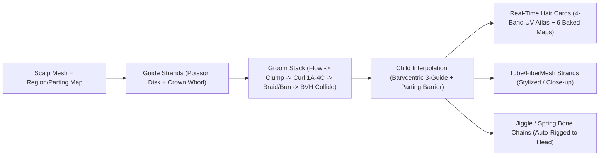

# Geppetto Character, Hair, Fur, Plumage & Digital Human Master Specification

> [!IMPORTANT]
> **Purpose**: Equip the implementing agent swarm with turn-key, file/line-accurate C# / GLSL / VMAT architectures for everything top-tier character, groom, and creature tools (**Ornatrix, Maya XGen, Houdini Groom/Vellum, Peregrine Labs Yeti, Blender 4.x Hair Nodes, Unreal MetaHuman, Reallusion Character Creator 4 + SkinGen, ZBrush FiberMesh, and Daz Genesis 9**) excel at—while grounding every output in **real, baked, engine-ready s&box `.vmdl` / `.fbx` / `.vmat` / `.png` assets**.

---

## 1. Ground-Truth Audit of Current Geppetto Hair, Fur & Character Files

| Existing File | What Exists Today | Critical Gaps to Close |
|---|---|---|
| [`Effigy/Features/StrandFeature.cs`](file:///home/poo/games/projects/geppetto/Effigy/Features/StrandFeature.cs#L19-L412) (`StrandSolver` & `StrandsFeature`) | Simple Verlet polyline settler (`Settle`), bounding-sphere-only collision, uniform `BuildTube` or untextured 1-strip `BuildCards`, and face-centroid `Scatter`. | No Guide-to-Child interpolation, no parting lines or crown whorls, no hierarchical Clump/Curl/Frizz/Braid/Bun/Coily Type 1A–4C modifiers, no BVH scalp/body collision, no multi-band Hair Card Atlas baker, and no Marschner dual-highlight hair shader. |
| [`Desktop/HairStrandService.cs`](file:///home/poo/Desktop/geppetto-desktop/HairStrandService.cs#L4-L131) | Viewer-side strand list with basic `Step`, `Comb`, `Cut`, and a broken `Clump` (which moves all roots to `_strands[0].Points[0]`!). | Fix `Clump` to attract strand **tips/mid-segments** toward local cluster guide curves while keeping roots locked to the scalp; add interactive grooming brushes (`Comb`, `Part`, `Puff`, `Smooth`, `Cut`, `Clump`, `Curl`, `Pin`). |
| [`Effigy/FurShells.cs`](file:///home/poo/games/projects/geppetto/Effigy/FurShells.cs#L22-L270) (`FurShells` & `FurMaterial`) | Extrudes stacked mesh shells along vertex normals with `-Z` droop and writes a basic 2D hash noise (`FurMaterial.NoiseRgba`) for `shaders/fur.shader`. | Extruding strictly along vertex normals makes fur look like a pin-cushion instead of flowing along anatomy (nose $\rightarrow$ brow $\rightarrow$ spine $\rightarrow$ tail). Lacks surface tangent flow fields, silhouette fin cards (`Shells + Fins`), guard-hair + undercoat dual layers, agouti root-to-tip banding, and Turing reaction-diffusion coat patterns. |
| [`Effigy/SkinMaterial.cs`](file:///home/poo/games/projects/geppetto/Effigy/SkinMaterial.cs#L30-L251) & [`Effigy/FleshMaterial.cs`](file:///home/poo/games/projects/geppetto/Effigy/FleshMaterial.cs#L1-L360) | Writes s&box `shaders/skin.shader` `.vmat` and procedural body-horror `FleshStack` layers. | Lacks **MetaHuman / CC4 SkinGen 3-Zone Facial Chromophore synthesis** (Gold/Yellow Forehead + Crimson Cheeks/Nose/Ears + Cool/Blue Periorbital & Jaw), directional micro-pore maps, vellus peach-fuzz sheen, sub-dermal tattoo ink blur, freckles/vitiligo, and scars/stitches. |
| [`Effigy/FaceRig.cs`](file:///home/poo/games/projects/geppetto/Effigy/FaceRig.cs#L24-L340) & [`Effigy/WrinkleMaps.cs`](file:///home/poo/games/projects/geppetto/Effigy/WrinkleMaps.cs#L31-L421) | 32 HL2/FACS stereo/bipolar flex controllers, 15 `viseme_*` lip-sync presets, and strain-driven squish/stretch wrinkle maps. | Lacks automatic **Procedural FACS Delta Generator** (generating the 52 ARKit / 32 FACS morph deltas automatically on any humanoid head from landmark weights), **Fleshy Eyelid Eye-Tracking**, **Sticky Lips (`lip_zip`)**, and **Multi-Part Eye & Oral/Dental Assemblies**. |

---

## 2. Pillar I — Professional Hair Grooming, Procedural Styles, Braids & Multi-Band Card Baking
*(Inspired by Ornatrix, Maya XGen, Houdini Groom, and Blender 4.x Geometry Nodes Hair)*

### 2.1 Architecture: Guide-to-Child Groom Pipeline (`Effigy/HairGroom.cs` & `Effigy/Features/StrandFeature.cs`)



#### A. Scalp Region, Parting Map & Crown Whorl Generator (`ScalpFlowMap`)
Real hair grows from a **crown whorl (vertex spiral)** and parts cleanly along **parting lines** (center part, left/right side part, zig-zag part, widow's peak hairline, temple recession, nape taper).
Create `/home/poo/games/projects/geppetto/Effigy/HairGroom.cs`:
```csharp
namespace Effigy;

public enum HairCurlType
{
	Straight_1A, Wavy_2A, Wavy_2B, Wavy_2C,
	Curly_3A, Curly_3B, Coily_4A, Coily_4B, Coily_4C
}

public enum HairStylePreset
{
	Custom, ShortCrop, BuzzCut, SlickedBack, SidePartPompadour, BobCut, LongLayered,
	Ponytail, HighBun, TwinTails, FrenchBraid, Dreadlocks, Cornrows, Afro, Mohawk,
	WolfMane, LionMane, HorseTail, FacialStubble, FullBeard, Mustache, Eyebrows, Eyelashes
}

public sealed class HairGroomOptions
{
	public HairStylePreset Preset = HairStylePreset.Custom;
	public HairCurlType CurlType = HairCurlType.Straight_1A;
	public int GuideCount = 64;
	public int ChildrenPerGuide = 12;
	public int Segments = 14;
	public float Length = 6.0f;
	public float LengthVariation = 0.18f;

	// Parting & Crown Whorl
	public Vec3 CrownCenter = new( 0f, -1.8f, 4.2f );
	public float CrownSwirl = 0.35f; // +CW, -CCW spiral at vertex
	public bool HasPartingLine = false;
	public Vec3 PartLineStart = new( 0f, 3.5f, 3.8f );
	public Vec3 PartLineEnd = new( 0f, -1.5f, 4.4f );
	public float PartSpread = 0.45f; // Pushes strands away from parting plane

	// Hierarchical Clumping (XGen / Houdini 2-level clumping)
	public int PrimaryClumps = 24;
	public float PrimaryClumpProfile = 0.75f; // 0 at root -> PrimaryClumpProfile at tip
	public int SecondaryClumps = 96;
	public float SecondaryClumpProfile = 0.45f;

	// Curl / Helix / Coily (Andre Walker 1A-4C taxonomy)
	public float CurlRadius = 0.25f;
	public float CurlFrequency = 4.0f; // turns per strand
	public float FrizzAmplitude = 0.08f;
	public float FlyawayFraction = 0.06f; // 6% stray hairs escaping clumps

	// Gather / Ponytail / Braid
	public Vec3? GatherTiePoint = null;
	public float GatherRadius = 0.65f;
	public bool BraidAfterTie = false;
	public int BraidStrands = 3; // 3 = standard 3-strand braid, 4 = rope/fishtail
}
```

#### B. Exact Groom Modifier Formulas (`HairGroom.Evaluate`)
1. **Parting Barrier & Crown Whorl Tangent Initializer**:
   - Given scalp root position $\mathbf{r}_i$ and surface normal $\mathbf{n}_i$, project $(\mathbf{r}_i - \mathbf{c}_{\text{crown}})$ onto the tangent plane:
     $$\mathbf{d}_{\text{radial}} = \text{normalize}\big((\mathbf{r}_i - \mathbf{c}_{\text{crown}}) - ((\mathbf{r}_i - \mathbf{c}_{\text{crown}}) \cdot \mathbf{n}_i)\mathbf{n}_i\big)$$
     $$\mathbf{d}_{\text{whorl}} = \cos(\theta_{\text{swirl}})\mathbf{d}_{\text{radial}} + \sin(\theta_{\text{swirl}})(\mathbf{n}_i \times \mathbf{d}_{\text{radial}})$$
   - If `HasPartingLine` is true, compute signed distance $s_i$ to the parting plane spanned by $(\mathbf{p}_{\text{start}}, \mathbf{p}_{\text{end}}, \mathbf{n}_{\text{head}})$. Never interpolate child strands across $\text{sign}(s_i) \ne \text{sign}(s_{\text{guide}})$! This guarantees a crisp, realistic scalp part without crossing polygons.
2. **Exact BVH Mesh Collision (Replacing the Coarse Sphere Approximation in `StrandFeature.cs:371-393`)**:
   - In `StrandSolver.Collide`, build a `MeshBVH` + signed-distance query over the head, neck, and shoulders (or use `Subdiv.ClosestPointOnMesh`). If a strand vertex $\mathbf{p}_{s,k}$ penetrates within `skinMargin` ($0.06\text{ in}$) of the scalp/face/shoulders, push it out along the interpolated surface normal and project the remaining segment length (`Project(pts, rest)`).
3. **2-Stage Hierarchical Clumping (Fixing `HairStrandService.Clump`)**:
   - For each strand $s$ and vertex parameter $t = k / \text{Segments} \in [0, 1]$:
     - **Root stays pinned at $t = 0$**! (In `HairStrandService.cs:121-130`, replace the bug `strand.Points[0] = center` with a root-preserving curve attraction weight $w(t) = t^{\gamma} \cdot \text{ClumpProfile}$).
     - Stage 1 blends $\mathbf{p}_s(t)$ toward its nearest Primary Clump Guide $\mathbf{g}_{p(s)}(t)$ by $w_1(t) = \text{SmoothStep}(0.05, 0.85, t) \cdot \text{PrimaryClumpProfile}$.
     - Stage 2 blends toward its Secondary Sub-Clump Guide $\mathbf{g}_{q(s)}(t)$ by $w_2(t) = \text{SmoothStep}(0.2, 1.0, t) \cdot \text{SecondaryClumpProfile}$.
4. **3-Strand Braid, Cornrow, Dreadlock & Bun Generators (`HairGroom.BuildBraid` / `BuildDreads`)**:
   - **3-Strand Braid (Lissajous / Figure-8 Cross-Over along Guide Curve $\mathbf{C}(t)$)**:
     - Given parallel-transported frame $(\mathbf{T}(t), \mathbf{N}(t), \mathbf{B}(t))$ along the braid centerline $\mathbf{C}(t)$ and phase $\phi_j(t) = \omega t + \frac{2\pi j}{3}$ for lobe $j \in \{0, 1, 2\}$:
       $$\mathbf{P}_j(t) = \mathbf{C}(t) + W_{\text{braid}}(t)\sin(\phi_j(t))\,\mathbf{N}(t) + H_{\text{braid}}(t)\sin(2\phi_j(t))\,\mathbf{B}(t)$$
     - Because $\sin(2\phi)$ has twice the frequency of $\sin(\phi)$, each of the 3 sub-bundles weaves **over-and-under** its neighbors in a true figure-8 interlock with zero self-intersection!
   - **Dreadlocks / Locs**: Cylindrical tube clumps with high-frequency matted surface frizz (`CurlType = Coily_4C`) and periodic constriction rings.
   - **Ponytail / Bun Gather**: Pulls all strands originating in the gather mask through a torus constraint at `GatherTiePoint`, then either cascades into a tail (`Ponytail`) or wraps helically around the tie normal (`HighBun`).

---

### 2.2 Multi-Band Hair Card Atlas Baker (`Effigy/HairTextureBaker.cs`)

Real-time game engines (s&box, Unreal 5, Unity) render hair cards using a **4-Band Horizontal or Vertical UV Atlas** so dense opaque base cards, mid-layer clump cards, sparse breakup cards, and single-strand flyaway cards all share a single draw call and material!

#### Create `/home/poo/games/projects/geppetto/Effigy/HairTextureBaker.cs`
Bakes **6 procedural 2D texture maps** (`1024x1024` or `2048x2048`) directly from 5,000 simulated micro-fibers across 4 UV bands (`Band 0: Dense Base [U: 0.00..0.25]`, `Band 1: Mid Clump [U: 0.25..0.50]`, `Band 2: Sparse Breakup [U: 0.50..0.75]`, `Band 3: Flyaways/Wisps [U: 0.75..1.00]`):
1. **`<stem>_hair_alpha.png`**: Super-sampled (`8x8` sub-pixel coverage) strand opacity with tapered root and feathered tip.
2. **`<stem>_hair_depth.png`**: Normalized strand Z-height within the clump (`0` = back of clump, `1` = front of clump) for parallax/depth-offset shadows.
3. **`<stem>_hair_id.png`**: Per-fiber deterministic hash value in `[0, 1]` so adjacent hairs on the same card shift hue/value slightly.
4. **`<stem>_hair_root2tip.png`**: Exact arc-length parameter $t \in [0, 1]$ (`0` at root $\rightarrow$ `1` at tip) for root darkening, bleached tips, or ombre gradients.
5. **`<stem>_hair_flow.png`**: Tangent vector $(T_x, T_y, T_z)$ encoded in RGB `(0.5 + 0.5 * T)` so the anisotropic Marschner shader follows the exact curl/braid direction of every fiber inside the card!
6. **`<stem>_hair_ao.png`**: Inter-fiber ambient occlusion (deeper fibers inside the clump are darker).

#### Card Placement & Orientation Rules (`StrandSolver.BuildCards` Upgrade in `StrandFeature.cs:164-218`)
Upgrade `StrandSolver.BuildCards` so each card ribbon:
- **Orients its initial ribbon cross-axis (`sides[0]`) tangent to the scalp surface** (`sides[0] = Vec3.Cross(tangent, scalpNormal).Normal`) instead of using an arbitrary global helper vector! A hair card whose flat face is perpendicular to the scalp leaves a harsh gap; orienting it **tangent to the scalp** tiles cards like roof shingles over the cranium!
- **Applies Cross-Card Camber (Curved 2-Segment Cross-Section)**: Optional `crossSegments=2` bends the width of the card slightly in a shallow `U` arc ($15^\circ$) so cards remain visible even when viewed edge-on!
- **Assigns UV Band by Layer Depth**:
  - Inner layer ($0..40\%$ of scalp offset) $\rightarrow$ `Band 0 (Dense Base)`
  - Middle layer ($40..75\%$) $\rightarrow$ `Band 1 (Mid Clump)`
  - Outer layer ($75..92\%$) $\rightarrow$ `Band 2 (Sparse Breakup)`
  - Outer flyaways ($92..100\%$) $\rightarrow$ `Band 3 (Flyaways)`
- **Transfers Scalp Normals Blended with Strand Tangent**:
  - Blend vertex normal $\mathbf{N}_{\text{card}} = \text{normalize}(\text{Lerp}(\mathbf{N}_{\text{scalp}}, \mathbf{N}_{\text{ribbon}}, 0.35))$ so lighting across the whole hair volume reads as a cohesive spherical canopy rather than disconnected flat strips!

---

### 2.3 Marschner Dual-Highlight & Melanin Hair Shading (`SlotLook.cs`, `ShadedRender.cs`, `MaterialFeatureShaders.cs`)

Add physical **Marschner / Kajiya-Kay Dual-Lobe Hair Shading** to both `ShadedRender.cs` and `MaterialFeatureShaders.cs` when `SlotLook.Pattern == "hair"` or `Preset == "hair_aniso"`:
- **Melanin Absorption (`Melanin` $\in [0, 1]$ = Eumelanin brown/black, `MelaninRedness` $\in [0, 1]$ = Pheomelanin blonde/auburn/red, `WhiteHair` $\in [0, 1]$ = salt-and-pepper grey fraction)**:
  $$\sigma_a(\text{eumelanin}, \text{pheomelanin}) = e_m \cdot (0.419, 0.697, 1.370) + p_m \cdot (0.187, 0.400, 1.050)$$
  $$\mathbf{C}_{\text{hair}} = \exp(-\sigma_a \cdot \text{thickness})$$
- **Dual Shifted Specular Lobes ($R$ + $TRT$)**:
  - Shift strand tangent $\mathbf{T}$ toward the root by cuticle tilt $\alpha_R = -8^\circ$ for the primary white highlight:
    $$\mathbf{T}_R = \text{normalize}(\mathbf{T} + \tan(\alpha_R)\mathbf{N}), \quad S_R = \left(\sqrt{1 - (\mathbf{T}_R \cdot \mathbf{H})^2}\right)^{p_R}$$
  - Shift strand tangent toward the tip by $\alpha_{TRT} = +12^\circ$ (modulated by per-fiber `hair_id` noise for glints) and multiply by $\mathbf{C}_{\text{hair}}$ for the rich colored secondary highlight:
    $$\mathbf{T}_{TRT} = \text{normalize}(\mathbf{T} + \tan(\alpha_{TRT})\mathbf{N}), \quad S_{TRT} = \mathbf{C}_{\text{hair}} \cdot \left(\sqrt{1 - (\mathbf{T}_{TRT} \cdot \mathbf{H})^2}\right)^{p_{TRT}}$$
  - Add forward-scattered rim transmission ($TT$ lobe) when $\mathbf{L} \cdot \mathbf{V} < -0.2$.

---

## 3. Pillar II — Next-Gen Fur, Feathers, Scales & Biological Coats
*(Inspired by Peregrine Labs Yeti, Houdini Fur/Feathers, Monster Hunter, and Ghost of Tsushima)*

### 3.1 Upgrade [`Effigy/FurShells.cs`](file:///home/poo/games/projects/geppetto/Effigy/FurShells.cs#L22-L151): Flow-Combed Shells + Silhouette Fin Cards + Agouti Banding

#### A. Surface Flow / Groom Vector Field (`FurShells.Options.FlowDirection` & `AutoAnatomicalFlow`)
Currently, `FurShells.Grow` (`FurShells.cs:74`) displaces every shell vertex strictly along `normals[vi] * lift + (0, 0, -sag)`.
**Upgrade**:
1. Add `Vec3[]? TangentFlow` and `bool AnatomicalFlow = true` to `FurShells.Options`:
   - When `AnatomicalFlow` is enabled on a creature/character body, compute the geodesic gradient from the nose/head root toward the tail and extremities, projected onto each vertex's tangent plane: $\mathbf{t}_i = \text{normalize}(\mathbf{f}_i - (\mathbf{f}_i \cdot \mathbf{n}_i)\mathbf{n}_i)$.
   - Displace shell layer $h \in [0, 1]$ along a **curved cantilever arc**:
     $$\mathbf{p}(h) = \mathbf{p}_0 + \mathbf{n}_i \cdot L (0.03 + 0.97 h \cos(\theta_{\text{lay}} h)) + \mathbf{t}_i \cdot L (h^{1.4} \sin(\theta_{\text{lay}} h)) + \mathbf{g}_{\text{droop}} \cdot (L \cdot \text{Droop} \cdot h^2)$$
   - Where $\theta_{\text{lay}} \in [0, 75^\circ]$ controls how sleekly the pelt lies flat against the body (e.g., $\theta_{\text{lay}} = 65^\circ$ for a sleek panther/seal/horse coat; $\theta_{\text{lay}} = 20^\circ$ for a fluffy bear/sheep/wolf mane).
2. **Encode Guard-Hair + Undercoat & Agouti Banding in Vertex Colors**:
   - Keep `R = h` (0..1 shell height for `shaders/fur.shader`), and encode:
     - `G = undercoatMask` (`1.0` in dense undercoat zones $h < 0.65$, tapering for long guard hairs $h \in [0.65, 1.0]$).
     - `B = agoutiBand` ($\sin(\pi h)$ mid-shaft warm band for wolf/rodent/wildcat agouti pelts).
3. **Hybrid Silhouette Fin Cards (`FurShells.GrowWithFins`)**:
   - Stacked shells alone show staircase gaps at glancing silhouette edges.
   - `GrowWithFins` identifies mesh edges with high dihedral angle or sparse stride loops and extrudes lightweight 2-quad **Fur Fin Ribbons** along the surface normal (`Height = o.Length`), UV-mapped to a side-profile fur tuft strip. Together, **16 Shells + Silhouette Fins** look indistinguishable from 200,000 hair strands at $< 8\text{k}$ triangles!

### 3.2 Biological Coat Pattern Generator (`FurMaterial.CoatPattern` in `Effigy/FurShells.cs`)
Extend `FurMaterial` (`FurShells.cs:157-270`) with procedural 3D solid-texture coat patterns (zero UV seam distortion!):
- `solid`: uniform pelt with dark roots and sun-bleached tips.
- `agouti`: banded wolf/coyote/husky pelt (dark slate base, warm buff mid-shaft, black guard-hair tips, pale belly counter-shading).
- `tiger_stripe`: anisotropic domain-warped vertical sine bands with pale ventral belly mask.
- `leopard_rosette`: 2-scale Voronoi cell rings (dark broken outer ring enclosing a warm golden center spot over a tawny base).
- `cheetah_spot`: Poisson-distributed solid oval spots.
- `brindle`: high-frequency directional FBM streaks along the anatomical flow field.
- `merle` / `piebald` / `calico`: multi-threshold reaction-diffusion patches.

### 3.3 Procedural Plumage / Feather System (`Effigy/Features/FeatherFeature.cs`)
Create `/home/poo/games/projects/geppetto/Effigy/Features/FeatherFeature.cs`:
- **`FeatherCardBuilder.BuildFeather(FeatherOptions o)`**:
  - Builds a single hero feather OR an entire imbricated wing/body plumage coat:
    - **Rachis (Shaft)**: Tapered curved tube or ridge from calamus (quill root) to tip.
    - **Inner & Outer Vane**: Asymmetric quad grid (`LeadingVaneWidth = 0.35 * TrailingVaneWidth` for aerodynamic flight feathers!) with procedural **Barb & Barbule Texture Baker** (diagonal $45^\circ$ barb normal map, alpha notch splits where barbs unzip near the tip, and iridescent specularity).
- **`PlumageScatter`**:
  - Distributes feathers across a body or wing with automatic **shingle imbrication tilt** ($\theta_{\text{tilt}} = 8^\circ + 12^\circ \cdot \text{curvature}$) so row $k$ cleanly overlaps row $k+1$ from head to tail without interpenetration!

### 3.4 Imbricated Scales, Osteoderms & Chitin Plates (`Effigy/Features/ScaleCoatFeature.cs`)
Create `/home/poo/games/projects/geppetto/Effigy/Features/ScaleCoatFeature.cs`:
- Supports **2 modes**:
  1. **Geometry Mode (`mode=mesh`)**: Places overlapping instanced scale tiles (`CtenoidFish`, `DiamondReptile`, `HexSnake`, `DragonPlate`, `PangolinArmor`, `ArmadilloBand`) in a staggered brick/hex lattice along the surface UV or tangent flow field, tilted outward by `tiltAngle` ($6^\circ..15^\circ$) so they never clip.
  2. **Displacement + Normal Map Mode (`mode=bake`)**: Evaluates the exact overlapping scale heightfield, normal map, cavity map, and thin-film iridescence mask directly into the body's `PaintCanvas` / normal bake!

---

## 4. Pillar III — What Top Character Makers Excel At (MetaHuman, CC4/SkinGen, ZBrush, Daz Genesis 9)

### 4.1 Parametric Character DNA & Base Body Synthesizer (`Effigy/CharacterDna.cs` & `Effigy/Features/CharacterFeature.cs`)
Why do artists love **MetaHuman**, **Character Creator 4**, and **Daz Genesis 9**? Because you never start a human or creature from a raw cylinder! You start from an **anatomically accurate, clean-quad, pre-rigged, pre-UV'd, FACS-ready Parametric Base Mesh** and dial in proportions, age, muscularity, and facial identity via DNA sliders before sculpting custom details or fitting clothes!

#### Create `/home/poo/games/projects/geppetto/Effigy/CharacterDna.cs`
- **BuildScript Syntax**:
  ```text
  add Character name=Hero preset=citizen_male height=72 muscularity=0.65 body_fat=0.15 age=35 shoulder_width=0.58 jaw_width=0.62 nose_bridge=0.45 brow_ridge=0.55 eyes=hazel skin_tone=olive
  ```
- **8 Built-in Clean-Quad Topologized Archetype Templates**:
  1. `citizen_male` / `citizen_female` (exact s&box Citizen bone names, proportions, and IK-ready hierarchy)
  2. `realistic_human` (8-head heroic proportions, full facial loop topology: concentric orbicularis oculi, orbicularis oris, nasolabial fold loop, sternocleidomastoid, clavicle, deltoid-pectoral insertion, and 5-finger hands)
  3. `stylized_hero` (Overwatch / Arcane / Fortnite clean-plane stylized proportions)
  4. `anime_base` (large expressive eye sockets, simplified nose plane, clean cel-shading normal flow)
  5. `heavy_brute` (broad trapezius/ribcage, thick digits)
  6. `creature_biped` (digitigrade hind legs, elongated torso/neck, clawed hands)
  7. `quadruped_canine` / `quadruped_feline` (scapula-humerus-radius-carpus forelimb + pelvis-femur-tibia-metatarsus hindlimb + tail chain)
  8. `ichthyoid_fish` / `avian_bird`
- **30 Parametric DNA Sliders**:
  - **Body**: `height` (inches), `muscularity` (inflates deltoid, pectoralis, biceps, triceps, rectus abdominis, quadriceps, gastrocnemius along anatomical muscle masks), `body_fat` (softens abdominal/flank/submental contours), `shoulder_width`, `chest_depth`, `waist_width`, `hip_width`, `arm_length`, `leg_length`, `hand_scale`, `foot_scale`, `posture_slouch`, `digitigrade`.
  - **Head & Face**: `head_scale`, `cranium_vault`, `jaw_width`, `jaw_angle`, `chin_projection`, `chin_cleft`, `cheekbone_prominence`, `cheek_gauntness`, `brow_ridge`, `eye_spacing`, `eye_size`, `eye_tilt` (canthal tilt), `nose_length`, `nose_width`, `nose_bridge_hump`, `nose_tip_turn`, `mouth_width`, `upper_lip_fullness`, `lower_lip_fullness`, `ear_size`, `ear_point` (elven/creature ears), `age` (blends nasolabial folds, marionette lines, crow's feet, and neck platysma cords).

---

### 4.2 Multi-Part Photorealistic Eye, Tearline & Eyelash Assembly (`Effigy/EyeMaker.cs`)
In every AAA character tool (MetaHuman, CC4), the eyes are the #1 determinant of life vs. uncanny valley.
Create `/home/poo/games/projects/geppetto/Effigy/EyeMaker.cs` (`add Eyes name=Eyes left=1.28,3.1,64.2 right=-1.28,3.1,64.2 radius=0.48 iris_color=#3b6e8c pupil=0.32`):
1. **Sclera & Physical Corneal Bulge (`eye_cornea` + `eye_sclera`)**:
   - The outer shell is a UV-sphere with radius $R = 0.48\text{ in}$ whose anterior cap ($\theta < 32^\circ$) bulges outward into a $R_{\text{cornea}} = 0.31\text{ in}$ dome (`Transmission=0.92, Ior=1.376, Clearcoat=1.0, Rough=0.01`).
   - The sclera behind the limbus uses `Subsurface=0.75, SubsurfaceColor=#e84a3c` with faint radial episcleral capillaries and upper/lower lid shadow AO gradient.
2. **Concave Iris & Dilation Morph (`eye_iris`)**:
   - Sits inside the anterior chamber behind the corneal dome and dishes **inward** (concave cone) so light refracting through the cornea casts a bright caustic highlight on the opposite side of the iris!
   - Procedural Iris Texture Baker (`BakeIrisMap`):
     - **Limbal Ring**: Darkened outer annulus at $r \in [0.85, 1.0]$.
     - **Stroma Fibers & Fuchs' Crypts**: 256 radial Worley/FBM fibers with collarette ring at $r = 0.42$ (amber central heterochromia around the pupil transitioning to `iris_color` outer stroma).
     - **Pupil Dilation Morphs**: Built-in `pupil_dilate` and `pupil_constrict` shape keys that radially scale the inner iris rings around the pupil aperture while keeping the outer limbus locked!
3. **Caruncle & Lacrimal Tearline Meniscus (`eye_tearline`)**:
   - Builds the medial pink **Lacrimal Caruncle** (`wet_mucus` material) at the inner canthus and a thin $0.03\text{ in}$ quad ribbon hugging the lower eyelid-to-cornea intersection (`Transmission=0.95, Clearcoat=1.0, Rough=0.01`)—this catches the unmistakable wet glisten along the lower lid!
4. **Curved Eyelash & Eyebrow Card Strips (`eye_lashes`)**:
   - Generates upper (28 curved tapered clumps) and lower (16 shorter clumps) eyelash cards parented to the eyelid morphs so they move 1:1 with `blink_L` / `blink_R`!

---

### 4.3 Dental, Gum, Tongue & Creature Jaw Kit (`Effigy/MouthMaker.cs`)
Create `/home/poo/games/projects/geppetto/Effigy/MouthMaker.cs` (`add MouthBag name=OralCavity preset=human|vampire|orc|carnivore|shark|abyssal`):
1. **Maxillary (Upper) & Mandibular (Lower) Gum Arches**:
   - Parabolic U-shaped alveolar ridges in `SkinMaterial.Mouth()` / `wet_mucus` with recessed interdental papillae scallops around each tooth root.
2. **Anatomically Distinct Tooth Dentition**:
   - Generates individualized **Central Incisors, Lateral Incisors, Canines (Cuspids), First/Second Premolars (Bicuspids), and First/Second/Third Molars** with enamel translucency at the incisal edge (`tooth` preset, yellowish root neck gradient).
   - **Creature Sliders**: `fang_length` (elongates upper/lower canines for vampires/wolves/big cats), `tusk_curve` (orc/boar lower canines), `rows=3` (revolving shark tooth rows), `pharyngeal_jaw=true` (moray eel / xenomorph inner jaw).
3. **Articulated 4-Bone Tongue & Palate**:
   - Rigged to `tongue_01` $\rightarrow$ `tongue_02` $\rightarrow$ `tongue_03` $\rightarrow$ `tongue_tip` with filiform papillae micro-roughness and sublingual frenulum.

---

### 4.4 SkinGen Multi-Layer Chromophore, Pore, Blemish, Scar & Tattoo Synthesizer (`Effigy/SkinMaterial.cs` & `Effigy/FleshMaterial.cs`)
Extend [`Effigy/FleshMaterial.cs`](file:///home/poo/games/projects/geppetto/Effigy/FleshMaterial.cs#L345-L450) and [`Effigy/SkinMaterial.cs`](file:///home/poo/games/projects/geppetto/Effigy/SkinMaterial.cs#L30-L110) with `SkinGenStack`:
1. ** Facial 3-Zone Chromophore Map (Forehead Gold / Cheek-Nose Crimson / Jaw-Orbit Cool Blue)**:
   - Automatic height + curvature + landmark masks tint the base melanin skin tone:
     - **Zone 1 (Upper Forehead / Brow / Nasal Bridge)**: $+4\%$ warm yellow-ochre shift (`#e8c888` multiply tint, thinner subcutis over skull bone).
     - **Zone 2 (Malar Cheeks, Nose Tip, Nostril Wings, Helix of Ears)**: $+8\%$ oxygenated hemoglobin crimson blush (`#d64545`, higher `Subsurface` & `TransmissiveMask`).
     - **Zone 3 (Infraorbital Tear Trough & Lower Jaw / Beard Shadow)**: $+5\%$ deoxygenated venous cool blue-violet/slate shift (`#5a687a`), plus optional hair-follicle stubble stipple (`stubble=0..1`).
2. **Anatomical Micro-Skin Normal & Roughness Zones**:
   - Forehead/Nose T-Zone has tighter pores and lower roughness (`Rough = 0.28`, sebaceous oil sheen `SecondLobeRatio = 0.04`); cheeks have directional pores stretched along Langer's skin tension lines (`Rough = 0.42`); lips have vertical vermilion sulcus grooves (`Rough = 0.24`).
3. **Procedural Character Surface Overlays (`add SkinDetail`)**:
   - **Freckles & Sun Spots**: Multi-scale Poisson-clustered melanin spots concentrated across nose bridge, malar cheeks, and shoulders.
   - **Scars, Slashes & Stitches**: Raised pale keloid scar ridge (`Height = +0.02in`, `Rough = 0.22`) or recessed wound trench with optional cross-stitch suture threads!
   - **Sub-Dermal Tattoos (`tattoo`)**: Desaturates and shifts ink toward dermal blue-teal (`#1d3442`), blurs edges by `0.8px` to simulate dermis scattering above the ink layer, and preserves skin pore normals over top!
   - **Vellus Peach Fuzz**: Adds `Sheen = 0.22, SheenRoughness = 0.65, SheenTint = 0.15` so backlit cheeks and forearms catch a soft golden vellus halo.

---

### 4.5 Automated FACS Morph Synthesizer, Fleshy Eyelids & Sticky Lips (`Effigy/FaceRig.cs` & `Effigy/Features/ShapeKeyFeatures.cs`)
Currently, `FaceRig.GenerateStandardFlexes` (`FaceRig.cs:118-147`) creates the controller metadata, but the artist/builder still has to sculpt all 32+ morph targets manually!
Add **`FaceRig.SynthesizeFacsMorphs(PolyMesh headMesh, FaceBounds landmarks)`**:
1. **Automatic 32-Flex / 52-ARKit Shape Key Generation**:
   - Using smooth anatomical influence falloff capsules around the detected landmarks (`leftEye`, `rightEye`, `browInner`, `browOuter`, `noseWing`, `mouthCorner`, `upperLip`, `lowerLip`, `chin`, `cheek`), automatically generates ready-to-use `MeshMorph` deltas on `headMesh.Morphs` for:
     - `blink_L`, `blink_R`, `eye_wide_L`, `eye_wide_R`, `squint_L`, `squint_R` (sliding upper/lower lids along the spherical eyeball surface of radius $R_{\text{eye}}$ rather than moving in a straight line—so eyelids never clip through the cornea!).
     - `brow_inner_up_L/R`, `brow_outer_up_L/R`, `brow_down_L/R` (coupled with `WrinkleMaps` forehead/glabella compression!).
     - `smile_L/R` (zygomaticus major pull up-and-back + malar cheek bunching under the lower eyelid!), `frown_L/R`, `pucker`, `funnel`, `upper_lip_raiser_L/R`, `nose_sneer_L/R`, `jaw_open`, `jaw_left`, `jaw_right`, `cheek_puff_L/R`.
     - All **15 s&box `viseme_*` presets** (`viseme_sil`, `viseme_PP`, `viseme_FF`, `viseme_TH`, `viseme_DD`, `viseme_kk`, `viseme_CH`, `viseme_SS`, `viseme_nn`, `viseme_RR`, `viseme_aa`, `viseme_E`, `viseme_I`, `viseme_O`, `viseme_U`).
2. **Fleshy Eye-Tracking Driver (`FacePoserService.ApplyFleshyEyeTrack`)**:
   - When `eye_L` or `eye_R` rotates by pitch $\Delta\theta_p$ and yaw $\Delta\theta_y$, automatically drives `lid_follow_up/down` ($35\%$ of pitch) and displaces the eyelid vertices radially over the moving corneal bulge ($0.04\text{ in}$) so you see the cornea pushing under the eyelid skin!
3. **Sticky Lips (`lip_zip` in `FaceRig.Evaluate`)**:
   - Adds a continuous `lip_zip` controller ($0..1$) that keeps the upper and lower vermilion border sealed from the outer commissures inward as `jaw_open` increases, peeling open progressively from center to corners like Pixar / MetaHuman rigs!

---

## 5. Summary of New BuildScript Verbs for Character & Groom Builders

| Verb | Example Usage | Output |
|---|---|---|
| `add Character` | `add Character name=Body preset=citizen_male height=72 muscularity=0.6 age=32` | Clean-quad, rigged, UV'd base human/creature mesh with DNA morphs applied |
| `add Eyes` | `add Eyes name=Eyes left=1.28,3.1,64.2 right=-1.28,3.1,64.2 iris_color=#3b6e8c` | Cornea + concave iris + pupil morphs + caruncle + tearline + eyelashes |
| `add MouthBag` | `add MouthBag name=Mouth preset=human fang_length=0.2` | Upper/lower gums + individualized teeth + rigged 4-bone tongue |
| `add HairGroom` | `add HairGroom name=Hair bodies=Head preset=FrenchBraid curl=Wavy_2B cards=true` | Guide-to-child groomed hair with 4-band card atlas + 6 baked maps + Marschner `.vmat` |
| `add FurCoat` | `add FurCoat name=Pelt bodies=Wolf length=1.2 layers=16 fins=true pattern=agouti` | Anatomical flow-combed fur shells + silhouette fin cards + agouti/rosette `.vmat` |
| `add Plumage` | `add Plumage name=Wings bodies=Wing_L,Wing_R rows=4 iridescence=0.7` | Imbricated coverts/secondaries/primaries feather cards + barb/rachis textures |
| `add ScaleCoat` | `add ScaleCoat name=Scales bodies=Body pattern=ctenoid tilt=8 mode=bake` | Overlapping imbricated fish/reptile/dragon scales (mesh or baked displacement/normals) |
| `add SkinDetail` | `add SkinDetail bodies=Head zones=true freckles=0.4 scar=0.8,3.2,63.5..1.4,2.8,62.9` | 3-zone facial hemoglobin, directional pores, freckles, scars/stitches, tattoos, peach fuzz |
| `add AutoFacs` | `add AutoFacs bodies=Head arkit52=true visemes=true fleshy_lids=true` | Generates all 32 FACS / 52 ARKit morph targets + wrinkle maps + `.facerig.json` |
