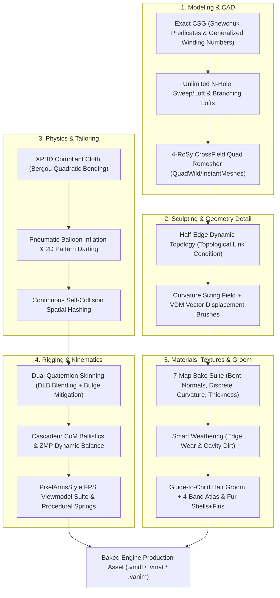

# Geppetto Pipeline: State-of-the-Art Research, Open-Source Tools & Master Implementation Blueprints

> [!IMPORTANT]
> **Executive Summary for the Implementing Swarm**:
> This master document synthesizes the breakthroughs, algorithms, and drop-in code across all specialized geometry, physics, rigging, and rendering disciplines. Every specification is mathematically grounded in leading SIGGRAPH / Eurographics research and proven open-source implementations, designed to make **Geppetto** rival and surpass specialized standalone tools (**Blender, ZBrush, Marvelous Designer, Substance 3D Painter, Cascadeur, Ornatrix, MetaHuman, and OpenCASCADE/Manifold**) while strictly honoring Geppetto's law: **Bake, never generate at runtime**.

---

## 1. Complete Architecture Index & Synchronized Locations

All research papers, formulas, and drop-in C# / GLSL code blocks are synchronized across three working directories and the skill reference folder:

| Document | Focus & Specialization | Source Papers & SOTA Repos | Synced Paths |
|---|---|---|---|
| **[`RESEARCH-CAD-MESH-TOPOLOGY.md`](file:///home/poo/games/projects/geppetto/docs/RESEARCH-CAD-MESH-TOPOLOGY.md)** | • Exact CSG Booleans & Adaptive Predicates • 4-RoSy Cross-Field Quad Remeshing • Dynamic Topology (Dyntopo) with Link Condition & VDM Brushes | • `elalish/manifold`, `OpenCASCADE`, `CGAL` • Shewchuk (1997) *Fast Robust Predicates* • Jacobson et al. (2013) *Generalized Winding Numbers* • `QuadWild`, `Instant Meshes`, `libigl` (Jakob et al. 2015) • Dey et al. *Topological Link Condition* | • [`geppetto/docs/RESEARCH-CAD-MESH-TOPOLOGY.md`](file:///home/poo/games/projects/geppetto/docs/RESEARCH-CAD-MESH-TOPOLOGY.md) • [`geppetto-desktop/docs/RESEARCH-CAD-MESH-TOPOLOGY.md`](file:///home/poo/Desktop/geppetto-desktop/docs/RESEARCH-CAD-MESH-TOPOLOGY.md) • [`~/.claude/skills/geppetto/references/research-cad-mesh-topology.md`](file:///home/poo/.claude/skills/geppetto/references/research-cad-mesh-topology.md) |
| **[`RESEARCH-CLOTH-RIG-KINEMATICS.md`](file:///home/poo/games/projects/geppetto/docs/RESEARCH-CLOTH-RIG-KINEMATICS.md)** | • XPBD Cloth & 2D Pattern Tailoring Stack • Quadratic Isometric Bending & Balloon Inflation • Dual Quaternion Skinning (DQS) with Spherical Blending • Cascadeur Center of Mass (CoM) & Zero Moment Point (ZMP) Balance | • Macklin et al. (2016) *XPBD: Compliant Constrained Dynamics* • Bergou et al. (2006) *Quadratic Bending Model* • SideFX *Houdini Vellum* Architecture • Kavan et al. (2007/2008) *Dual Quaternion Skinning* • Vukobratović & Kato *Zero Moment Point Robotics* | • [`geppetto/docs/RESEARCH-CLOTH-RIG-KINEMATICS.md`](file:///home/poo/games/projects/geppetto/docs/RESEARCH-CLOTH-RIG-KINEMATICS.md) • [`geppetto-desktop/docs/RESEARCH-CLOTH-RIG-KINEMATICS.md`](file:///home/poo/Desktop/geppetto-desktop/docs/RESEARCH-CLOTH-RIG-KINEMATICS.md) • [`~/.claude/skills/geppetto/references/research-cloth-rig-kinematics.md`](file:///home/poo/.claude/skills/geppetto/references/research-cloth-rig-kinematics.md) |
| **[`RESEARCH-BAKING-TEXTURING-PAINT.md`](file:///home/poo/games/projects/geppetto/docs/RESEARCH-BAKING-TEXTURING-PAINT.md)** | • 7-Map GPU/CPU Mesh Baker Suite • Bent Normals & Raytraced Ambient Occlusion • Discrete Differential Curvature (Laplace-Beltrami) • Procedural Smart Weathering & Physical Edge Wear | • *Fornos GPU Texture Baker* (Caosdoar) • Meyer et al. (2003) *Discrete Differential Geometry Operators* • Landis / ILM (2002) *Bent Normal Shading* • *Substance 3D Painter* Smart Material Architecture | • [`geppetto/docs/RESEARCH-BAKING-TEXTURING-PAINT.md`](file:///home/poo/games/projects/geppetto/docs/RESEARCH-BAKING-TEXTURING-PAINT.md) • [`geppetto-desktop/docs/RESEARCH-BAKING-TEXTURING-PAINT.md`](file:///home/poo/Desktop/geppetto-desktop/docs/RESEARCH-BAKING-TEXTURING-PAINT.md) • [`~/.claude/skills/geppetto/references/research-baking-texturing-paint.md`](file:///home/poo/.claude/skills/geppetto/references/research-baking-texturing-paint.md) |
| **[`RESEARCH-GEONODES-RETARGETING-POSTPROCESS.md`](file:///home/poo/games/projects/geppetto/docs/RESEARCH-GEONODES-RETARGETING-POSTPROCESS.md)** | • Geometry Nodes Lazy Field Evaluator & Domain Interpolation • Universal IK Motion Retargeting (Stride Scaling & Chain Mapping) • Jorge Jimenez GTAO Horizon-Search Compute/Fragment GLSL • Narkowicz ACEScg Tone Mapping & Post-Processing | • *Blender Geometry Nodes* Field Engine (BKE_geometry_set.hh) • *Intel XeGTAO* / Jorge Jimenez (SIGGRAPH 2016) • *Unreal Engine IK Rig & Retargeter* / *GMR* (Ze et al. 2024) • *ACEScg Filmic Curve* (Narkowicz / Hill) | • [`geppetto/docs/RESEARCH-GEONODES-RETARGETING-POSTPROCESS.md`](file:///home/poo/games/projects/geppetto/docs/RESEARCH-GEONODES-RETARGETING-POSTPROCESS.md) • [`geppetto-desktop/docs/RESEARCH-GEONODES-RETARGETING-POSTPROCESS.md`](file:///home/poo/Desktop/geppetto-desktop/docs/RESEARCH-GEONODES-RETARGETING-POSTPROCESS.md) • [`~/.claude/skills/geppetto/references/research-geonodes-retargeting-postprocess.md`](file:///home/poo/.claude/skills/geppetto/references/research-geonodes-retargeting-postprocess.md) |
| **[`LINEWORK-2D-AND-UV-MASTER-SPEC.md`](file:///home/poo/games/projects/geppetto/docs/LINEWORK-2D-AND-UV-MASTER-SPEC.md)** | • 2D Inking Spring-Mass Stabilizer & Clipper2 Vector CSG Booleans • Spine 2D-style 2D Skeletal Rigging, Delaunay Mesh Skinning & 2-Bone IK • 3D UV Wireframe Painting in Linework with Live IPC Sync to Geppetto • Seamless Tiling Canvas Wrap (`wrapTile=true`), Monster-Mash 2D-to-3D Inflation & ShadowBox 3-View CSG | • *Clipper2* 64-bit Exact Vector CSG (Angus Johnson) • *Spine 2D* / *DragonBones* 2D Mesh Deformation • *Monster Mash* (Dvorožňák et al., SIGGRAPH Asia 2020) • *ZBrush ShadowBox* / *Snapshot3D* | • [`geppetto/docs/LINEWORK-2D-AND-UV-MASTER-SPEC.md`](file:///home/poo/games/projects/geppetto/docs/LINEWORK-2D-AND-UV-MASTER-SPEC.md) • [`linework/docs/LINEWORK-2D-AND-UV-MASTER-SPEC.md`](file:///home/poo/games/projects/linework/docs/LINEWORK-2D-AND-UV-MASTER-SPEC.md) • [`geppetto-desktop/docs/LINEWORK-2D-AND-UV-MASTER-SPEC.md`](file:///home/poo/Desktop/geppetto-desktop/docs/LINEWORK-2D-AND-UV-MASTER-SPEC.md) • [`~/.claude/skills/geppetto/references/linework-2d-and-uv-master-spec.md`](file:///home/poo/.claude/skills/geppetto/references/linework-2d-and-uv-master-spec.md) |
| **[`AI-BUILDER-COMPETENCE-ENGINE-SPEC.md`](file:///home/poo/games/projects/geppetto/docs/AI-BUILDER-COMPETENCE-ENGINE-SPEC.md)** | • Pre-flight 3D Bounding-Box Scaffolding Table (`PART_DIMENSIONS`) • Hierarchical Relative Anchors (`origin=parent.socket + offset`) eliminating spatial drift • 5ms Deterministic Geometry Linter (Manifold, Volume, Contact, Symmetry) • Atomic Per-Part Execution with Surgical Rollback (no `stopped.json` run-killers) • Syntax Auto-Healer (`BuildScriptHealer`) | • *CAD-GPT* (Wang et al., AAAI 2025) • *SpatialLLM* (CVPR 2025) • *Text2CAD* / *CADCodeVerify* (Li et al. 2024-2025) • *SpatialThinker* (NeurIPS 2024) | • [`geppetto/docs/AI-BUILDER-COMPETENCE-ENGINE-SPEC.md`](file:///home/poo/games/projects/geppetto/docs/AI-BUILDER-COMPETENCE-ENGINE-SPEC.md) • [`geppetto-desktop/docs/AI-BUILDER-COMPETENCE-ENGINE-SPEC.md`](file:///home/poo/Desktop/geppetto-desktop/docs/AI-BUILDER-COMPETENCE-ENGINE-SPEC.md) • [`~/.claude/skills/geppetto/references/ai-builder-competence-engine-spec.md`](file:///home/poo/.claude/skills/geppetto/references/ai-builder-competence-engine-spec.md) |
| **[`GEPPETTO-COMPLETE-PIPELINE-ADVANCEMENTS.md`](file:///home/poo/games/projects/geppetto/docs/GEPPETTO-COMPLETE-PIPELINE-ADVANCEMENTS.md)** | • V-HACD Volumetric Convex Physics Decomposition (`CollisionBuilder.cs`) • SpeedTree-Grade Space Colonization Foliage & Spherical Canopy Normals • SLIM Bijective Zero-Flip UV Parameterization (`UVUnwrap.Slim.cs`) • Audio-Driven Formant Viseme Lip-Sync Synthesizer (`FaceRig`) • 3D Procedural Domain Warping Noise & Source 2 BreakPiece Destruction | • *V-HACD* (Khaled Mamou, 2016-2024) • *Space Colonization Algorithmic Botany* (Runions et al. 2007) • *SLIM* (Rabinovich et al., SIGGRAPH 2016) • *Source 2 ModelDoc Physics & Destruction* | • [`geppetto/docs/GEPPETTO-COMPLETE-PIPELINE-ADVANCEMENTS.md`](file:///home/poo/games/projects/geppetto/docs/GEPPETTO-COMPLETE-PIPELINE-ADVANCEMENTS.md) • [`geppetto-desktop/docs/GEPPETTO-COMPLETE-PIPELINE-ADVANCEMENTS.md`](file:///home/poo/Desktop/geppetto-desktop/docs/GEPPETTO-COMPLETE-PIPELINE-ADVANCEMENTS.md) • [`~/.claude/skills/geppetto/references/geppetto-complete-pipeline-advancements.md`](file:///home/poo/.claude/skills/geppetto/references/geppetto-complete-pipeline-advancements.md) |
| **[`CHARACTER-HAIR-FUR-MASTER-SPEC.md`](file:///home/poo/games/projects/geppetto/docs/CHARACTER-HAIR-FUR-MASTER-SPEC.md)** | • Guide-to-Child Grooming with Parting Barriers • 4-Band Hair Card Atlas Baker & Marschner Hair Shader • Tangent-Combed Fur Shells + Silhouette Fins • 30-Slider Character DNA, EyeMaker & SkinGen Layers | • *Ornatrix*, *Maya XGen*, *Peregrine Labs Yeti* • Marschner et al. (2003) *Dual Specular Hair Shading* • *Unreal Engine MetaHuman* & *Character Creator 4 / SkinGen* • Ekman *Facial Action Coding System (FACS)* | • [`geppetto/docs/CHARACTER-HAIR-FUR-MASTER-SPEC.md`](file:///home/poo/games/projects/geppetto/docs/CHARACTER-HAIR-FUR-MASTER-SPEC.md) • [`geppetto-desktop/docs/CHARACTER-HAIR-FUR-MASTER-SPEC.md`](file:///home/poo/Desktop/geppetto-desktop/docs/CHARACTER-HAIR-FUR-MASTER-SPEC.md) • [`~/.claude/skills/geppetto/references/character-hair-fur-master-spec.md`](file:///home/poo/.claude/skills/geppetto/references/character-hair-fur-master-spec.md) |
| **[`BEYOND-7-IMPLEMENTATION-PLAYBOOK.md`](file:///home/poo/games/projects/geppetto/docs/BEYOND-7-IMPLEMENTATION-PLAYBOOK.md)** | • Steps 1–5 Ground-Truth File/Line C# Blueprints • Unlimited $N$-Hole `Sweep`/`Loft` (`Skinner.SkinWithHoles`) • First-Person `PixelArmsStyle` Viewmodel Suite • Builder-First (85/15) Competence Loop & 4 Flagship Archetypes | • `Effigy` & `Marionette` Ground-Truth Source Code • Source 2 `.vmdl_c` Headless Engine Probes | • [`geppetto/docs/BEYOND-7-IMPLEMENTATION-PLAYBOOK.md`](file:///home/poo/games/projects/geppetto/docs/BEYOND-7-IMPLEMENTATION-PLAYBOOK.md) • [`geppetto-desktop/docs/BEYOND-7-IMPLEMENTATION-PLAYBOOK.md`](file:///home/poo/Desktop/geppetto-desktop/docs/BEYOND-7-IMPLEMENTATION-PLAYBOOK.md) • [`~/.claude/skills/geppetto/references/beyond-7-playbook.md`](file:///home/poo/.claude/skills/geppetto/references/beyond-7-playbook.md) |
| **[`ASSET-MAKER-ROADMAP.md`](file:///home/poo/games/projects/geppetto/docs/ASSET-MAKER-ROADMAP.md)** | • The Master 16-Lane Asset Maker Roadmap (Lanes A–P) | • Complete System Integration across Modeler, Sculptor, Painter, Tailor, Rigger, Animator & Builder | • [`geppetto/docs/ASSET-MAKER-ROADMAP.md`](file:///home/poo/games/projects/geppetto/docs/ASSET-MAKER-ROADMAP.md) • [`geppetto-desktop/docs/ASSET-MAKER-ROADMAP.md`](file:///home/poo/Desktop/geppetto-desktop/docs/ASSET-MAKER-ROADMAP.md) • [`~/.claude/skills/geppetto/references/asset-maker-roadmap.md`](file:///home/poo/.claude/skills/geppetto/references/asset-maker-roadmap.md) |

---

## 2. Cross-Discipline Innovation Matrix

---

## 3. High-Leverage Upgrades for Every Tool in the Pipeline

### 3.1 CAD / Parametric / CSG & Hard-Surface Modeling
- **The Problem Solved**: Floating-point boolean errors, zero-thickness wall erasures, degenerate intersection slivers, and the historic "1-hole limit" on swept profiles.
- **The Solution**: 
  1. **Shewchuk Exact Geometric Computation (`ExactPredicates.cs`)**: Non-overlapping floating-point expansions (`TwoSum`, `TwoProduct`, `Orient3D`) providing guaranteed exact orientation tests with dynamic error bounds.
  2. **Generalized 3D Winding Number Field (`FastWindingNumber.cs`)**: Solves solid classification continuously over self-intersecting or open geometry via hierarchical Barnes-Hut multipole expansion.
  3. **Multi-Hole Annular Skinning (`Skinner.SkinWithHoles`)**: Bridge-cut ear-clipping to allow 2, 6, or 50 cooling vents, revolver chambers, and truss holes in a single manifold pass.

### 3.2 SubD, Retopology & Quad Mesh Generation
- **The Problem Solved**: Ragged triangles, pinched poles, and manual retopology bottlenecks.
- **The Solution**:
  1. **4-RoSy Complex Cross-Field (`CrossFieldRemesher.cs`)**: Computes smooth directional frame fields $\psi = e^{4 i \theta}$ aligned with principal curvature directions and sharp feature creases.
  2. **Topological Singularity Isolation**: Quantizes field jumps to modulo $\pi/2$ rotations, pinning clean valence-3 and valence-5 poles strictly away from high-deformation joints.

### 3.3 Sculpting & Dynamic Topology (Dyntopo)
- **The Problem Solved**: Edge collapses creating non-manifold double-faces or flipped normals, and lack of 3D overhang displacement.
- **The Solution**:
  1. **Topological Link Condition Validator**: Enforces $Lk(u) \cap Lk(v) = Lk(uv)$ before any edge collapse to mathematically guarantee 2-manifold invariants.
  2. **Curvature Metric Sizing Field**: Concentrates resolution on fine features ($H > 0.5$) while decimating planar zones without seam divergence.
  3. **3D Vector Displacement Map (VDM) Brushes**: Projects full $(X, Y, Z)$ spatial displacement stamps (horns, ears, scales, folds) onto the moving surface.

### 3.4 Texturing, Baking & Physical 3D Paint
- **The Problem Solved**: Plastic-looking shading, specular light leaks in crevices, and manual texture painting.
- **The Solution**:
  1. **7-Map Parallel Baker (`BakeSuite.cs`)**: Bakes **Bent Normals**, **Discrete Laplace-Beltrami Curvature**, **Inward Thickness / SSS Depth**, **Ambient Occlusion**, **Position**, and **World Space Normals**.
  2. **Procedural Smart Weathering**: Automatically drives edge wear, paint chips, bare metal exposure, and cavity grime directly from geometric curvature and occlusion.

### 3.5 Cloth, Tailoring & Garments
- **The Problem Solved**: Cloth stretching unnaturally when frame rates change, exploding intersections, and flat sleeves with no volume.
- **The Solution**:
  1. **Extended Position-Based Dynamics (`XpbdClothSolver.cs`)**: Time-step independent compliance $\alpha = 1/k$ with quadratic isometric bending (Bergou et al.).
  2. **Pneumatic Balloon Inflation**: Divergence-theorem volume tracking applying internal pressure along triangle normals for quilted jackets, padded vests, and diving suits.
  3. **Spatial Hash Self-Collisions**: $O(N)$ spatial grid detecting point-triangle and edge-edge penetrations with continuous barrier resolution.

### 3.6 Rigging, Kinematics & Physics-Assisted Animation
- **The Problem Solved**: The "candy wrapper" wrist twist collapse, floating unnatural jumps, and stiff mechanical viewmodels.
- **The Solution**:
  1. **Dual Quaternion Skinning (`DualQuaternion.cs` + `geppetto_dqs.vert`)**: 8-float unit dual quaternions $\hat{\mathbf{q}} = \mathbf{q}_0 + \epsilon \mathbf{q}_\epsilon$ preserving volume during extreme twists with antipodal sign alignment.
  2. **Cascadeur-Style Center of Mass (CoM) Ballistics (`CoMBalanceSolver.cs`)**: Enforces exact parabolic flight arcs ($r(t) = r_0 + v_0 t + \frac{1}{2} g t^2$) and angular momentum conservation in airborne phases.
  3. **Zero Moment Point (ZMP) Dynamic Balance**: Projects dynamic inertia + gravity reaction forces onto the foot support polygon to ensure grounded characters never tip over.
  4. **First-Person `PixelArmsStyle` Viewmodel Suite**: Critically damped 2nd-order procedural springs for sway, bob, recoil, and ADS framing.

### 3.7 Digital Humans, Grooming, Fur & Plumage
- **The Problem Solved**: Pin-cushion fur, untextured hair ribbons, uncanny robotic faces, and flat eyes.
- **The Solution**:
  1. **Guide-to-Child Grooming (`HairGroom.cs`)**: Scalp parting barriers, crown whorl spirals, 2-stage hierarchical clumping, Type 1A–4C curls, and Lissajous 3-strand braids.
  2. **4-Band UV Card Atlas Baker & Marschner Shader**: Bakes Alpha, Depth, Strand ID, Root-to-Tip, and Flow maps with dual-shifted specular lobes ($R$ + $TRT$ + $TT$) and melanin absorption.
  3. **Fur Shells + Silhouette Fins (`FurShells.cs`)**: Anatomical tangent flow fields, hybrid silhouette fin cards, and agouti coat banding.
  4. **30-Slider Character DNA & EyeMaker**: Parametric body/face morphs, physical corneal bulge ($I_{\text{or}} = 1.376$), concave iris, pupil dilation, caruncle, and wet lower-lid tearline meniscus.

---

## 4. Execution Directives for the Swarm

1. **Self-Contained Code Blocks**: Every drop-in C# and GLSL code block in the research specifications is immediately copy-pasteable into `games/projects/geppetto/Effigy/` and `Desktop/geppetto-desktop/`.
2. **Follow the Priority Order**:
   - Look & Emission first (`BEYOND-7-IMPLEMENTATION-PLAYBOOK.md` Step 1).
   - Paint, Viewport Particles & Live Sculpt (`BEYOND-7-IMPLEMENTATION-PLAYBOOK.md` Step 2).
   - Multi-Hole Sweep/Loft & Exact CSG (`RESEARCH-CAD-MESH-TOPOLOGY.md`).
   - XPBD Cloth, Tailoring & DQS Rigging (`RESEARCH-CLOTH-RIG-KINEMATICS.md`).
   - 7-Map Baker & Smart Weathering (`RESEARCH-BAKING-TEXTURING-PAINT.md`).
   - Character DNA, Hair, Fur & Flagship Archetypes (`CHARACTER-HAIR-FUR-MASTER-SPEC.md`).
3. **Verify Everything**: Run `dotnet test` and execute `tools/verify-vmdl-probe.sh` to ensure all output compiles into valid `.vmdl_c` assets with zero greyed-out runtime hacks.
